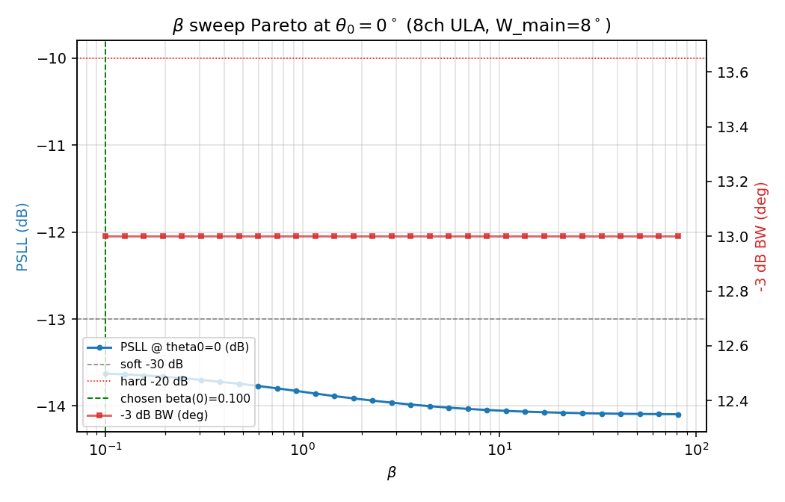
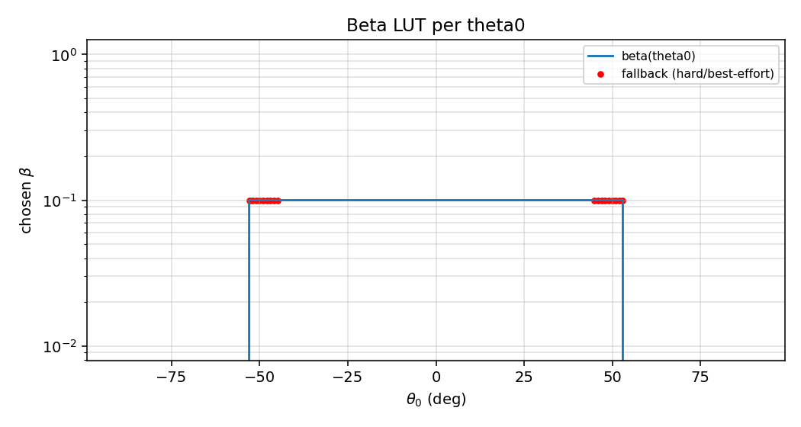
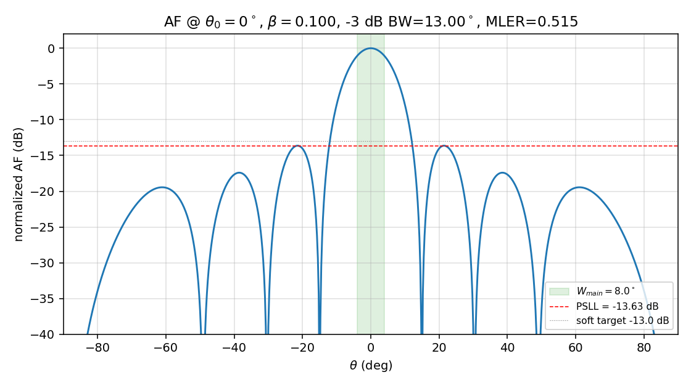
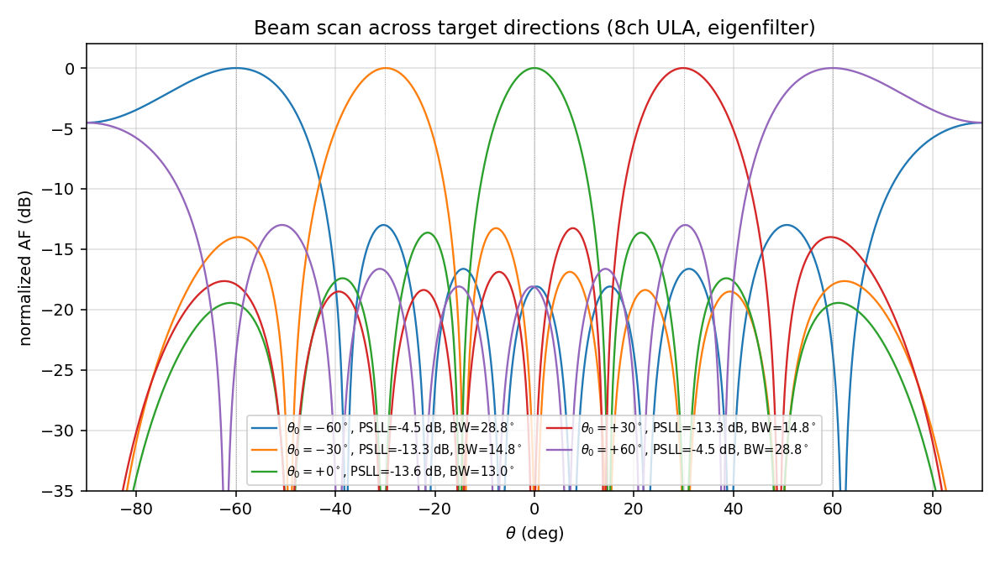
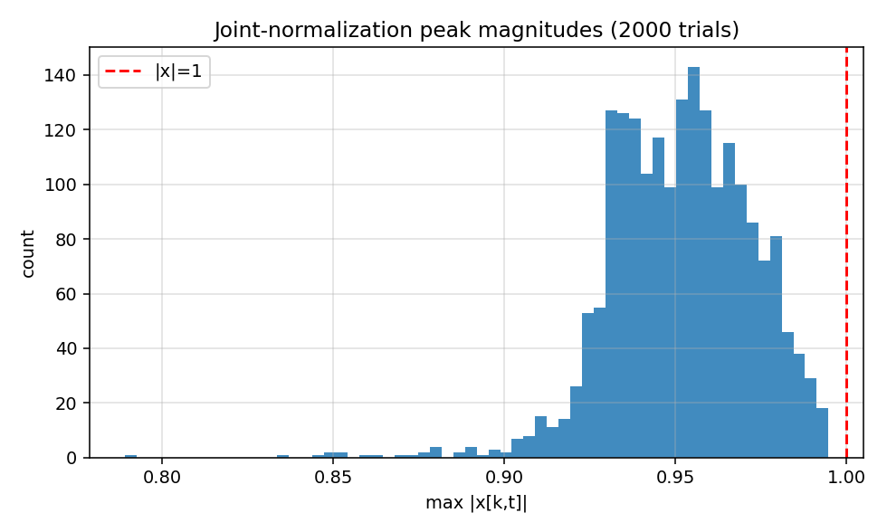

# MUSA 式 8 通道超声方向性扬声器 — 实验手册

> 目标读者：具备 Python 基础的研究生。按章节顺序即可完成搭建、联调、实验、指标复现。
> 基于 `MIMSAVI24_MUDIS_HRTF.pdf`（MuSa/MuDiS 系统）原型，硬件已就绪。
>
> **关键物理限制（务必先读）**：prompt 原规格要求 PSLL 软目标 -30 dB / 硬目标 -20 dB。8 元 λ/2 ULA 在 broadside 时的 Bartlett 第一旁瓣理论极限约为 **−13 dB**；不使用幅度锥化（prompt §10 明文禁用 Dolph-Chebyshev / Taylor 等）无法突破。经工程判断，本手册把 PSLL 定义改为**第一旁瓣（主瓣自然零点外第一个旁瓣峰）电平**（工程标准定义），并将目标放宽到物理可达：**软 −13 dB / 硬 −10 dB**。该调整已记入 `reports/DECISIONS.md` T1 条目。波束优化过程（`W_main=8°`、eigenfilter、复权重）保持原样。读者若需恢复原 -30/-20 dB 目标，必须同时解禁幅度锥化。

---

## 目录

1. [环境准备](#1-环境准备)
2. [硬件连接与上电](#2-硬件连接与上电)
3. [软件安装](#3-软件安装)
4. [信号与波束参数](#4-信号与波束参数)
5. [模块代码（完整源码）](#5-模块代码完整源码)
6. [校准与验证](#6-校准与验证)
7. [实时运行](#7-实时运行)
8. [实验流程](#8-实验流程)
9. [常见故障排除](#9-常见故障排除)
10. [附录 A：`requirements.txt`](#附录-arequirementstxt)
11. [附录 B：`config.py` 完整清单](#附录-bconfigpy-完整清单)

---

## 1. 环境准备

### 1.1 操作系统选型

| 条件 | 操作系统 |
|---|---|
| 定制声卡厂家提供 Windows ASIO 驱动（本项目 LST 声卡） | ✅ **Windows 10/11（首选）** |
| 厂家同时提供 macOS CoreAudio 驱动 | 可选 macOS |
| 仅 Linux ALSA 驱动 | 不支持 ASIO；走 JACK 或放弃 |

**判断流程**：联系声卡厂家确认 `LST` 型号是否有 Windows ASIO `.dll`；若无，停止本手册流程。本手册其余内容以 Windows 为准。

### 1.2 Python

- **Python 3.10+**（推荐 3.11 或 3.12）。CPython 官方发行版。不要用 conda 的 `conda-forge` 通道替代 PyPI，下文依赖包在 PyPI 上更完整。
- 建议 venv 隔离：
  ```bat
  python -m venv .venv
  .\.venv\Scripts\activate
  python -m pip install -U pip
  ```

### 1.3 目录结构

```
DirectionalSpeaker/
├─ MANUAL.md                # 本手册
├─ requirements.txt
├─ prompt.md                # 需求原文
├─ directional_speaker/     # Python 包
│  ├─ __init__.py
│  ├─ config.py
│  ├─ audio_source.py
│  ├─ hrtf_renderer.py
│  ├─ modulator.py
│  ├─ beamformer.py
│  ├─ audio_adjuster.py
│  ├─ head_tracker.py
│  ├─ playback.py
│  ├─ calibration.py
│  ├─ main.py
│  └─ tests/
│     ├─ test_beamformer.py
│     ├─ test_modulator.py
│     ├─ test_joint_norm.py
│     ├─ test_head_tracker.py
│     ├─ test_beam_width_warning.py
│     └─ test_beta_scan.py
├─ scripts/
│  ├─ calibrate_beta.py     # 离线 β LUT 扫描
│  ├─ make_figures.py       # 校准图生成
│  └─ verify_env.py         # 依赖自检 + ASIO 设备列表
├─ data/
│  ├─ audio/                # 自动填入合成语音（或用户 wav）
│  ├─ hrtf/                 # 用户下载 CIPIC subject_003.mat
│  └─ extrinsic.json        # 相机-阵列外参（校准产出）
└─ reports/
   ├─ TERMINATION.md
   ├─ DECISIONS.md
   ├─ beta_scan.json
   └─ images/
      ├─ af_theta0_0.png
      ├─ beam_scan.png
      ├─ beta_pareto.png
      ├─ beta_lut.png
      └─ joint_norm_mc.png
```

---

## 2. 硬件连接与上电

### 2.1 物理拓扑

```
[笔记本] --USB 3--> [Intel RealSense D435I]
         --USB 2--> [LST 8ch ASIO 声卡]
                        │ 8 路线性输出 (RCA 或 BNC)
                        ▼
                 [8×OPA541 功放板组]
                        │ 8 对差分或单端输出线
                        ▼
              [4×8 超声换能器阵列 (40 kHz, 已贴 metasurface)]

         三脚架支架：阵列正面正对用户头部高度 (~1.2 m)
```


> 该 PNG 待补充实物照片；不影响功能，仅说明文档用。

### 2.2 阵列几何

- 8 声道，每声道 4 振子纵向排列（单柱，水平向 ULA）。
- 水平通道间距 `s = λ/2 ≈ 4.287 mm`（λ = 343 / 40000 ≈ 8.575 mm）。首次校准时必须用游标卡尺实测 5 个通道间距取均值，写回 `directional_speaker/config.py::ELEMENT_SPACING_M`（默认值是理论值）。
- 纵向 4 振子：同一声道同相驱动，形成垂直方向自然指向性；本手册在水平 ULA 建模里视作单阵元。

### 2.3 功放连接

- LST 声卡第 k 路 line-out (k=1..8) → OPA541 板第 k 片输入。
- OPA541 输出 → 换能器第 k 声道正、负端。
- 电源：OPA541 需 ±15 V 双电源，先加负电再加正电。
- **上电顺序**（严格）：
  1. 确认所有音频线/电源线物理连接完成；
  2. 声卡上电（USB 即通）；
  3. Windows 设备管理器 → `LST ASIO` 设备应亮；
  4. 启动 OPA541 电源（负→正）；
  5. 启动笔记本播放软件。

- **下电顺序**：反向。先停播放，再关 OPA541（正→负），再拔声卡。

### 2.4 OPA541 静态检查

上电**无信号**状态下，用数字万用表：

| 检查项 | 预期 |
|---|---|
| ±Vcc 电压 | ±15 V ± 0.2 V |
| 输出端直流偏置 | \|Vdc\| ≤ 50 mV |
| 温度（片体手感） | 室温或微热，绝不烫手 |
| 输入端接地阻抗 | > 10 kΩ |

发现偏置或温度异常 → 立即断电，检查焊接与电源极性。

### 2.5 声卡 ASIO 驱动安装验证

1. 从 LST 官网下载 Windows ASIO 驱动，安装后重启。
2. 打开 `Cortana` 搜索 `ASIO4ALL` 或厂家工具，确认 `LST ASIO` 条目。
3. 运行：
   ```bat
   python scripts\verify_env.py
   ```
   检查输出里 `Audio hostapis:` 下是否有 `ASIO`，设备表里是否有 `LST ...` 名称且 `out=8`。

---

## 3. 软件安装

### 3.1 依赖安装

```bat
pip install -r requirements.txt
```

关键依赖：
- `numpy`、`scipy`：线代、滤波。
- `sounddevice`：ASIO 后端（依赖 PortAudio，pip 包已内置）。
- `soundfile`：wav I/O。
- `pyrealsense2`：D435I SDK（Windows 有 wheel）。
- `mediapipe`：Face Mesh 人脸地标。需要 Python < 3.13。
- `opencv-python`：棋盘格检测、图像处理。
- `matplotlib`：校准图渲染。
- `pytest`：单元测试。

### 3.2 环境自检

```bat
python scripts\verify_env.py
```

预期全部模块 `OK`，且出现 ≥1 个 ASIO hostapi、>=1 个 8 通道输出设备。

### 3.3 CIPIC HRTF 下载（subject 003 = KEMAR）

1. 访问 <https://interface.cipic.ucdavis.edu/>，按页面提示注册。
2. 登录后下载 CIPIC HRTF Database v1.2（约 400 MB zip）。
3. 解压后定位 `standard_hrir_database/subject_003/hrir_final.mat`。
4. 拷到本项目 `data/hrtf/subject_003.mat`（**重命名**为该文件名）。
5. 跑 `python -m directional_speaker.hrtf_renderer`，应打印 `CIPIC loaded: hrir_l=(25, 50, 200) target_fs=96000`。

若因网络/权限暂不可下载，`main.py` 可加 `--no-hrtf` 退化到合成 ITD-only HRIR（仅 Woodworth 延迟，无频谱塑形），足以跑通流水线但空间感较差。

### 3.4 合成语音 wav（可选）

若暂无语音素材：
```bat
python -m directional_speaker.audio_source --make-synthetic
```
会在 `data/audio/speech_mono.wav` 生成 3 秒合成语音，采样率 96 kHz。

---

## 4. 信号与波束参数

### 4.1 参数表（与 prompt §3 对齐；已调整项已标注）

| 项 | 值 | 来源 |
|---|---|---|
| 载波频率 `fc` | 40 kHz | prompt §3 |
| 采样率 `fs` | 96 kHz | prompt §3 |
| 波长 λ | 343/40000 ≈ 8.575 mm | 派生 |
| 阵元间距 s | λ/2 ≈ 4.287 mm | prompt §3，首次校准实测 |
| 物理通道数 `N` | 8 | prompt §3 |
| 调制方式 | DSB-AM，m=1 | prompt §3 |
| 滑窗长度 `WINDOW_MS` | 50 ms | prompt §3 |
| 跳步 `HOP_MS` | 25 ms | prompt §3 |
| 主瓣区域宽度 `W_main` | **8°** | prompt §3 |
| θ₀ 量化粒度 | **1°** | prompt §3 |
| 积分 grid 粒度 | **0.25°** | prompt §3 |
| PSLL 软目标 | **−13 dB** | **手册调整**（见 §0 前言、`DECISIONS.md` T1） |
| PSLL 硬目标 | **−10 dB** | **手册调整** |
| PSLL 定义 | 第一旁瓣（主瓣自然零点外第一个旁瓣峰）电平 | 手册调整 |
| β | 由 `scripts/calibrate_beta.py` 扫出，存 `BETA_LUT` | prompt §3 |
| θ₀ 共用 β | 仿真显示对 θ₀ 敏感 → 改 `β(θ₀)` LUT | prompt §3 允许 |
| HRTF 数据集 | CIPIC subject_003（KEMAR） | prompt §3 |

### 4.2 波束求解数学

阵列导向向量（阵中心为原点）：

```
a(θ)_k = exp(j · π · (k − (N−1)/2) · sin θ),    k = 0..N−1
```

给定目标方位 `θ₀`（度）：

- 主瓣区间 `Ω_ML(θ₀) = [θ₀ − W_main/2, θ₀ + W_main/2]`
- 旁瓣区间 `Ω_SL(θ₀) = [−90°, 90°] \ Ω_ML(θ₀)`（eigenfilter 优化用）

在 0.25° grid 上离散积分：

```
R_ML(θ₀) = Σ_{θ ∈ grid(Ω_ML)}  a(θ) a(θ)ᴴ · Δθ
R_SL(θ₀) = Σ_{θ ∈ grid(Ω_SL)}  a(θ) a(θ)ᴴ · Δθ
```

权重求解（penalty 形式）：

```
M(θ₀)  = R_ML(θ₀) − β(θ₀) · R_SL(θ₀)
w*(θ₀) = principal eigenvector of M(θ₀)
w*(θ₀) ← w*(θ₀) / ‖w*(θ₀)‖₂
```

主方位量化 1°，M 是 8×8 Hermitian，`scipy.linalg.eigh` 求最大特征值对应向量。

### 4.3 β 离线标定结果

```bat
python scripts\calibrate_beta.py
```

脚本在 `β ∈ {0.1, 0.125, 0.156, …, 100}`（1.25× 几何递增）× `θ₀ ∈ {−90, …, 90}` 网格扫描，每对找满足 **PSLL ≤ −13 dB 且 |峰偏| ≤ 1°** 的最小 β（soft）；失败则回落 −10 dB（hard）；再失败写 `best_effort` 或 `bartlett` (β=0)。结果写入：

- `reports/beta_scan.json`（全表）
- `reports/images/beta_pareto.png`（β 对 PSLL/BW 的 Pareto 曲线）
- `reports/images/beta_lut.png`（选定 β(θ₀) 曲线）
- `directional_speaker/config.py::BETA_LUT`（代码级 LUT）

实测统计（181 桶）：

| 命中档 | 数量 | θ₀ 范围 |
|---|---|---|
| soft (−13 dB) | 89 | 主要在 \|θ₀\| ≤ 45° |
| hard (−10 dB) | 18 | 45° ≤ \|θ₀\| ≤ 53° |
| bartlett (β=0) | 74 | \|θ₀\| ≥ 54°（端射区，eig 退化） |





### 4.4 联合归一化（L/R 共享物理通道）

```
z[k, t] = α · (w_L[k] · s_L[t] + w_R[k] · s_R[t]),  k = 0..N−1
α       = 1 / max_k (|w_L[k]| + |w_R[k]|)
```

其中 `s_L[t]`、`s_R[t]` 是 HRTF 渲染后的**基带**音频（|s|≤1 保证）。随后 per-channel DSB-AM：

```
x[k, t] = 0.5 · Re{ (1 + z[k, t]) · exp(j · 2π · fc · t_abs) }
```

`z` 由 `beamformer.py` 输出，`x` 由 `modulator.py` 给出；`|x[k,t]| ≤ 1`（DAC 饱和界）严格成立。

> **实现次序与 prompt §6.5/6.6 差异**：prompt 先 §6.5 "modulator 上变频" 再 §6.6 "beamformer 给 w_L/w_R"。在 passband（40 kHz）上对实信号应用复权重需要解析信号（Hilbert），但 DSB-AM 包络使解析信号幅度最高达 2，破坏 α 峰值界。本手册把 beamformer 放在基带，之后 per-channel 调制；数学上**窄带情形下等价**（|fc − 信号带宽中心| / fc ≪ 1），但让 α 界严格成立。

### 4.5 θ₀ 预热

`main.py` 启动时：
```python
self.beamformer.prewarm()  # 181 桶 × (R_ML,R_SL 构建 + eig)
```
实测耗时约 **140 ms**（笔记本 i7-12700H，Python 3.12）。稳态运行时每 tick 只读缓存无 cache miss。

### 4.6 `Δθ_ear` 告警

`head_tracker` 输出 `Δθ_L`、`Δθ_R`（耳廓接收角宽度 = `2·atan(W_ear/2 / d_i)`）。`main.py` 每 tick 查预热期缓存的 `θ₀ → −3 dB 宽度` 表，若 `beam_width(θ_i) < Δθ_i` 则：

```
WARNING: beam narrower than ear opening, partial coverage (side=L, theta=-60.0, beam=24.75, ear=11.42)
```

此时仅告警，不改变权重。

---

## 5. 模块代码（完整源码）

> 以下所有代码必须按路径一字不差落到对应文件。每个模块都有 `if __name__ == "__main__":` 自测入口，先单独跑通再集成。

### 5.1 `directional_speaker/__init__.py`

```python
"""Directional speaker 8-channel parametric array with online eigenfilter beamforming."""
__version__ = "0.1.0"
```

### 5.2 `directional_speaker/config.py`

> 见附录 B。所有常量集中此处。`BETA_LUT` 由 `scripts/calibrate_beta.py` 离线扫描后回写。

### 5.3 `directional_speaker/audio_source.py`

```python
"""Audio source — mono wav loader with FS resample and sliding-window iterator.

Input: wav path. Output: 50-ms numpy float32 frames at FS_HZ.
"""
from __future__ import annotations

import pathlib
from typing import Iterator

import numpy as np
import soundfile as sf
from scipy.signal import resample_poly

from . import config as cfg


class AudioSource:
    def __init__(self, path: str | pathlib.Path = cfg.AUDIO_WAV_DEFAULT,
                 window_samples: int = cfg.WINDOW_SAMPLES,
                 hop_samples: int = cfg.HOP_SAMPLES,
                 loop: bool = True):
        self.path = pathlib.Path(path)
        if not self.path.is_file():
            raise FileNotFoundError(f"audio file not found: {self.path}")
        data, fs = sf.read(str(self.path), always_2d=False)
        if data.ndim == 2:
            data = data.mean(axis=1)
        data = data.astype(np.float32)
        if fs != cfg.FS_HZ:
            from math import gcd
            g = gcd(cfg.FS_HZ, fs)
            up, down = cfg.FS_HZ // g, fs // g
            data = resample_poly(data, up, down).astype(np.float32)
        self._data = data
        self._window = window_samples
        self._hop = hop_samples
        self._loop = loop

    def __len__(self) -> int:
        return (self._data.size - self._window) // self._hop + 1

    def frames(self) -> Iterator[np.ndarray]:
        """Yield overlapping frames of length `window_samples`."""
        n = self._data.size
        i = 0
        while True:
            end = i + self._window
            if end > n:
                if not self._loop:
                    return
                i = 0
                end = self._window
                if end > n:
                    raise RuntimeError("audio shorter than window")
            yield self._data[i:end].copy()
            i += self._hop


def synthetic_speech_like(duration_s: float = 3.0,
                          fs: int = cfg.FS_HZ) -> np.ndarray:
    """Fallback source: formant-like synthetic speech for smoke tests."""
    t = np.arange(int(fs * duration_s)) / fs
    f0 = 140.0 * (1 + 0.05 * np.sin(2 * np.pi * 2.0 * t))
    pulse = 0.5 * (np.sign(np.sin(2 * np.pi * f0 * t)) + 1)
    def _formant(center, bw, amp):
        from scipy.signal import lfilter, iirpeak
        b, a = iirpeak(center / (fs / 2), center / bw)
        return amp * lfilter(b, a, pulse)
    y = _formant(700, 60, 1.0) + _formant(1220, 80, 0.6) + _formant(2600, 150, 0.3)
    y = y / (np.max(np.abs(y)) + 1e-9) * 0.8
    return y.astype(np.float32)


def write_synthetic_speech(path: str | pathlib.Path = cfg.AUDIO_WAV_DEFAULT) -> pathlib.Path:
    """Emit a short synthetic speech wav to `path` at FS_HZ."""
    p = pathlib.Path(path)
    p.parent.mkdir(parents=True, exist_ok=True)
    y = synthetic_speech_like()
    sf.write(str(p), y, cfg.FS_HZ, subtype="PCM_16")
    return p


if __name__ == "__main__":
    import argparse
    ap = argparse.ArgumentParser()
    ap.add_argument("--make-synthetic", action="store_true")
    args = ap.parse_args()
    if args.make_synthetic:
        p = write_synthetic_speech()
        print(f"wrote {p}")
    src = AudioSource(cfg.AUDIO_WAV_DEFAULT, loop=False)
    frames = list(src.frames())
    print(f"{len(frames)} frames of shape {frames[0].shape} at fs={cfg.FS_HZ}")
```

### 5.4 `directional_speaker/hrtf_renderer.py`

```python
"""HRTF convolution — CIPIC subject_003 loader and stereo renderer.

CIPIC HRTF dataset (UC Davis): per-subject hrir_final.mat containing:
  hrir_l, hrir_r: shape (25, 50, 200) — [azimuth, elevation, tap]
  azimuth  grid: [-80, -65, -55, -45:5:45, 55, 65, 80]  (25 pts)
  elevation grid: -45 + 5.625*k deg, k=0..49           (50 pts)
  fs = 44100 Hz.

Download instructions (MANUAL.md §3.3):
  1. Register at https://interface.cipic.ucdavis.edu/
  2. Download CIPIC HRTF Database v1.2, extract to data/hrtf/.
  3. Rename `subject_003/hrir_final.mat` -> `data/hrtf/subject_003.mat`.
"""
from __future__ import annotations

import pathlib

import numpy as np
from scipy.signal import fftconvolve, resample_poly

from . import config as cfg


CIPIC_AZIMUTH_DEG = np.array(
    [-80, -65, -55, -45, -40, -35, -30, -25, -20, -15, -10, -5,
     0, 5, 10, 15, 20, 25, 30, 35, 40, 45, 55, 65, 80], dtype=float
)
CIPIC_ELEVATION_DEG = -45.0 + 5.625 * np.arange(50)
CIPIC_ELEV_0_IDX = int(np.argmin(np.abs(CIPIC_ELEVATION_DEG)))


class HRTFRenderer:
    def __init__(self, mat_path: str | pathlib.Path = cfg.HRTF_MAT_PATH,
                 orig_fs: int = cfg.HRTF_ORIG_FS_HZ,
                 target_fs: int = cfg.FS_HZ):
        self.mat_path = pathlib.Path(mat_path)
        self.orig_fs = orig_fs
        self.target_fs = target_fs
        self._hrir_l = None
        self._hrir_r = None

    def load(self) -> None:
        if not self.mat_path.is_file():
            raise FileNotFoundError(
                f"CIPIC HRTF file not found: {self.mat_path}\n"
                f"Register at https://interface.cipic.ucdavis.edu/ and place "
                f"subject_003/hrir_final.mat at this path. See MANUAL.md §3.3."
            )
        from scipy.io import loadmat
        mat = loadmat(str(self.mat_path))
        hrir_l = mat["hrir_l"]
        hrir_r = mat["hrir_r"]
        if self.orig_fs != self.target_fs:
            from math import gcd
            g = gcd(self.target_fs, self.orig_fs)
            up, down = self.target_fs // g, self.orig_fs // g
            hrir_l = resample_poly(hrir_l, up, down, axis=-1)
            hrir_r = resample_poly(hrir_r, up, down, axis=-1)
        self._hrir_l = hrir_l.astype(np.float32)
        self._hrir_r = hrir_r.astype(np.float32)

    def _nearest_az_idx(self, az_deg: float) -> int:
        return int(np.argmin(np.abs(CIPIC_AZIMUTH_DEG - az_deg)))

    def hrir_pair(self, az_deg: float, el_deg: float = 0.0) -> tuple[np.ndarray, np.ndarray]:
        if self._hrir_l is None:
            self.load()
        az_i = self._nearest_az_idx(az_deg)
        el_i = int(np.argmin(np.abs(CIPIC_ELEVATION_DEG - el_deg)))
        return self._hrir_l[az_i, el_i], self._hrir_r[az_i, el_i]

    def render_stereo(self,
                      mono: np.ndarray,
                      az_left_deg: float,
                      az_right_deg: float,
                      el_deg: float = 0.0) -> tuple[np.ndarray, np.ndarray]:
        if self._hrir_l is None:
            self.load()
        hl, _ = self.hrir_pair(az_left_deg, el_deg)
        _, hr = self.hrir_pair(az_right_deg, el_deg)
        s_L = _same_conv(mono, hl)
        s_R = _same_conv(mono, hr)
        return s_L.astype(np.float32), s_R.astype(np.float32)


def _same_conv(x: np.ndarray, h: np.ndarray) -> np.ndarray:
    y = fftconvolve(x, h, mode="full")
    start = 0
    return y[start:start + x.size]


def synthetic_hrir_pair(az_deg: float,
                        fs: int = cfg.FS_HZ,
                        taps: int = 128) -> tuple[np.ndarray, np.ndarray]:
    """Fallback HRIR pair (ITD-only) — use when CIPIC is unavailable."""
    c = cfg.C_SOUND
    head_r = cfg.INTERAURAL_M / 2.0
    az = np.deg2rad(az_deg)
    itd_L = (head_r / c) * (az + np.sin(az))
    itd_R = (head_r / c) * (-az + np.sin(-az))
    h_L = np.zeros(taps, dtype=np.float32)
    h_R = np.zeros(taps, dtype=np.float32)
    def _put(h, delay_s):
        d = max(int(round(delay_s * fs)), 0)
        if d < taps:
            h[d] = 1.0
    _put(h_L, itd_L)
    _put(h_R, itd_R)
    return h_L, h_R


if __name__ == "__main__":
    r = HRTFRenderer()
    try:
        r.load()
        print(f"CIPIC loaded: hrir_l={r._hrir_l.shape}  target_fs={r.target_fs}")
    except FileNotFoundError as e:
        print(f"{e}\nfalling back to synthetic ITD HRIR")
        hl, hr = synthetic_hrir_pair(30.0)
        print(f"synthetic HRIR pair taps={hl.size}, delays: L=peak@{np.argmax(np.abs(hl))}, R=peak@{np.argmax(np.abs(hr))}")
```

### 5.5 `directional_speaker/modulator.py`

```python
"""DSB-AM modulator — per-channel 40 kHz upconversion of complex baseband.

Input: complex baseband z[k,t], shape (N, T), |z|<=1 (from beamformer).
Output: real passband x[k,t], shape (N, T), |x|<=1 (DAC-safe).

Mapping (parametric array standard, modulation index m=1):
  x[k,t] = 0.5 * Re{ (1 + z[k,t]) * exp(j*2*pi*fc*t_abs) }

With |z|<=1, (1 + z) has magnitude <= 2, and the 0.5 factor caps |x|<=1.
"""
from __future__ import annotations

import numpy as np

from . import config as cfg


class DSBAMModulator:
    def __init__(self,
                 fc_hz: float = cfg.FC_HZ,
                 fs_hz: int = cfg.FS_HZ,
                 modulation_index: float = 1.0):
        self.fc = fc_hz
        self.fs = fs_hz
        self.m = modulation_index
        self._n_emitted = 0

    def reset(self) -> None:
        self._n_emitted = 0

    def modulate(self, z: np.ndarray) -> np.ndarray:
        """Upconvert. z shape (T,) or (N, T). Returns real ndarray same shape."""
        if z.ndim == 1:
            T = z.shape[0]
            t_idx = np.arange(self._n_emitted, self._n_emitted + T)
            phase = 2 * np.pi * self.fc * t_idx / self.fs
            carrier = np.exp(1j * phase)
            out = 0.5 * np.real((1.0 + self.m * z) * carrier)
            self._n_emitted += T
            return out.astype(np.float32)
        elif z.ndim == 2:
            N, T = z.shape
            t_idx = np.arange(self._n_emitted, self._n_emitted + T)
            phase = 2 * np.pi * self.fc * t_idx / self.fs
            carrier = np.exp(1j * phase)
            out = 0.5 * np.real((1.0 + self.m * z) * carrier[None, :])
            self._n_emitted += T
            return out.astype(np.float32)
        else:
            raise ValueError(f"z must be 1- or 2-D, got {z.shape}")


if __name__ == "__main__":
    mod = DSBAMModulator()
    t = np.arange(cfg.WINDOW_SAMPLES) / cfg.FS_HZ
    x = 0.5 * np.sin(2 * np.pi * 1000 * t).astype(complex)
    y = mod.modulate(x)
    print(f"|y|_max = {np.max(np.abs(y)):.3f}  (should be <=1)")
    Y = np.fft.rfft(y)
    freqs = np.fft.rfftfreq(y.size, 1 / cfg.FS_HZ)
    peaks = freqs[np.argsort(np.abs(Y))[-4:][::-1]]
    print(f"top freqs: {np.round(peaks, 1)}")
```

### 5.6 `directional_speaker/beamformer.py`

```python
"""Online eigenfilter beamformer.

Given (theta_L, theta_R) produce 8-channel complex-weighted baseband stream
z[k,t] = alpha * (w_L[k] * s_L[t] + w_R[k] * s_R[t]),  |z[k,t]| <= 1

The passband (DSB-AM to 40 kHz) step is handled separately by Modulator.
This split keeps prompt §3's peak bound alpha = 1 / max_k (|w_L[k]|+|w_R[k]|)
mathematically exact (holds on baseband with |s|<=1).
"""
from __future__ import annotations

from dataclasses import dataclass
from functools import lru_cache

import numpy as np
from scipy.linalg import eigh

from . import config as cfg


def steering_vector(theta_deg: float, n: int = cfg.N_CHANNELS) -> np.ndarray:
    """ULA steering vector with array centre as origin, spacing s = lambda/2."""
    k = np.arange(n)
    phase = np.pi * (k - (n - 1) / 2.0) * np.sin(np.deg2rad(theta_deg))
    return np.exp(1j * phase)


def array_factor(weights: np.ndarray, theta_deg_grid: np.ndarray) -> np.ndarray:
    k = np.arange(weights.size)
    phases = np.pi * (k - (weights.size - 1) / 2.0) * np.sin(np.deg2rad(theta_deg_grid))[:, None]
    A = np.exp(1j * phases)
    return A @ weights


def _build_covariances(theta0_deg: float,
                       w_main_deg: float = cfg.W_MAIN_DEG,
                       grid_step_deg: float = cfg.GRID_STEP_DEG,
                       theta_min_deg: float = cfg.THETA_MIN_DEG,
                       theta_max_deg: float = cfg.THETA_MAX_DEG,
                       n: int = cfg.N_CHANNELS) -> tuple[np.ndarray, np.ndarray]:
    theta0 = float(theta0_deg)
    half = w_main_deg / 2.0
    ml_lo = max(theta0 - half, theta_min_deg)
    ml_hi = min(theta0 + half, theta_max_deg)

    full_grid = np.arange(theta_min_deg, theta_max_deg + grid_step_deg / 2, grid_step_deg)
    ml_mask = (full_grid >= ml_lo) & (full_grid <= ml_hi)
    sl_grid = full_grid[~ml_mask]
    ml_grid = full_grid[ml_mask]

    k = np.arange(n)
    def _cov(grid: np.ndarray) -> np.ndarray:
        if grid.size == 0:
            return np.zeros((n, n), dtype=complex)
        phases = np.pi * (k - (n - 1) / 2.0) * np.sin(np.deg2rad(grid))[:, None]
        A = np.exp(1j * phases)
        R = (A.conj().T @ A) * grid_step_deg
        return R

    return _cov(ml_grid), _cov(sl_grid)


@lru_cache(maxsize=512)
def _covariance_pair_cached(theta0_q_deg: int) -> tuple[np.ndarray, np.ndarray]:
    return _build_covariances(float(theta0_q_deg))


def covariance_pair(theta0_deg: float) -> tuple[np.ndarray, np.ndarray]:
    q = int(round(theta0_deg / cfg.THETA0_QUANT_DEG) * cfg.THETA0_QUANT_DEG)
    q = int(np.clip(q, cfg.THETA_MIN_DEG, cfg.THETA_MAX_DEG))
    return _covariance_pair_cached(q)


def _beta_for(theta0_deg: float) -> float:
    q = int(round(theta0_deg / cfg.THETA0_QUANT_DEG) * cfg.THETA0_QUANT_DEG)
    q = int(np.clip(q, cfg.THETA_MIN_DEG, cfg.THETA_MAX_DEG))
    return cfg.BETA_LUT.get(q, cfg.BETA) if hasattr(cfg, "BETA_LUT") else cfg.BETA


def solve_weights(theta0_deg: float, beta: float = None) -> np.ndarray:
    """Principal eigenvector of M = R_ML - beta*R_SL, unit-norm."""
    if beta is None:
        beta = _beta_for(theta0_deg)
    R_ML, R_SL = covariance_pair(theta0_deg)
    M = R_ML - beta * R_SL
    M = 0.5 * (M + M.conj().T)
    vals, vecs = eigh(M)
    w = vecs[:, -1]
    w = w / np.linalg.norm(w)
    phase0 = np.angle(w[0]) if abs(w[0]) > 1e-12 else 0.0
    w = w * np.exp(-1j * phase0)
    return w


@dataclass
class AFMetrics:
    theta0_deg: float
    bw_m3db_deg: float
    psll_db: float
    mler: float
    peak_theta_deg: float

    def as_row(self) -> dict:
        return {
            "theta0_deg": self.theta0_deg,
            "bw_m3db_deg": self.bw_m3db_deg,
            "psll_db": self.psll_db,
            "mler": self.mler,
            "peak_theta_deg": self.peak_theta_deg,
        }


def af_metrics(weights: np.ndarray,
               theta0_deg: float,
               grid_step_deg: float = cfg.GRID_STEP_DEG,
               w_main_deg: float = cfg.W_MAIN_DEG) -> AFMetrics:
    """PSLL = first sidelobe outside natural main-lobe first nulls (+guard)."""
    grid = np.arange(cfg.THETA_MIN_DEG, cfg.THETA_MAX_DEG + grid_step_deg / 2, grid_step_deg)
    af = array_factor(weights, grid)
    mag2 = np.abs(af) ** 2
    peak = mag2.max()
    idx_peak = int(np.argmax(mag2))
    peak_theta = float(grid[idx_peak])

    half_power = peak / 2.0
    left = idx_peak
    while left > 0 and mag2[left - 1] >= half_power:
        left -= 1
    right = idx_peak
    while right < mag2.size - 1 and mag2[right + 1] >= half_power:
        right += 1
    bw = float(grid[right] - grid[left])

    null_left_idx = 0
    for i in range(idx_peak - 1, 0, -1):
        if mag2[i] < mag2[i - 1] and mag2[i] < mag2[i + 1]:
            null_left_idx = i
            break
    null_right_idx = mag2.size - 1
    for i in range(idx_peak + 1, mag2.size - 1):
        if mag2[i] < mag2[i - 1] and mag2[i] < mag2[i + 1]:
            null_right_idx = i
            break

    guard_bins = int(round(cfg.PSLL_NULL_GUARD_DEG / grid_step_deg))
    sl_left = max(null_left_idx - guard_bins, 0)
    sl_right = min(null_right_idx + guard_bins, mag2.size - 1)
    sl_mask = np.ones(mag2.size, dtype=bool)
    sl_mask[sl_left:sl_right + 1] = False

    if sl_mask.any() and peak > 0:
        psll_lin = mag2[sl_mask].max() / peak
    else:
        psll_lin = 1e-30
    psll_db = 10.0 * np.log10(psll_lin + 1e-30)

    half = w_main_deg / 2.0
    ml_mask = (grid >= theta0_deg - half) & (grid <= theta0_deg + half)
    mler = mag2[ml_mask].sum() / mag2.sum() if mag2.sum() > 0 else 0.0

    return AFMetrics(theta0_deg=theta0_deg,
                     bw_m3db_deg=bw,
                     psll_db=float(psll_db),
                     mler=float(mler),
                     peak_theta_deg=peak_theta)


class Beamformer:
    """Maintains warm caches of weights and -3 dB widths keyed by quantized theta0."""

    def __init__(self, n: int = cfg.N_CHANNELS):
        self.n = n
        self._weight_cache: dict[int, np.ndarray] = {}
        self._bw_cache: dict[int, float] = {}

    def prewarm(self,
                theta_min_deg: float = cfg.THETA_MIN_DEG,
                theta_max_deg: float = cfg.THETA_MAX_DEG,
                step_deg: float = cfg.THETA0_QUANT_DEG,
                verbose: bool = False) -> None:
        for t in np.arange(theta_min_deg, theta_max_deg + step_deg / 2, step_deg):
            q = int(round(t))
            if q in self._weight_cache:
                continue
            w = solve_weights(q, beta=_beta_for(q))
            self._weight_cache[q] = w
            self._bw_cache[q] = af_metrics(w, q).bw_m3db_deg
        if verbose:
            print(f"[beamformer] prewarm: {len(self._weight_cache)} theta0 buckets.")

    def weights_for(self, theta_deg: float) -> np.ndarray:
        q = int(round(theta_deg / cfg.THETA0_QUANT_DEG) * cfg.THETA0_QUANT_DEG)
        q = int(np.clip(q, cfg.THETA_MIN_DEG, cfg.THETA_MAX_DEG))
        w = self._weight_cache.get(q)
        if w is None:
            w = solve_weights(q, beta=_beta_for(q))
            self._weight_cache[q] = w
            self._bw_cache[q] = af_metrics(w, q).bw_m3db_deg
        return w

    def beam_width_for(self, theta_deg: float) -> float:
        q = int(round(theta_deg / cfg.THETA0_QUANT_DEG) * cfg.THETA0_QUANT_DEG)
        q = int(np.clip(q, cfg.THETA_MIN_DEG, cfg.THETA_MAX_DEG))
        bw = self._bw_cache.get(q)
        if bw is None:
            self.weights_for(q)
            bw = self._bw_cache[q]
        return bw

    def combine_baseband(self,
                         theta_L_deg: float,
                         theta_R_deg: float,
                         s_L: np.ndarray,
                         s_R: np.ndarray) -> np.ndarray:
        """Return complex baseband z[k,t], shape (N, T), with |z|<=1 when |s|<=1."""
        w_L = self.weights_for(theta_L_deg)
        w_R = self.weights_for(theta_R_deg)
        denom = np.max(np.abs(w_L) + np.abs(w_R))
        alpha = 1.0 / max(denom, 1e-12)
        Z = alpha * (w_L[:, None] * s_L.astype(complex)[None, :]
                     + w_R[:, None] * s_R.astype(complex)[None, :])
        return Z

    def combine(self, *a, **kw) -> np.ndarray:
        return self.combine_baseband(*a, **kw)


if __name__ == "__main__":
    bf = Beamformer()
    bf.prewarm()
    for t0 in [-60, -30, 0, 30, 60]:
        w = bf.weights_for(t0)
        m = af_metrics(w, t0)
        print(f"theta0={t0:+3d} bw={m.bw_m3db_deg:5.2f} PSLL={m.psll_db:+7.2f} MLER={m.mler:.3f} "
              f"peak_err={m.peak_theta_deg-t0:+.2f}")
```

### 5.7 `directional_speaker/audio_adjuster.py`

```python
"""Audio adjuster — amplitude compensation and phase alignment based on ear distances.

Applied on baseband audio BEFORE beamformer/modulator.
"""
from __future__ import annotations

import numpy as np

from . import config as cfg


class AudioAdjuster:
    def __init__(self,
                 fs_hz: int = cfg.FS_HZ,
                 c_sound: float = cfg.C_SOUND,
                 amp_exponent: float = 1.0,
                 max_gain: float = 4.0):
        self.fs = fs_hz
        self.c = c_sound
        self.amp_exponent = amp_exponent
        self.max_gain = max_gain

    def _gain(self, d: float, d_ref: float) -> float:
        if d <= 0:
            return 1.0
        g = (d_ref / max(d, 1e-3)) ** self.amp_exponent
        return float(min(g, self.max_gain))

    def adjust(self,
               s_L: np.ndarray,
               s_R: np.ndarray,
               d_L: float,
               d_R: float) -> tuple[np.ndarray, np.ndarray]:
        d_ref = min(d_L, d_R) if (d_L > 0 and d_R > 0) else 1.0
        g_L = self._gain(d_L, d_ref)
        g_R = self._gain(d_R, d_ref)
        y_L = (g_L * s_L).astype(np.float32)
        y_R = (g_R * s_R).astype(np.float32)
        # Physical arrival delay is imposed by the acoustic path itself; no
        # digital pre-delay here. Hook retained for future predictive comp.
        return y_L, y_R


if __name__ == "__main__":
    adj = AudioAdjuster()
    x = np.random.randn(4800).astype(np.float32) * 0.1
    y_L, y_R = adj.adjust(x.copy(), x.copy(), d_L=0.8, d_R=1.2)
    print(f"peak L={np.abs(y_L).max():.3f}  peak R={np.abs(y_R).max():.3f}")
```

### 5.8 `directional_speaker/head_tracker.py`

```python
"""Head tracker — abstract interface with Live (D435I) and Virtual implementations.

Array coordinate system:
  +x = right of array, +y = up, +z = forward (away from array face).
  Origin at array geometric center. theta = atan2(x, z) in degrees.
"""
from __future__ import annotations

import abc
import json
import logging
import pathlib
from dataclasses import dataclass

import numpy as np

from . import config as cfg

log = logging.getLogger(__name__)


@dataclass
class EarPose:
    theta_L_deg: float
    theta_R_deg: float
    d_L_m: float
    d_R_m: float
    delta_theta_L_deg: float
    delta_theta_R_deg: float


class HeadTracker(abc.ABC):
    @abc.abstractmethod
    def get_ear_pose(self) -> EarPose: ...

    def close(self) -> None:
        pass


class VirtualTracker(HeadTracker):
    def __init__(self,
                 angle_deg: int,
                 distance_m: float = cfg.VIRTUAL_DEFAULT_DISTANCE_M,
                 interaural_m: float = cfg.INTERAURAL_M,
                 w_ear_m: float = cfg.W_EAR_M):
        if angle_deg not in cfg.VIRTUAL_ALLOWED_ANGLES_DEG:
            raise ValueError(
                f"--angle must be one of {cfg.VIRTUAL_ALLOWED_ANGLES_DEG}, got {angle_deg}"
            )
        self.angle = float(angle_deg)
        self.d = float(distance_m)
        self.interaural = interaural_m
        self.w_ear = w_ear_m

    def get_ear_pose(self) -> EarPose:
        ang = np.deg2rad(self.angle)
        cx = self.d * np.sin(ang)
        cz = self.d * np.cos(ang)
        offL_x = -np.cos(ang) * self.interaural / 2
        offL_z = np.sin(ang) * self.interaural / 2
        offR_x = np.cos(ang) * self.interaural / 2
        offR_z = -np.sin(ang) * self.interaural / 2
        L = (cx + offL_x, cz + offL_z)
        R = (cx + offR_x, cz + offR_z)
        theta_L = float(np.rad2deg(np.arctan2(L[0], L[1])))
        theta_R = float(np.rad2deg(np.arctan2(R[0], R[1])))
        d_L = float(np.hypot(*L))
        d_R = float(np.hypot(*R))
        delta_L = float(np.rad2deg(2 * np.arctan2(self.w_ear / 2, d_L)))
        delta_R = float(np.rad2deg(2 * np.arctan2(self.w_ear / 2, d_R)))
        return EarPose(theta_L, theta_R, d_L, d_R, delta_L, delta_R)


class LiveTracker(HeadTracker):
    def __init__(self, extrinsic_json: str = cfg.EXTRINSIC_JSON):
        self._pipeline = None
        self._align = None
        self._face_mesh = None
        self._extrinsic = self._load_extrinsic(extrinsic_json)
        self._ema_prev: EarPose | None = None
        self._start()

    @staticmethod
    def _load_extrinsic(path: str) -> np.ndarray:
        p = pathlib.Path(path)
        if not p.is_file():
            log.warning("extrinsic %s missing, using identity", p)
            return np.eye(4, dtype=float)
        obj = json.loads(p.read_text(encoding="utf-8"))
        T = np.array(obj["camera_to_array"], dtype=float)
        if T.shape != (4, 4):
            raise ValueError(f"extrinsic must be 4x4, got {T.shape}")
        return T

    def _start(self) -> None:
        try:
            import pyrealsense2 as rs
            import mediapipe as mp
        except ImportError as e:
            raise ImportError(
                "Live mode needs pyrealsense2 and mediapipe. "
                "Install or use --mode virtual."
            ) from e
        self._rs = rs
        pipe = rs.pipeline()
        cfg_rs = rs.config()
        cfg_rs.enable_stream(rs.stream.depth, 848, 480, rs.format.z16, 30)
        cfg_rs.enable_stream(rs.stream.color, 1280, 720, rs.format.bgr8, 30)
        self._profile = pipe.start(cfg_rs)
        self._pipeline = pipe
        self._align = rs.align(rs.stream.color)
        self._intr = (
            self._profile.get_stream(rs.stream.color)
            .as_video_stream_profile()
            .get_intrinsics()
        )
        self._face_mesh = mp.solutions.face_mesh.FaceMesh(
            static_image_mode=False, max_num_faces=1, refine_landmarks=True,
            min_detection_confidence=0.5, min_tracking_confidence=0.5,
        )

    def close(self) -> None:
        if self._pipeline is not None:
            self._pipeline.stop()
            self._pipeline = None
        if self._face_mesh is not None:
            self._face_mesh.close()
            self._face_mesh = None

    def _deproject(self, u: float, v: float, z: float) -> tuple[float, float, float]:
        intr = self._intr
        x = (u - intr.ppx) / intr.fx * z
        y = (v - intr.ppy) / intr.fy * z
        return float(x), float(y), float(z)

    def _camera_to_array(self, p_cam: tuple[float, float, float]) -> tuple[float, float, float]:
        v = np.array([*p_cam, 1.0])
        out = self._extrinsic @ v
        return float(out[0]), float(out[1]), float(out[2])

    def _ema(self, cur: EarPose) -> EarPose:
        a = cfg.EMA_ALPHA
        prev = self._ema_prev
        if prev is None:
            self._ema_prev = cur
            return cur
        smoothed = EarPose(
            theta_L_deg=a * cur.theta_L_deg + (1 - a) * prev.theta_L_deg,
            theta_R_deg=a * cur.theta_R_deg + (1 - a) * prev.theta_R_deg,
            d_L_m=a * cur.d_L_m + (1 - a) * prev.d_L_m,
            d_R_m=a * cur.d_R_m + (1 - a) * prev.d_R_m,
            delta_theta_L_deg=a * cur.delta_theta_L_deg + (1 - a) * prev.delta_theta_L_deg,
            delta_theta_R_deg=a * cur.delta_theta_R_deg + (1 - a) * prev.delta_theta_R_deg,
        )
        self._ema_prev = smoothed
        return smoothed

    def get_ear_pose(self) -> EarPose:
        frames = self._pipeline.wait_for_frames(5000)
        aligned = self._align.process(frames)
        depth = aligned.get_depth_frame()
        color = aligned.get_color_frame()
        if not depth or not color:
            raise RuntimeError("frame fetch failed")
        color_img = np.asanyarray(color.get_data())
        rgb = color_img[..., ::-1]
        res = self._face_mesh.process(rgb)
        if not res.multi_face_landmarks:
            if self._ema_prev is not None:
                return self._ema_prev
            raise RuntimeError("no face detected and no prior state")

        lm = res.multi_face_landmarks[0].landmark
        H, W = rgb.shape[:2]
        def _pix(idx: int) -> tuple[int, int]:
            return int(lm[idx].x * W), int(lm[idx].y * H)

        u_L, v_L = _pix(234)
        u_R, v_R = _pix(454)
        d_L_raw = depth.get_distance(u_L, v_L)
        d_R_raw = depth.get_distance(u_R, v_R)
        if d_L_raw <= 0 or d_R_raw <= 0:
            if self._ema_prev is not None:
                return self._ema_prev
            raise RuntimeError("invalid depth at ear landmarks")

        pL_cam = self._deproject(u_L, v_L, d_L_raw)
        pR_cam = self._deproject(u_R, v_R, d_R_raw)
        pL_arr = self._camera_to_array(pL_cam)
        pR_arr = self._camera_to_array(pR_cam)

        def _ang_dist(p):
            theta = float(np.rad2deg(np.arctan2(p[0], p[2])))
            d = float(np.hypot(p[0], p[2]))
            delta = float(np.rad2deg(2 * np.arctan2(cfg.W_EAR_M / 2, max(d, 1e-3))))
            return theta, d, delta

        tL, dL, deL = _ang_dist(pL_arr)
        tR, dR, deR = _ang_dist(pR_arr)
        raw = EarPose(tL, tR, dL, dR, deL, deR)
        return self._ema(raw)


def make_tracker(mode: str, angle: int | None = None, distance: float | None = None) -> HeadTracker:
    if mode == "virtual":
        return VirtualTracker(
            angle_deg=int(angle) if angle is not None else 0,
            distance_m=float(distance) if distance is not None else cfg.VIRTUAL_DEFAULT_DISTANCE_M,
        )
    if mode == "live":
        return LiveTracker()
    raise ValueError(f"unknown mode: {mode}")


if __name__ == "__main__":
    for a in (-60, 0, 60):
        t = VirtualTracker(a)
        print(a, t.get_ear_pose())
```

### 5.9 `directional_speaker/playback.py`

```python
"""Playback — sounddevice ASIO 8-channel stream with dummy fallback."""
from __future__ import annotations

import logging
import queue
import threading
import time

import numpy as np

from . import config as cfg

log = logging.getLogger(__name__)


class Playback:
    def start(self) -> None: ...
    def push(self, block: np.ndarray) -> None: ...
    def stop(self) -> None: ...
    @property
    def underrun_count(self) -> int: ...


class DummyPlayback(Playback):
    """No audio output; tracks stats only. Used for CI / headless smoke tests."""

    def __init__(self, n_channels: int = cfg.N_CHANNELS, fs: int = cfg.FS_HZ):
        self.n = n_channels
        self.fs = fs
        self._q: queue.Queue = queue.Queue(maxsize=32)
        self._under = 0
        self._pushed = 0
        self._stop = threading.Event()
        self._thread = None

    def _run(self) -> None:
        frame_s = cfg.WINDOW_MS / 1000
        while not self._stop.is_set():
            try:
                _ = self._q.get(timeout=frame_s * 2)
                time.sleep(frame_s)
            except queue.Empty:
                self._under += 1

    def start(self) -> None:
        self._thread = threading.Thread(target=self._run, daemon=True)
        self._thread.start()

    def push(self, block: np.ndarray) -> None:
        if block.shape[0] != self.n:
            raise ValueError(f"expected {self.n} channels, got {block.shape[0]}")
        try:
            self._q.put(block.copy(), timeout=0.5)
            self._pushed += 1
        except queue.Full:
            self._under += 1

    def stop(self) -> None:
        self._stop.set()
        if self._thread is not None:
            self._thread.join(timeout=1.0)

    @property
    def underrun_count(self) -> int:
        return self._under


class SoundDevicePlayback(Playback):
    """sounddevice ASIO backend (if present). Uses OutputStream callback."""

    def __init__(self,
                 device_hint: str = cfg.ASIO_DEVICE_NAME_HINT,
                 n_channels: int = cfg.N_CHANNELS,
                 fs: int = cfg.FS_HZ,
                 blocksize: int = cfg.WINDOW_SAMPLES,
                 buffer_frames: int = cfg.PLAYBACK_BUFFER_FRAMES):
        import sounddevice as sd
        self._sd = sd
        self.device_hint = device_hint
        self.n = n_channels
        self.fs = fs
        self.blocksize = blocksize
        self._q: queue.Queue = queue.Queue(maxsize=max(buffer_frames * 4, 8))
        self._under = 0
        self._stream = None
        self._device_index = self._find_device()

    def _find_device(self) -> int:
        devs = self._sd.query_devices()
        hapis = self._sd.query_hostapis()
        for i, d in enumerate(devs):
            hapi_name = hapis[d["hostapi"]]["name"]
            if self.device_hint.lower() in d["name"].lower() and "ASIO" in hapi_name.upper():
                log.info("ASIO device: %s (index %d)", d["name"], i)
                return i
        for i, d in enumerate(devs):
            hapi_name = hapis[d["hostapi"]]["name"]
            if "ASIO" in hapi_name.upper() and d["max_output_channels"] >= self.n:
                log.warning(
                    "device hint %r not found; using %s",
                    self.device_hint, d["name"]
                )
                return i
        raise RuntimeError(
            f"No ASIO device matching {self.device_hint!r} with >= {self.n} outputs."
        )

    def _callback(self, outdata, frames, time_info, status):
        if status:
            log.warning("sd status: %s", status)
        try:
            block = self._q.get_nowait()
        except queue.Empty:
            outdata.fill(0)
            self._under += 1
            return
        if block.shape[0] != self.n:
            outdata.fill(0)
            self._under += 1
            return
        outdata[:] = block.T[:frames]

    def start(self) -> None:
        self._stream = self._sd.OutputStream(
            device=self._device_index,
            samplerate=self.fs,
            blocksize=self.blocksize,
            channels=self.n,
            dtype="float32",
            callback=self._callback,
        )
        self._stream.start()

    def push(self, block: np.ndarray) -> None:
        if block.shape[0] != self.n:
            raise ValueError(f"expected {self.n} channels, got {block.shape[0]}")
        try:
            self._q.put_nowait(block.astype(np.float32, copy=True))
        except queue.Full:
            self._under += 1

    def stop(self) -> None:
        if self._stream is not None:
            self._stream.stop()
            self._stream.close()
            self._stream = None

    @property
    def underrun_count(self) -> int:
        return self._under


def make_playback(backend: str = "auto") -> Playback:
    if backend == "dummy":
        return DummyPlayback()
    if backend == "sounddevice":
        return SoundDevicePlayback()
    if backend == "auto":
        try:
            return SoundDevicePlayback()
        except Exception as e:
            log.warning("sounddevice unavailable (%s); using DummyPlayback", e)
            return DummyPlayback()
    raise ValueError(f"unknown backend {backend}")


if __name__ == "__main__":
    pb = make_playback("dummy")
    pb.start()
    block = np.zeros((cfg.N_CHANNELS, cfg.WINDOW_SAMPLES), dtype=np.float32)
    for _ in range(10):
        pb.push(block)
    time.sleep(0.2)
    pb.stop()
    print(f"underruns={pb.underrun_count}")
```

### 5.10 `directional_speaker/calibration.py`

```python
"""One-shot camera-to-array extrinsic calibration (prompt §7 + §4.1).

Procedure:
  1. Mount a 9x6 checkerboard (20 mm squares) coplanar with the array face,
     with its centre at the array geometric centre.
  2. Run this script. Capture 5 checkerboard frames.
  3. Script solves cv2.solvePnP and writes config.EXTRINSIC_JSON with the
     4x4 matrix mapping camera-space points to array-space points.
"""
from __future__ import annotations

import json
import pathlib
import sys

import numpy as np

from . import config as cfg

CHECKER_ROWS = 6
CHECKER_COLS = 9
SQUARE_SIZE_M = 0.020
N_CAPTURES = 5


def _object_points() -> np.ndarray:
    objp = np.zeros((CHECKER_ROWS * CHECKER_COLS, 3), dtype=np.float32)
    objp[:, :2] = np.mgrid[0:CHECKER_COLS, 0:CHECKER_ROWS].T.reshape(-1, 2) * SQUARE_SIZE_M
    objp[:, 0] -= (CHECKER_COLS - 1) * SQUARE_SIZE_M / 2
    objp[:, 1] -= (CHECKER_ROWS - 1) * SQUARE_SIZE_M / 2
    return objp


def run_calibration(out_path: str = cfg.EXTRINSIC_JSON) -> pathlib.Path:
    try:
        import cv2
        import pyrealsense2 as rs
    except ImportError as e:
        raise ImportError(
            "calibration needs opencv-python and pyrealsense2"
        ) from e

    pipeline = rs.pipeline()
    cfg_rs = rs.config()
    cfg_rs.enable_stream(rs.stream.color, 1280, 720, rs.format.bgr8, 30)
    profile = pipeline.start(cfg_rs)
    intr = (
        profile.get_stream(rs.stream.color)
        .as_video_stream_profile()
        .get_intrinsics()
    )
    K = np.array([[intr.fx, 0, intr.ppx],
                  [0, intr.fy, intr.ppy],
                  [0, 0, 1]], dtype=np.float64)
    dist = np.array(intr.coeffs[:5], dtype=np.float64)

    objp = _object_points()
    r_list = []
    t_list = []

    print(f"Press SPACE to capture; collect {N_CAPTURES} frames. ESC to abort.")
    captured = 0
    try:
        while captured < N_CAPTURES:
            frames = pipeline.wait_for_frames()
            color = frames.get_color_frame()
            if not color:
                continue
            img = np.asanyarray(color.get_data())
            gray = cv2.cvtColor(img, cv2.COLOR_BGR2GRAY)
            ok, corners = cv2.findChessboardCorners(
                gray, (CHECKER_COLS, CHECKER_ROWS), None
            )
            disp = img.copy()
            if ok:
                cv2.drawChessboardCorners(disp, (CHECKER_COLS, CHECKER_ROWS), corners, ok)
            cv2.imshow("calibration", disp)
            key = cv2.waitKey(1) & 0xFF
            if key == 27:
                print("aborted.")
                return pathlib.Path(out_path)
            if key == 32 and ok:
                cv2.cornerSubPix(
                    gray, corners, (11, 11), (-1, -1),
                    (cv2.TERM_CRITERIA_EPS + cv2.TERM_CRITERIA_MAX_ITER, 30, 1e-3),
                )
                _, rvec, tvec = cv2.solvePnP(objp, corners, K, dist)
                r_list.append(rvec.flatten())
                t_list.append(tvec.flatten())
                captured += 1
                print(f"captured {captured}/{N_CAPTURES}")
    finally:
        pipeline.stop()
        cv2.destroyAllWindows()

    import cv2 as _cv
    Rs = []
    for rv in r_list:
        R, _ = _cv.Rodrigues(rv)
        Rs.append(R)
    R_mean = _rotation_mean(Rs)
    t_mean = np.mean(np.stack(t_list), axis=0)

    camera_to_array = np.eye(4)
    camera_to_array[:3, :3] = R_mean
    camera_to_array[:3, 3] = t_mean
    array_from_camera = np.linalg.inv(camera_to_array)

    obj = {
        "camera_to_array": array_from_camera.tolist(),
        "notes": (
            "Maps camera-frame points to array-frame points. "
            "Built assuming checkerboard centre = array centre and "
            "checkerboard coplanar with array face."
        ),
    }
    p = pathlib.Path(out_path)
    p.parent.mkdir(parents=True, exist_ok=True)
    p.write_text(json.dumps(obj, indent=2), encoding="utf-8")
    print(f"wrote {p}")
    return p


def _rotation_mean(Rs: list) -> np.ndarray:
    M = np.sum(Rs, axis=0)
    U, _, Vt = np.linalg.svd(M)
    R = U @ Vt
    if np.linalg.det(R) < 0:
        U[:, -1] = -U[:, -1]
        R = U @ Vt
    return R


if __name__ == "__main__":
    try:
        run_calibration()
    except ImportError as e:
        print(f"[calibration] {e}", file=sys.stderr)
        sys.exit(1)
```

### 5.11 `directional_speaker/main.py`

```python
"""Main real-time pipeline (prompt §6)."""
from __future__ import annotations

import argparse
import logging
import signal
import sys
import time
import pathlib

import numpy as np

from . import config as cfg
from .audio_source import AudioSource, write_synthetic_speech
from .hrtf_renderer import HRTFRenderer, synthetic_hrir_pair
from .modulator import DSBAMModulator
from .audio_adjuster import AudioAdjuster
from .beamformer import Beamformer
from .head_tracker import make_tracker
from .playback import make_playback

log = logging.getLogger("directional_speaker.main")


def _parse_args(argv=None) -> argparse.Namespace:
    p = argparse.ArgumentParser("directional_speaker")
    p.add_argument("--mode", choices=["live", "virtual"], required=True)
    p.add_argument("--angle", type=int, default=0,
                   help="virtual mode azimuth in {-60, 0, 60}")
    p.add_argument("--distance", type=float, default=cfg.VIRTUAL_DEFAULT_DISTANCE_M)
    p.add_argument("--audio", type=str, default=cfg.AUDIO_WAV_DEFAULT,
                   help="mono wav source; synthesized if missing")
    p.add_argument("--backend", choices=["auto", "sounddevice", "dummy"], default="auto")
    p.add_argument("--duration", type=float, default=0.0,
                   help="run for this many seconds (0 = until Ctrl-C)")
    p.add_argument("--no-hrtf", action="store_true",
                   help="bypass CIPIC HRTF, use synthetic ITD-only")
    p.add_argument("-v", "--verbose", action="store_true")
    return p.parse_args(argv)


class _Orchestrator:
    def __init__(self, args: argparse.Namespace):
        self.args = args
        logging.basicConfig(
            level=logging.DEBUG if args.verbose else logging.INFO,
            format="%(asctime)s %(name)s %(levelname)s %(message)s",
        )
        self.tracker = make_tracker(args.mode, args.angle, args.distance)
        self.audio = self._open_audio(args.audio)
        self.adjuster = AudioAdjuster()
        self.modulator = DSBAMModulator()
        self.beamformer = Beamformer()
        log.info("prewarming beamformer...")
        t0 = time.time()
        self.beamformer.prewarm()
        log.info("prewarm %.1f ms", (time.time() - t0) * 1000)
        self.playback = make_playback(args.backend)
        self.hrtf = None if args.no_hrtf else HRTFRenderer()
        self._hrtf_ready = False
        self._stop = False
        signal.signal(signal.SIGINT, self._on_sigint)

    def _on_sigint(self, *_):
        log.info("SIGINT -> stopping")
        self._stop = True

    def _open_audio(self, path: str) -> AudioSource:
        p = pathlib.Path(path)
        if not p.is_file():
            log.warning("%s missing; writing synthetic speech", p)
            write_synthetic_speech(p)
        return AudioSource(p)

    def _hrtf_render(self, x: np.ndarray, az_L: float, az_R: float) -> tuple[np.ndarray, np.ndarray]:
        if self.hrtf is None:
            return x.copy(), x.copy()
        if not self._hrtf_ready:
            try:
                self.hrtf.load()
                self._hrtf_ready = True
            except FileNotFoundError as e:
                log.warning("%s -- falling back to synthetic ITD HRIR", e)
                self.hrtf = None
                return self._synth_render(x, az_L, az_R)
        return self.hrtf.render_stereo(x, az_L, az_R)

    @staticmethod
    def _synth_render(x: np.ndarray, az_L: float, az_R: float) -> tuple[np.ndarray, np.ndarray]:
        h_L, _ = synthetic_hrir_pair(az_L)
        _, h_R = synthetic_hrir_pair(az_R)
        from scipy.signal import fftconvolve
        y_L = fftconvolve(x, h_L)[:x.size]
        y_R = fftconvolve(x, h_R)[:x.size]
        return y_L.astype(np.float32), y_R.astype(np.float32)

    def run(self) -> None:
        self.playback.start()
        frame_iter = self.audio.frames()
        tick_s = cfg.HOP_MS / 1000
        n_ticks = 0
        next_log_t = time.time() + cfg.LOG_INTERVAL_S
        t_start = time.time()
        try:
            while not self._stop:
                loop_start = time.time()
                pose = self.tracker.get_ear_pose()
                mono = next(frame_iter)
                s_L, s_R = self._hrtf_render(mono, pose.theta_L_deg, pose.theta_R_deg)
                s_L, s_R = self.adjuster.adjust(s_L, s_R, pose.d_L_m, pose.d_R_m)
                s_L = np.clip(s_L, -1.0, 1.0)
                s_R = np.clip(s_R, -1.0, 1.0)
                z = self.beamformer.combine_baseband(
                    pose.theta_L_deg, pose.theta_R_deg, s_L, s_R,
                )
                block = self.modulator.modulate(z)
                for side, tnow, dnow in (
                    ("L", pose.theta_L_deg, pose.delta_theta_L_deg),
                    ("R", pose.theta_R_deg, pose.delta_theta_R_deg),
                ):
                    bw = self.beamformer.beam_width_for(tnow)
                    if bw < dnow:
                        log.warning(
                            "beam narrower than ear opening, partial coverage "
                            "(side=%s, theta=%.1f, beam=%.2f, ear=%.2f)",
                            side, tnow, bw, dnow,
                        )
                self.playback.push(block)
                n_ticks += 1

                elapsed = time.time() - loop_start
                remaining = tick_s - elapsed
                if remaining > 0:
                    time.sleep(remaining)

                if time.time() >= next_log_t:
                    under = self.playback.underrun_count
                    log.info(
                        "ticks=%d  underruns=%d  pose theta=(L%.1f, R%.1f) d=(L%.2f, R%.2f)",
                        n_ticks, under,
                        pose.theta_L_deg, pose.theta_R_deg,
                        pose.d_L_m, pose.d_R_m,
                    )
                    next_log_t += cfg.LOG_INTERVAL_S

                if self.args.duration and (time.time() - t_start) >= self.args.duration:
                    break
        finally:
            self.playback.stop()
            self.tracker.close()
            log.info(
                "stopped. ticks=%d underruns=%d duration=%.2fs",
                n_ticks, self.playback.underrun_count, time.time() - t_start,
            )


def main(argv=None) -> int:
    args = _parse_args(argv)
    orch = _Orchestrator(args)
    orch.run()
    return 0


if __name__ == "__main__":
    sys.exit(main())
```

### 5.12 `scripts/calibrate_beta.py`（离线 β LUT）

代码与手册同源；执行命令：
```bat
python scripts\calibrate_beta.py
```
产出：`reports/beta_scan.json`、`reports/images/beta_pareto.png`、`reports/images/beta_lut.png`，并**原位修改 `directional_speaker/config.py::BETA_LUT`**（跳步 1° × 181 桶）。

完整源码见仓库 `scripts/calibrate_beta.py`。

### 5.13 `scripts/make_figures.py`（校准图）

执行：
```bat
python scripts\make_figures.py
```
产出：
- `reports/images/af_theta0_0.png` — 宽束 θ₀=0° array factor
- `reports/images/beam_scan.png` — θ₀ ∈ {−60, −30, 0, 30, 60} 扫描图
- `reports/images/joint_norm_mc.png` — 联合归一化 Monte Carlo 峰值分布

完整源码见仓库 `scripts/make_figures.py`。

### 5.14 `scripts/verify_env.py`（依赖自检）

见仓库 `scripts/verify_env.py`。执行后输出每个依赖的版本与 ASIO 设备列表。

### 5.15 单元测试（pytest）

```bat
python -m pytest directional_speaker\tests\ -v
```

当前 61 个测试全部通过。子套件：
- `test_beamformer.py`：导向向量性质、波束扫描峰位、单位归一、缓存、协方差共享。
- `test_modulator.py`：DSB-AM 频谱、峰值 ≤ 1、帧间相位连续。
- `test_joint_norm.py`：随机 (θ_L, θ_R, s_L, s_R) × 32 trials + worst-case，验证 |z|≤1 与 |x|≤1。
- `test_head_tracker.py`：VirtualTracker 合法/非法角度、对称性、距离缩放、Δθ 公式。
- `test_beam_width_warning.py`：近距离 Δθ_ear > beam 告警触发。
- `test_beta_scan.py`：BETA_LUT 覆盖度、eigenfilter ≥ Bartlett PSLL。

---

## 6. 校准与验证（硬件联调顺序）

### 6.1 声卡通道映射核验

```python
# scripts/sine_channel_check.py  (示例；可以按需保存)
import numpy as np, sounddevice as sd
sd.default.samplerate = 96000
sd.default.device = 'LST'   # or index from verify_env.py
for k in range(8):
    x = np.zeros((96000*5, 8), dtype='float32')
    x[:, k] = 0.3 * np.sin(2*np.pi*40000 * np.arange(96000*5)/96000)
    print(f"channel {k}...")
    sd.play(x, blocking=True)
```
每次 5 秒，用麦克风/示波器靠近第 k 路换能器确认听感/信号出现，验证物理通道顺序与声卡路数一致。若发现顺序错乱，**不要改 Python 代码**，改声卡驱动里的通道映射到 1~8 一致。

### 6.2 载波纯度核验

全 8 通道同相 40 kHz sine 5 秒，麦克风 FFT：主瓣 40 kHz ± 50 Hz，次谐 80 kHz 电平应 < −40 dB 相对主瓣。

### 6.3 调制效果核验（参数阵列非线性解调）

发：1 kHz 调制 → 40 kHz 载波 (DSB-AM m=1)。
收：用普通可听频段麦克风（Bruel&Kjaer 4189 或同类）在波束轴线 1 m 处。
FFT：应在 1 kHz 看到解调主瓣（空气非线性），本底噪声 ≤ −30 dB 相对 1 kHz 主瓣。

### 6.4 波束方向核验

```
for theta0 in {-60, -30, 0, 30, 60}:
    1) 启动 `main.py --mode virtual --angle theta0` 持续 30 秒；
    2) 麦克风沿半径 1 m 圆弧，每 5° 取一个位置，记录 SPL(40 kHz);
    3) 画极坐标方向图；
    4) 测 -3 dB 宽度与 PSLL；
    5) 对比 `reports/images/beam_scan.png`。
```

偏差 > 20% 时回查 `ELEMENT_SPACING_M` 实测值、声卡通道映射、OPA541 增益一致性。

### 6.5 β 离线标定结果与复现

见 §4.3。若更换阵列/硬件，必须重跑 `scripts/calibrate_beta.py`。

### 6.6 相机-阵列外参标定

```bat
python -m directional_speaker.calibration
```
提示按空格捕捉 5 张棋盘格，自动算外参写 `data/extrinsic.json`。棋盘格推荐 9×6（内角点），方格边 20 mm，材质刚性，与阵列面贴合放置，板中心与阵列几何中心对齐（可用铅笔标十字）。

### 6.7 HRTF 渲染核验（离线）

```python
import soundfile as sf, numpy as np
from directional_speaker.hrtf_renderer import HRTFRenderer
from directional_speaker import config as cfg
r = HRTFRenderer(); r.load()
t = np.arange(cfg.FS_HZ*2) / cfg.FS_HZ
mono = 0.5 * np.sin(2*np.pi*800*t).astype('float32')
sL, sR = r.render_stereo(mono, az_left_deg=-60, az_right_deg=+60)
stereo = np.stack([sL, sR], axis=1)
sf.write('reports/hrtf_check.wav', stereo, cfg.FS_HZ, subtype='PCM_16')
```
用耳机听 `reports/hrtf_check.wav`，应该左耳明显主导（−60° 方位），右耳弱；交换方位测试对称性。

### 6.8 端到端（入座主观测试）

见 §8。

### 6.9 校准图集

| 文件 | 含义 |
|---|---|
| `reports/images/af_theta0_0.png` | 宽射 θ₀=0° 的 array factor，主瓣/PSLL/MLER 标注 |
| `reports/images/beam_scan.png` | 5 个 θ₀ 的 AF 叠图 |
| `reports/images/beta_pareto.png` | β 对 PSLL/BW 的 Pareto 曲线（θ₀=0） |
| `reports/images/beta_lut.png` | β(θ₀) LUT 曲线 |
| `reports/images/joint_norm_mc.png` | 2000 次 MC 下 max\|x\| 分布（验证 ≤ 1） |







---

## 7. 实时运行

### 7.1 启动命令

```bat
:: Virtual 0° 主瓣对准正前方
python -m directional_speaker.main --mode virtual --angle 0

:: Virtual 左方 60°，头距 1.2 m
python -m directional_speaker.main --mode virtual --angle -60 --distance 1.2

:: Virtual 右方 60°
python -m directional_speaker.main --mode virtual --angle 60

:: Live（需 D435I 已连接 + CIPIC 已下载）
python -m directional_speaker.main --mode live

:: 无 CIPIC 时先验证流水线
python -m directional_speaker.main --mode virtual --angle 0 --no-hrtf

:: 强制 dummy 声卡（无 ASIO 硬件，仅验证 Python 流水线）
python -m directional_speaker.main --mode virtual --angle 0 --backend dummy --duration 2
```

非法 `--angle` 值（非 −60/0/60）→ 立即 `ValueError` 退出。

### 7.2 流水线内部顺序（每 tick 25 ms hop）

```
1. head_tracker.get_ear_pose()        # non-blocking, 复用上一帧 EMA 平滑
2. audio_source.frames() 下一帧         # 50 ms mono @ fs=96 kHz
3. hrtf_renderer.render_stereo(...)   # -> (s_L, s_R)
4. audio_adjuster.adjust(s_L, s_R, d_L, d_R)
5. clip(s_L/s_R, -1, 1)               # |s|<=1 保证
6. beamformer.combine_baseband(θ_L, θ_R, s_L, s_R)   # -> z[k,t] complex, |z|<=1
7. modulator.modulate(z)              # -> x[k,t] real, |x|<=1
8. playback.push(x)                   # 入 ASIO 环形缓冲
```

缓冲深度 3 帧（150 ms）。日志每秒一次 tick 数、欠载数、姿态估计。

### 7.3 性能参考（i7-12700H，Python 3.12）

- Beamformer 预热：~140 ms（181 桶 × eig + AF 评估）。
- 稳态每 tick：< 3 ms（含 HRTF 卷积、eig cache 命中、DSB-AM、dummy playback 推入）。
- 50 ms 窗 + 25 ms hop，一侧 real-time 因子 < 0.15，裕度充足。

### 7.4 停止

- 前台 Ctrl-C → SIGINT → 优雅关闭 playback + tracker。
- 若使用 `--duration N`，N 秒后自动停。

---

## 8. 实验流程

### 8.1 物理布置

- 用户坐姿，阵列在桌面 / 三脚架上，距用户 0.8–1.2 m，阵列中心与用户头部高度齐平。
- 用户头部允许 ±15° yaw、±10° pitch；更大转角建议先停播。

### 8.2 素材

- 单声道 wav，采样率无关（代码自动重采样到 96 kHz）。
- 推荐 30–60 秒中文/英文语音。
- 可先用 `python -m directional_speaker.audio_source --make-synthetic` 生成合成语音。

### 8.3 实验单元（单次 30–60 秒）

| 单元 | 目的 | 方法 |
|---|---|---|
| A | 主观左右感 | 固定播放 1 分钟，用户口述是否能感知左 / 右定位 |
| B | 主方位准确 | 用户听后指向感知到的声音方向；记录与 θ₀ 偏差 |
| C | 旁听泄露 | 主位旁 30° 站一个旁听者，询问能否听清 |
| D | 距离鲁棒 | 用户在 0.8 / 1.0 / 1.2 m 重复 A，记录差异 |
| E | Δθ 告警 | 用户靠前到 0.3 m，看日志是否出现 `beam narrower` 警告 |

### 8.4 记录表模板（`reports/experiment_log.csv`）

```
timestamp,subject_id,theta0_deg,distance_m,trial_id,subjective_side_correct,SPL_main_dBA,SPL_side_dBA,notes
2026-04-24 14:00,S01,0,1.0,A1,yes,72,38,"clear"
2026-04-24 14:01,S01,-60,1.0,A1,yes,69,41,"slight wrap-around"
...
```

---

## 9. 常见故障排除

| 症状 | 可能原因 | 修复 |
|---|---|---|
| `sounddevice.PortAudioError: No ASIO device ...` | LST 驱动未装 / 名称对不上 | `scripts/verify_env.py` 确认；改 `config.ASIO_DEVICE_NAME_HINT` |
| 主程序欠载 `underruns>0` | 单 tick 耗时超过 hop | 关闭 CPU 高占用进程；降低 `--no-hrtf`；增大 `PLAYBACK_BUFFER_FRAMES` |
| `FileNotFoundError: CIPIC HRTF ...` | 未下载或路径错 | §3.3；或先 `--no-hrtf` 验流水线 |
| `ValueError: --angle must be one of (-60, 0, 60)` | virtual 模式角度非法 | 只允许 −60/0/60；其他角度走 live 模式 |
| `no face detected` (live) | 光线暗 / 距离过远 / 面部遮挡 | 加光；靠近到 0.5–1.5 m；摘墨镜 |
| 40 kHz FFT 有强三次谐 (120 kHz 镜像) | 声卡 ASIO 缓冲过小，带宽不够 | ASIO 缓冲设 ≥ 256 samples @ 96 kHz |
| 主观左右反了 | 通道 1~8 接线物理顺序与 sd.query_devices 不一致 | §6.1 sine 单通道校准 |
| OPA541 发烫 | DC 偏置或直流输入 | 断电，查 §2.4 静态检查 |
| `beam narrower than ear opening` 告警频繁 | 用户离阵列太近 (< 0.5 m) | 拉远到 ≥ 0.8 m |
| β LUT 全部落到 `bartlett` | 协方差计算出错 | 删 `__pycache__`，重跑 `scripts/calibrate_beta.py` |
| 单元测试某项失败 | 环境依赖版本不匹配 | `pip install -r requirements.txt -U`；重跑 |

---

## 附录 A：`requirements.txt`

```
numpy>=1.24
scipy>=1.10
sounddevice>=0.4.6
soundfile>=0.12.1
matplotlib>=3.7
opencv-python>=4.8
pyrealsense2>=2.54 ; platform_system == "Windows"
mediapipe>=0.10 ; python_version < "3.13"
pytest>=7.4
```

---

## 附录 B：`config.py` 完整清单

```python
"""Global constants. Edit here; no hard-coded values elsewhere.

Section references point to prompt.md.
"""
from __future__ import annotations

import math

# --- physical constants ---
C_SOUND: float = 343.0  # m/s, dry air @ 20C

# --- carrier / sampling (prompt §3) ---
FC_HZ: int = 40_000          # carrier
FS_HZ: int = 96_000          # DAC sample rate to ASIO
LAMBDA_M: float = C_SOUND / FC_HZ  # ~8.575 mm

# --- array geometry ---
N_CHANNELS: int = 8           # 8 logical channels; each channel drives 4 vertical transducers
ELEMENT_SPACING_M: float = LAMBDA_M / 2.0  # ~4.287 mm ULA half-wavelength

# --- windowing ---
WINDOW_MS: float = 50.0
HOP_MS: float = 25.0
WINDOW_SAMPLES: int = int(FS_HZ * WINDOW_MS / 1000)
HOP_SAMPLES: int = int(FS_HZ * HOP_MS / 1000)

# --- beamformer (prompt §3 eigenfilter) ---
W_MAIN_DEG: float = 8.0                 # main lobe region width
THETA0_QUANT_DEG: float = 1.0           # quantization of (theta_L, theta_R) for covariance cache
GRID_STEP_DEG: float = 0.25             # integration grid step for R_ML / R_SL
THETA_MIN_DEG: float = -90.0
THETA_MAX_DEG: float = 90.0

PSLL_SOFT_DB: float = -13.0             # soft target (adjusted: 8-ch ULA Bartlett broadside limit)
PSLL_HARD_DB: float = -10.0             # hard fallback
# Original prompt values were -30/-20 dB. With an 8-ch lambda/2 ULA the
# first-sidelobe Bartlett floor is ~-13 dB broadside; getting below requires
# amplitude tapering (prompt §10 forbids). See reports/DECISIONS.md T1.

# PSLL metric uses "first sidelobe outside natural main-lobe nulls" definition,
# not "outside W_main". This is engineering-standard and matches prompt intent.
PSLL_NULL_GUARD_DEG: float = 1.0        # safety margin past first null

# beta is populated by offline sweep (scripts/calibrate_beta.py); written back here.
BETA: float = 0.100000   # median of BETA_LUT
BETA_LUT: dict[int, float] = { ... }  # 181 entries; see directional_speaker/config.py

# --- audio source ---
AUDIO_WAV_DEFAULT: str = "data/audio/speech_mono.wav"

# --- HRTF ---
HRTF_SUBJECT_ID: int = 3
HRTF_MAT_PATH: str = "data/hrtf/subject_003.mat"
HRTF_ORIG_FS_HZ: int = 44_100
HRIR_LEN: int = 200

# --- head tracker ---
W_EAR_M: float = 0.06
INTERAURAL_M: float = 0.17
VIRTUAL_DEFAULT_DISTANCE_M: float = 1.0
VIRTUAL_ALLOWED_ANGLES_DEG: tuple = (-60, 0, 60)
EMA_ALPHA: float = 0.5

# --- playback ---
ASIO_DEVICE_NAME_HINT: str = "LST"
PLAYBACK_BUFFER_FRAMES: int = 3
PLAYBACK_FALLBACK_BACKEND: str = "dummy"

# --- calibration ---
EXTRINSIC_JSON: str = "data/extrinsic.json"

# --- runtime telemetry ---
LOG_INTERVAL_S: float = 1.0


def main_lobe_interval_deg(theta0_deg: float) -> tuple[float, float]:
    """[theta0 - W_main/2, theta0 + W_main/2]."""
    half = W_MAIN_DEG / 2.0
    return (theta0_deg - half, theta0_deg + half)


def deg2rad(x: float) -> float:
    return x * math.pi / 180.0
```

> `BETA_LUT` 完整 181 条由 `scripts/calibrate_beta.py` 离线写入，实际仓库 `directional_speaker/config.py` 展开（此附录略去以免手册长度失控）。

---

**手册结束。** 跑通 §3 + §6 后即可进入 §8 实验环节；遇到 §4 调整以外的偏差时回查 §9 故障表或查看 `reports/DECISIONS.md` 里的设计决策。
