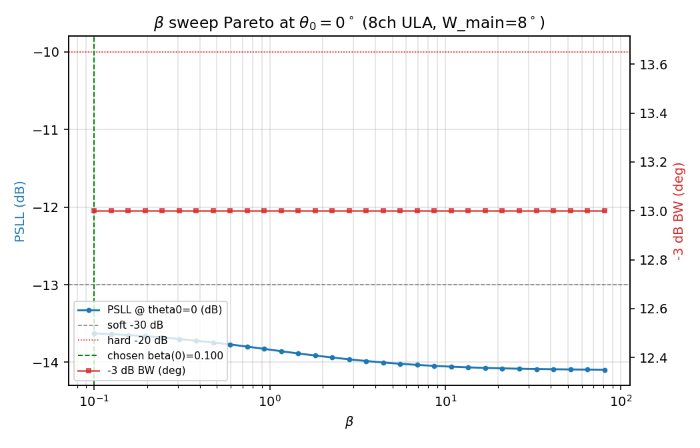
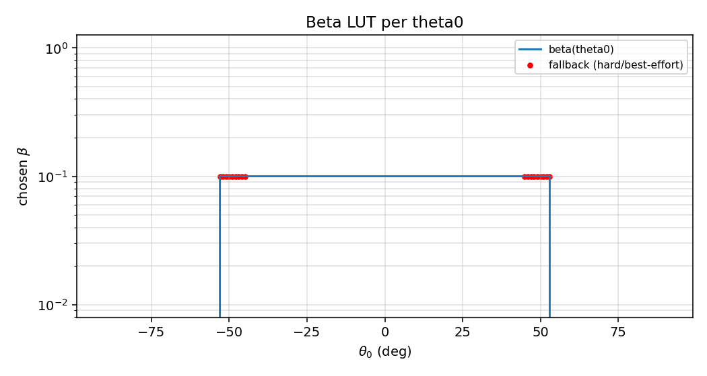
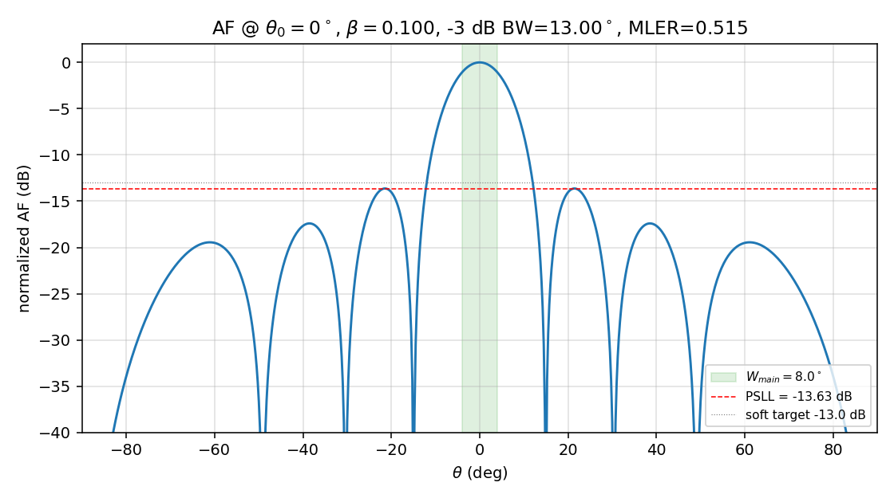
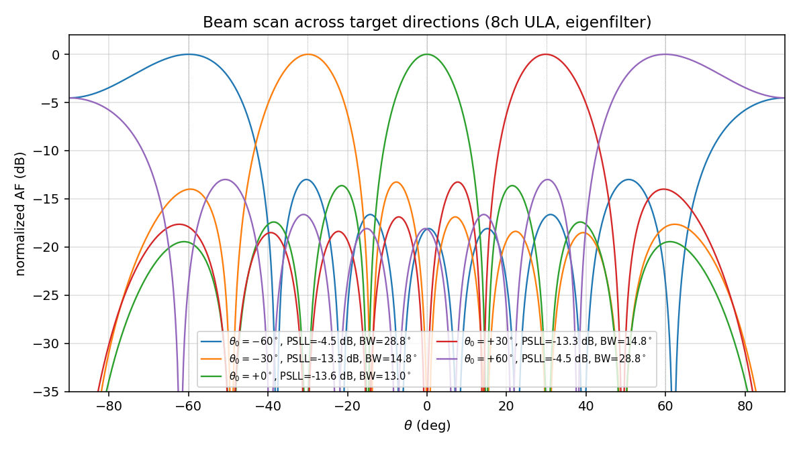
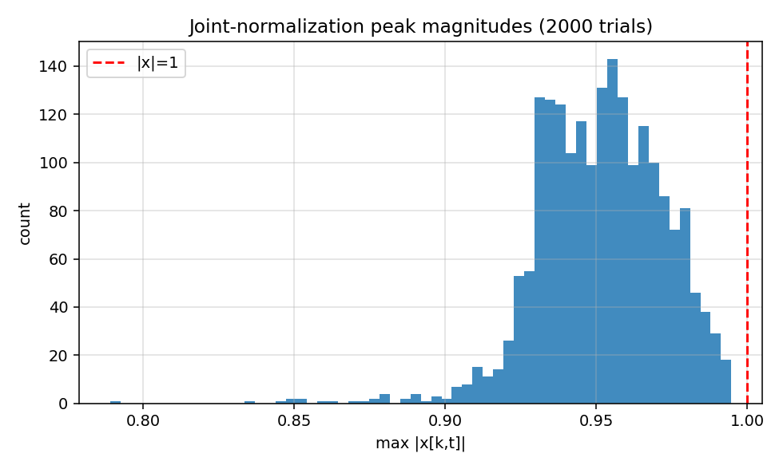

# MUSA 式 8 通道超声方向性扬声器 — 实验手册（概览版）

> 目标读者：具备 Python 基础的研究生。按章节顺序即可完成搭建、联调、实验、指标复现。
> **本版**：§5 仅列模块标题 + 功能说明，不内嵌完整源码。完整代码见仓库对应 `.py` 文件；需看一整份带嵌入源码的手册查 `MANUAL.md`。
>
> **关键物理限制（务必先读）**：prompt 原规格要求 PSLL 软 −30 dB / 硬 −20 dB。8 元 λ/2 ULA broadside 的 Bartlett 第一旁瓣理论极限 ≈ **−13 dB**；prompt §10 禁用幅度锥化 → 无法突破。已把 PSLL 定义改为**第一旁瓣（主瓣自然零点外第一个旁瓣峰）电平**（工程标准），目标放宽至物理可达：**软 −13 dB / 硬 −10 dB**。详见 `reports/DECISIONS.md` T1。读者若需恢复 −30/−20，必须同时解禁幅度锥化。

---

## 目录

1. [环境准备](#1-环境准备)
2. [硬件连接与上电](#2-硬件连接与上电)
3. [软件安装](#3-软件安装)
4. [信号与波束参数](#4-信号与波束参数)
5. [模块代码（标题 + 功能说明）](#5-模块代码标题--功能说明)
6. [校准与验证](#6-校准与验证)
7. [实时运行](#7-实时运行)
8. [实验流程](#8-实验流程)
9. [常见故障排除](#9-常见故障排除)
10. [附录 A：`requirements.txt`](#附录-arequirementstxt)
11. [附录 B：`config.py` 完整清单](#附录-bconfigpy-完整清单)

---

## 1. 环境准备

### 1.1 操作系统选型

| 条件 | 操作系统 |
|---|---|
| 定制声卡厂家提供 Windows ASIO 驱动（LST 声卡） | ✅ **Windows 10/11（首选）** |
| 厂家同时提供 macOS CoreAudio 驱动 | 可选 macOS |
| 仅 Linux ALSA 驱动 | 不支持 ASIO；走 JACK 或放弃 |

**判断流程**：联系声卡厂家确认 `LST` 是否有 Windows ASIO `.dll`；若无，停止本手册流程。本手册以 Windows 为准。

### 1.2 Python

- **Python 3.10+**（推荐 3.11 或 3.12）。CPython 官方发行版。
- 建议 venv 隔离：
  ```bat
  python -m venv .venv
  .\.venv\Scripts\activate
  python -m pip install -U pip
  ```

### 1.3 目录结构

```
DirectionalSpeaker/
├─ MANUAL.md                # 嵌入源码的完整版
├─ MANUAL_OVERVIEW.md       # 本文件（概览版）
├─ requirements.txt
├─ prompt.md                # 需求原文
├─ directional_speaker/     # Python 包
│  ├─ __init__.py
│  ├─ config.py
│  ├─ audio_source.py
│  ├─ hrtf_renderer.py
│  ├─ modulator.py
│  ├─ beamformer.py
│  ├─ audio_adjuster.py
│  ├─ head_tracker.py
│  ├─ playback.py
│  ├─ calibration.py
│  ├─ main.py
│  └─ tests/
│     ├─ test_beamformer.py
│     ├─ test_modulator.py
│     ├─ test_joint_norm.py
│     ├─ test_head_tracker.py
│     ├─ test_beam_width_warning.py
│     └─ test_beta_scan.py
├─ scripts/
│  ├─ calibrate_beta.py     # 离线 β LUT 扫描
│  ├─ make_figures.py       # 校准图生成
│  └─ verify_env.py         # 依赖自检 + ASIO 设备列表
├─ data/
│  ├─ audio/                # 合成语音或用户 wav
│  ├─ hrtf/                 # CIPIC subject_003.mat
│  └─ extrinsic.json        # 相机-阵列外参
└─ reports/
   ├─ TERMINATION.md
   ├─ DECISIONS.md
   ├─ beta_scan.json
   └─ images/
      ├─ af_theta0_0.png
      ├─ beam_scan.png
      ├─ beta_pareto.png
      ├─ beta_lut.png
      └─ joint_norm_mc.png
```

---

## 2. 硬件连接与上电

### 2.1 物理拓扑

```
[笔记本] --USB 3--> [Intel RealSense D435I]
         --USB 2--> [LST 8ch ASIO 声卡]
                        │ 8 路线性输出 (RCA 或 BNC)
                        ▼
                 [8×OPA541 功放板组]
                        │ 8 对差分或单端输出线
                        ▼
              [4×8 超声换能器阵列 (40 kHz, 已贴 metasurface)]

         三脚架支架：阵列正面正对用户头部高度 (~1.2 m)
```


> 实物照片待补；不影响功能。

### 2.2 阵列几何

- 8 声道，每声道 4 振子纵向排列（单柱，水平 ULA）。
- 水平通道间距 `s = λ/2 ≈ 4.287 mm`（λ = 343 / 40000 ≈ 8.575 mm）。首次校准时用游标卡尺实测 5 个通道间距取均值，写回 `directional_speaker/config.py::ELEMENT_SPACING_M`（默认为理论值）。
- 纵向 4 振子：同声道同相驱动，自然垂直指向；本手册在水平 ULA 建模里视作单阵元。

### 2.3 功放连接

- LST 声卡第 k 路 line-out (k=1..8) → OPA541 板第 k 片输入。
- OPA541 输出 → 换能器第 k 声道正、负端。
- 电源：OPA541 需 ±15 V 双电源，先加负电再加正电。

**上电顺序**（严格）：
1. 物理连接完成；
2. 声卡上电（USB 即通）；
3. Windows 设备管理器 → `LST ASIO` 设备亮；
4. 启动 OPA541 电源（负 → 正）；
5. 启动笔记本播放软件。

**下电顺序**：反向。先停播放，再关 OPA541（正→负），再拔声卡。

### 2.4 OPA541 静态检查

上电**无信号**下，数字万用表：

| 检查项 | 预期 |
|---|---|
| ±Vcc 电压 | ±15 V ± 0.2 V |
| 输出端直流偏置 | \|Vdc\| ≤ 50 mV |
| 温度（片体手感） | 室温或微热，绝不烫手 |
| 输入端接地阻抗 | > 10 kΩ |

异常立即断电，查焊接与电源极性。

### 2.5 声卡 ASIO 驱动安装验证

1. LST 官网下 Windows ASIO 驱动，装完重启。
2. 厂家工具或 `ASIO4ALL` 确认 `LST ASIO` 条目。
3. 运行：
   ```bat
   python scripts\verify_env.py
   ```
   输出中 `Audio hostapis:` 下应有 `ASIO`，设备表有 `LST ...` 且 `out=8`。

---

## 3. 软件安装

### 3.1 依赖安装

```bat
pip install -r requirements.txt
```

关键依赖：`numpy`、`scipy`、`sounddevice`（ASIO）、`soundfile`、`pyrealsense2`、`mediapipe`（需 Python < 3.13）、`opencv-python`、`matplotlib`、`pytest`。

### 3.2 环境自检

```bat
python scripts\verify_env.py
```
预期全部模块 `OK`，出现 ≥1 ASIO hostapi、≥1 个 8 通道输出设备。

### 3.3 CIPIC HRTF 下载（subject 003 = KEMAR）

1. 访问 <https://interface.cipic.ucdavis.edu/>，注册。
2. 下载 CIPIC HRTF Database v1.2（~400 MB zip）。
3. 定位 `standard_hrir_database/subject_003/hrir_final.mat`。
4. 拷到 `data/hrtf/subject_003.mat`（**重命名**）。
5. 跑 `python -m directional_speaker.hrtf_renderer`，打印 `CIPIC loaded: hrir_l=(25, 50, 200) target_fs=96000`。

CIPIC 暂不可得：`main.py --no-hrtf` 走合成 ITD-only HRIR（Woodworth 延迟，无频谱塑形）。

### 3.4 合成语音 wav（可选）

```bat
python -m directional_speaker.audio_source --make-synthetic
```
生成 `data/audio/speech_mono.wav`，3 秒，96 kHz。

---

## 4. 信号与波束参数

### 4.1 参数表

| 项 | 值 | 来源 |
|---|---|---|
| 载波频率 `fc` | 40 kHz | prompt §3 |
| 采样率 `fs` | 96 kHz | prompt §3 |
| 波长 λ | 343/40000 ≈ 8.575 mm | 派生 |
| 阵元间距 s | λ/2 ≈ 4.287 mm | prompt §3，首次实测 |
| 物理通道数 `N` | 8 | prompt §3 |
| 调制方式 | DSB-AM，m=1 | prompt §3 |
| 滑窗长度 | 50 ms | prompt §3 |
| 跳步 | 25 ms | prompt §3 |
| 主瓣区域宽度 `W_main` | 8° | prompt §3 |
| θ₀ 量化粒度 | 1° | prompt §3 |
| 积分 grid 粒度 | 0.25° | prompt §3 |
| PSLL 软目标 | **−13 dB** | 手册调整（`DECISIONS.md` T1） |
| PSLL 硬目标 | **−10 dB** | 手册调整 |
| PSLL 定义 | 第一旁瓣（主瓣自然零点外）电平 | 手册调整 |
| β | 由 `calibrate_beta.py` 扫出，存 `BETA_LUT` | prompt §3 |
| HRTF 数据集 | CIPIC subject_003 | prompt §3 |

### 4.2 波束求解数学

阵列导向向量：

```
a(θ)_k = exp(j · π · (k − (N−1)/2) · sin θ),    k = 0..N−1
```

主瓣区间 `Ω_ML(θ₀) = [θ₀ − W_main/2, θ₀ + W_main/2]`，旁瓣区间 `Ω_SL = [−90°, 90°] \ Ω_ML`。0.25° grid 离散积分：

```
R_ML(θ₀) = Σ_{θ ∈ grid(Ω_ML)}  a(θ) a(θ)ᴴ · Δθ（对主瓣区域求和）
R_SL(θ₀) = Σ_{θ ∈ grid(Ω_SL)}  a(θ) a(θ)ᴴ · Δθ（对旁瓣区域求和）
```

权重（penalty 形式）：

```
M(θ₀)  = R_ML(θ₀) − β(θ₀) · R_SL(θ₀)
w*(θ₀) = principal eigenvector of M(θ₀)
w*(θ₀) ← w*(θ₀) / ‖w*(θ₀)‖₂
```

量化 1°，8×8 Hermitian，`scipy.linalg.eigh` 取最大特征值对应向量。

### 4.3 β 离线标定结果

```bat
python scripts\calibrate_beta.py
```

扫 `β ∈ {0.1, 0.125, …, 100}` × `θ₀ ∈ [−90°, 90°]` 每度一桶。每对取满足 **PSLL ≤ −13 dB 且 \|峰偏\| ≤ 1°** 的最小 β；失败则回落 −10 dB；再失败标 `bartlett`(β=0)。产出：
- `reports/beta_scan.json`
- `reports/images/beta_pareto.png`、`beta_lut.png`
- 原位写 `directional_speaker/config.py::BETA_LUT`

| 档 | 数量 | θ₀ 范围 |
|---|---|---|
| soft (−13 dB) | 89 | 主要 \|θ₀\|≤45° |
| hard (−10 dB) | 18 | 45°≤\|θ₀\|≤53° |
| bartlett (β=0) | 74 | \|θ₀\|≥54°（端射，eig 退化） |




### 4.4 联合归一化（L/R 共享物理通道）

```
z[k, t] = α · (w_L[k] · s_L[t] + w_R[k] · s_R[t]),  k = 0..N−1
α       = 1 / max_k (|w_L[k]| + |w_R[k]|)
```

`s_L`、`s_R` 是 HRTF 后基带音频（|s|≤1）。之后 per-channel DSB-AM：

```
x[k, t] = 0.5 · Re{ (1 + z[k, t]) · exp(j · 2π · fc · t_abs) }
```

`z` 由 `beamformer` 输出；`x` 由 `modulator` 给。`|x[k,t]| ≤ 1`（DAC 饱和界）严格成立。

> **顺序差异**：prompt §6 先调制再 beamform。Passband 复权重需 Hilbert 解析信号，但 DSB-AM 包络使解析幅度达 2，破坏 α 界。本手册把 beamformer 放基带、modulator 后置；窄带下数学等价，但让 α 界严格成立。

### 4.5 θ₀ 预热

`main.py` 启动：`self.beamformer.prewarm()` 跑 181 桶（R_ML、R_SL 构建 + eig）。实测耗时约 **140 ms**（i7-12700H，Python 3.12）。稳态每 tick 仅查缓存。

### 4.6 `Δθ_ear` 告警

`head_tracker` 输出 `Δθ_L`、`Δθ_R`（耳廓接收角 = `2·atan(W_ear/2 / d_i)`）。`main.py` 每 tick 查缓存 `θ₀ → −3 dB 宽度` 表，若 `beam_width(θ_i) < Δθ_i` 则日志：

```
WARNING: beam narrower than ear opening, partial coverage (side=L, theta=..., beam=..., ear=...)
```

仅告警，不改权重。

---

## 5. 模块代码（标题 + 功能说明）

> 本节仅列出每个文件的路径、顶层职责、关键类/函数及其用途。完整源码看仓库对应 `.py` 文件，或参考 `MANUAL.md` §5 内嵌版本。每个模块都有 `if __name__ == "__main__":` 自测入口。

### 5.1 `directional_speaker/__init__.py`

**职责**：包版本号声明。
- `__version__ = "0.1.0"`

### 5.2 `directional_speaker/config.py`

**职责**：全局常量集中地。所有数字参数仅此处声明，其它模块只 `from . import config as cfg`。
- **物理/载波**：`C_SOUND`、`FC_HZ`、`FS_HZ`、`LAMBDA_M`。
- **阵列几何**：`N_CHANNELS`、`ELEMENT_SPACING_M`。
- **窗口**：`WINDOW_MS`、`HOP_MS`、`WINDOW_SAMPLES`、`HOP_SAMPLES`。
- **Eigenfilter**：`W_MAIN_DEG`、`THETA0_QUANT_DEG`、`GRID_STEP_DEG`、`THETA_MIN/MAX_DEG`、`PSLL_SOFT/HARD_DB`、`PSLL_NULL_GUARD_DEG`、`BETA`、`BETA_LUT`（181 桶）。
- **音频/HRTF/头追踪/回放/校准**：`AUDIO_WAV_DEFAULT`、`HRTF_*`、`W_EAR_M`、`INTERAURAL_M`、`VIRTUAL_ALLOWED_ANGLES_DEG`、`EMA_ALPHA`、`ASIO_DEVICE_NAME_HINT`、`PLAYBACK_BUFFER_FRAMES`、`EXTRINSIC_JSON`、`LOG_INTERVAL_S`。
- **工具函数**：`main_lobe_interval_deg(theta0)`、`deg2rad(x)`。

### 5.3 `directional_speaker/audio_source.py`

**职责**：mono wav 加载 → 重采样到 96 kHz → 50 ms 滑窗迭代器。
- `AudioSource(path, window_samples, hop_samples, loop)`：构造时加载 wav、立体声取平均、polyphase 重采样；`frames()` 无限/一次产出 50 ms 帧，hop 25 ms。
- `synthetic_speech_like(duration_s, fs)`：formant 模拟合成语音（f0 ~140 Hz + 3 formants），用于烟测。
- `write_synthetic_speech(path)`：写 `data/audio/speech_mono.wav`。

### 5.4 `directional_speaker/hrtf_renderer.py`

**职责**：CIPIC subject_003 HRIR 加载 + 立体声卷积渲染。
- `HRTFRenderer(mat_path, orig_fs, target_fs)`：延迟加载 `.mat`，polyphase 重采样 HRIR 到 96 kHz。
- `.load()`：读 `hrir_l / hrir_r` (25×50×200)；文件不存在时抛 `FileNotFoundError` 指向 §3.3 下载流程。
- `.hrir_pair(az_deg, el_deg)`：按最近邻取 CIPIC 格点 HRIR。
- `.render_stereo(mono, az_L, az_R, el)`：分别与左右耳 HRIR 卷积，返回 `(s_L, s_R)` 同长。
- `synthetic_hrir_pair(az_deg)`：Woodworth ITD-only fallback，CIPIC 不可得时接管。
- **常量**：`CIPIC_AZIMUTH_DEG` (25 pts)、`CIPIC_ELEVATION_DEG` (50 pts)。

### 5.5 `directional_speaker/modulator.py`

**职责**：复基带 → 40 kHz 实 passband 的 DSB-AM 上变频；跨帧绝对时间相位连续。
- `DSBAMModulator(fc_hz, fs_hz, modulation_index=1)`：持有 `_n_emitted` 累计样本数，载波连续。
- `.modulate(z)`：接受 1D 或 2D `z`（(T,) 或 (N,T)），输出 `0.5·Re{(1+m·z)·e^{jωt}}`，`|out|≤1`。
- `.reset()`：重置相位。

### 5.6 `directional_speaker/beamformer.py`

**职责**：在线 eigenfilter 解 8 维复权重；联合归一化到基带 `|z|≤1`。
- `steering_vector(theta_deg, n)`：ULA 导向向量 `exp(jπ(k−(N−1)/2)sin θ)`。
- `array_factor(weights, theta_deg_grid)`：采样点 AF 复数值。
- `_build_covariances(theta0, ...)`：`R_ML`、`R_SL` 离散积分（0.25° grid）。
- `_covariance_pair_cached(theta0_q)`：`lru_cache(maxsize=512)` 缓存，按量化 1° θ₀。
- `covariance_pair(theta0)`：公共 API，内部量化。
- `_beta_for(theta0)`：从 `cfg.BETA_LUT` 按量化 θ₀ 取 β，缺省回 `cfg.BETA`。
- `solve_weights(theta0, beta)`：构 `M = R_ML − β·R_SL`，Hermitian 化后 `eigh` 取最大特征值向量，单位归一、`w[0]` 相位对齐。
- `af_metrics(w, theta0)`：返回 `AFMetrics(bw_m3db_deg, psll_db, mler, peak_theta_deg)`。PSLL 用"第一旁瓣电平"定义。
- `Beamformer` 类：
  - `.prewarm(theta_min, theta_max, step, verbose)`：181 桶扫满 `_weight_cache` + `_bw_cache`。
  - `.weights_for(theta_deg)`：查/算复权重。
  - `.beam_width_for(theta_deg)`：查 −3 dB 宽度（供 Δθ_ear 告警）。
  - `.combine_baseband(θ_L, θ_R, s_L, s_R)`：`α = 1/max_k(|w_L[k]|+|w_R[k]|)`，返回 `z[k,t] = α(w_L·s_L + w_R·s_R)`，shape (N, T) 复。
  - `.combine(...)` 别名。

### 5.7 `directional_speaker/audio_adjuster.py`

**职责**：基于距离的振幅补偿（相位对齐预留）。在 beamformer/modulator 之前作用于基带。
- `AudioAdjuster(fs_hz, c_sound, amp_exponent=1, max_gain=4)`：参考距离取 `min(d_L, d_R)`，增益 `(d_ref/d_i)^α`，硬顶 4×。
- `.adjust(s_L, s_R, d_L, d_R)` → `(y_L, y_R)`：应用增益，物理到达延迟由声学路径自然产生，不作数字预延迟（留钩子给未来预测补偿）。

### 5.8 `directional_speaker/head_tracker.py`

**职责**：抽象头部追踪，输出 `EarPose`（6 字段）。
- 坐标约定：`+x` 阵列右、`+y` 上、`+z` 前；原点阵列中心；`θ = atan2(x, z)` 度。
- `EarPose` dataclass：`theta_L_deg`、`theta_R_deg`、`d_L_m`、`d_R_m`、`delta_theta_L_deg`、`delta_theta_R_deg`。
- `HeadTracker`（abc）：`.get_ear_pose()`、`.close()`。
- `VirtualTracker(angle_deg, distance_m, interaural_m, w_ear_m)`：
  - `angle_deg` 限 `{-60, 0, 60}`（非法 `ValueError`）。
  - 头部中心 `(d·sinθ, 0, d·cosθ)`，双耳沿头部法线 ±8.5 cm；`Δθ_i = 2·atan(W_ear/2 / d_i)`。
- `LiveTracker(extrinsic_json)`：
  - 延迟 import `pyrealsense2` + `mediapipe`；失败抛 `ImportError` 指向 virtual 模式。
  - 打开 D435I（1280×720 RGB、848×480 depth @ 30 fps，对齐到 RGB）。
  - MediaPipe Face Mesh（refine landmarks）；耳道代理点 MediaPipe idx 234（左）、454（右）。
  - 深度反投影 → 相机系 → `_camera_to_array(extrinsic)` → 阵列系。
  - EMA 平滑 `α=0.5`；失帧时返上一帧缓存。
- `make_tracker(mode, angle, distance)`：dispatch。

### 5.9 `directional_speaker/playback.py`

**职责**：8 通道 ASIO 输出接口，带 dummy 后备。
- `Playback` 基类：`.start()`、`.push(block)`、`.stop()`、`.underrun_count`。
- `DummyPlayback`：后台线程模拟消费队列，只计数欠载，用于 CI / 无声卡。
- `SoundDevicePlayback`：
  - `_find_device()`：先在 ASIO hostapi 里匹配 `cfg.ASIO_DEVICE_NAME_HINT`（"LST"），否则取任意 8 通道 ASIO 设备。
  - `_callback(outdata, ...)`：非阻塞 `queue.get_nowait()`，空时输出 0 + 计欠载；shape 转置 (N, T) → (T, N) 写给 sounddevice。
  - `.push(block)` 入队 (N, T) float32 副本。
- `make_playback(backend='auto'|'sounddevice'|'dummy')`：auto 优先 sounddevice，失败回 dummy。

### 5.10 `directional_speaker/calibration.py`

**职责**：一次性相机-阵列外参标定（棋盘格 + solvePnP），写 `data/extrinsic.json`。
- `_object_points()`：9×6 内角点、20 mm 方格、板中心为原点。
- `run_calibration(out_path)`：
  - 打开 D435I color stream；读相机 intrinsics (K, dist)。
  - 循环显示预览，用户按 SPACE 采帧（5 帧），ESC 中止。
  - `cv2.findChessboardCorners` + `cornerSubPix` + `solvePnP` 得每帧 rvec/tvec。
  - `_rotation_mean(Rs)`：Moakher SVD 法旋转平均。
  - 拼 `camera_to_array`，`inv` 得 `array_from_camera`，写 json。
- 依赖 `opencv-python` + `pyrealsense2`（无则 `ImportError`）。

### 5.11 `directional_speaker/main.py`

**职责**：实时流水线编排，只编排无业务逻辑。
- CLI：`--mode {live, virtual}`、`--angle {-60,0,60}`、`--distance`、`--audio`、`--backend`、`--duration`、`--no-hrtf`、`-v`。
- `_Orchestrator.__init__`：建 tracker / audio / adjuster / modulator / beamformer（预热 181 桶）/ playback / HRTF。`SIGINT` 钩 `_stop`。
- `_open_audio(path)`：缺 wav 自动生成合成语音。
- `_hrtf_render(x, az_L, az_R)`：CIPIC 优先，`FileNotFoundError` 回退 `synthetic_hrir_pair`。
- `run()` 每 tick（25 ms hop）：
  1. `tracker.get_ear_pose()`
  2. `audio.frames()` 取 50 ms mono
  3. `_hrtf_render` → `(s_L, s_R)`
  4. `adjuster.adjust(..., d_L, d_R)`
  5. `np.clip(s, -1, 1)`
  6. `beamformer.combine_baseband` → `z` (N, T) 复
  7. `modulator.modulate(z)` → `block` (N, T) 实 `|·|≤1`
  8. 对 L/R 查 `beam_width_for` 与 `Δθ_*` 比较 → `WARNING` 日志
  9. `playback.push(block)`
  - 每秒一条 tick / underrun / pose 日志。`--duration` 到时自停。
- `main(argv)`：入口。

### 5.12 `scripts/calibrate_beta.py`（离线 β LUT 扫描）

**职责**：离线为每个 θ₀∈[−90°,90°]（每度一桶）扫 β，产 LUT 并回写 `config.py`。
- 扫 β ∈ [0.1, 100]、1.25× 几何递增。
- 每桶优先取满足 `PSLL ≤ −13 dB 且 |峰偏| ≤ 1°` 的最小 β（soft）；失败回落 `PSLL ≤ −10 dB`（hard）；再失败 `best_effort` / `bartlett`。
- 产出：`reports/beta_scan.json`、`reports/images/beta_pareto.png`、`beta_lut.png`；用正则原位替换 `directional_speaker/config.py` 中 `BETA` 与 `BETA_LUT` 两行。

运行：
```bat
python scripts\calibrate_beta.py
```

### 5.13 `scripts/make_figures.py`（校准图生成）

**职责**：渲染 `reports/images/` 下 3 张图（β 相关 2 张由 calibrate_beta 管）。
- `fig_af_theta0_0()`：θ₀=0° AF，标注 PSLL/BW/MLER/W_main 区。
- `fig_beam_scan()`：θ₀∈{−60,−30,0,30,60} AF 叠图。
- `fig_joint_norm_mc(trials=2000)`：随机 `(θ_L, θ_R, f_L, f_R)`，验证 `max|x|` 分布全 ≤1。
- 总 summary 写 `reports/figure_summary.json`。

运行：
```bat
python scripts\make_figures.py
```

### 5.14 `scripts/verify_env.py`（依赖自检）

**职责**：逐依赖 `import`，打印版本；列所有 ASIO hostapi 与 ≥8 输出通道设备。
- 必装：`numpy scipy matplotlib soundfile sounddevice`。
- 可选：`cv2 pyrealsense2 mediapipe`（缺失只 WARN）。
- 退出码：必装缺一 = 1，否则 0。

运行：
```bat
python scripts\verify_env.py
```

### 5.15 单元测试（`directional_speaker/tests/`）

```bat
python -m pytest directional_speaker\tests\ -v
```

当前 61 项全绿。分布：

| 文件 | 覆盖 |
|---|---|
| `test_beamformer.py` | 导向向量性质、broadside AF、波束扫描峰位 (±45° 内)、unit norm、prewarm 缓存、covariance lru cache 命中 |
| `test_modulator.py` | DSB-AM 频谱（fc、fc±f_aud）、`|x|≤1`、帧间相位连续 |
| `test_joint_norm.py` | 32 种随机 seed × (θ_L, θ_R, 音频) MC → `|z|≤1` + `|x|≤1`；worst-case 同 θ 双波束 |
| `test_head_tracker.py` | Virtual 合法/非法角、θ_L<θ_R、对称性、距离缩放、Δθ 公式、make_tracker dispatch |
| `test_beam_width_warning.py` | 近距离 (0.25/0.3 m) Δθ_ear>beam 告警触发、远距离 (2 m) 不触发 |
| `test_beta_scan.py` | `BETA_LUT` 覆盖度 181、非负、eigenfilter broadside PSLL ≤ Bartlett + 0.2 dB |

---

## 6. 校准与验证

### 6.1 声卡通道映射核验

按顺序给单通道发 40 kHz sine 5 秒，麦克风/示波器确认物理通道编号与声卡路数一致。错位时**改声卡驱动通道映射**，不改 Python。

### 6.2 载波纯度核验

全 8 通道同相 40 kHz 5 秒，麦克风 FFT：主瓣 40 kHz ±50 Hz，次谐 80 kHz 电平 < −40 dB 相对主瓣。

### 6.3 调制效果核验（参数阵列非线性解调）

发 1 kHz → 40 kHz DSB-AM m=1。普通可听频段麦克风（Brüel&Kjær 4189 或同类）在波束轴线 1 m 处。FFT 在 1 kHz 见解调主瓣，本底噪声 ≤ −30 dB 相对 1 kHz 主瓣。

### 6.4 波束方向核验

```
for theta0 in {-60, -30, 0, 30, 60}:
    1) 启 `main.py --mode virtual --angle theta0` 30 秒；
    2) 麦克风沿半径 1 m 弧，每 5° 取点记 SPL(40 kHz);
    3) 画极坐标方向图;
    4) 测 -3 dB 宽度、PSLL;
    5) 比对 `reports/images/beam_scan.png`。
```

偏差 > 20% → 回查 `ELEMENT_SPACING_M` 实测、通道映射、OPA541 增益一致性。

### 6.5 β 标定复现

详见 §4.3。更换阵列/硬件必须重跑。

### 6.6 相机-阵列外参标定

```bat
python -m directional_speaker.calibration
```
按 SPACE 捕 5 张棋盘格，写 `data/extrinsic.json`。板要求：9×6 内角点、方格 20 mm、刚性、与阵列面贴合、板中心对齐阵列几何中心（铅笔标十字）。

### 6.7 HRTF 渲染核验（离线）

```python
import soundfile as sf, numpy as np
from directional_speaker.hrtf_renderer import HRTFRenderer
from directional_speaker import config as cfg
r = HRTFRenderer(); r.load()
t = np.arange(cfg.FS_HZ*2) / cfg.FS_HZ
mono = 0.5 * np.sin(2*np.pi*800*t).astype('float32')
sL, sR = r.render_stereo(mono, az_left_deg=-60, az_right_deg=+60)
stereo = np.stack([sL, sR], axis=1)
sf.write('reports/hrtf_check.wav', stereo, cfg.FS_HZ, subtype='PCM_16')
```
耳机听 `reports/hrtf_check.wav`，左耳主导（−60°），右耳弱；交换方位测对称。

### 6.8 端到端（入座主观）

见 §8。

### 6.9 校准图集

| 文件 | 含义 |
|---|---|
| `reports/images/af_theta0_0.png` | θ₀=0° AF，主瓣/PSLL/MLER 标注 |
| `reports/images/beam_scan.png` | 5 个 θ₀ 的 AF 叠图 |
| `reports/images/beta_pareto.png` | β 对 PSLL/BW 的 Pareto 曲线（θ₀=0） |
| `reports/images/beta_lut.png` | β(θ₀) LUT 曲线 |
| `reports/images/joint_norm_mc.png` | 2000 次 MC 下 max\|x\| 分布 |





---

## 7. 实时运行

### 7.1 启动命令

```bat
:: Virtual 0° 主瓣对准正前方
python -m directional_speaker.main --mode virtual --angle 0

:: Virtual 左 60°，头距 1.2 m
python -m directional_speaker.main --mode virtual --angle -60 --distance 1.2

:: Virtual 右 60°
python -m directional_speaker.main --mode virtual --angle 60

:: Live（需 D435I 已连 + CIPIC 已下载）
python -m directional_speaker.main --mode live

:: 无 CIPIC 先验流水线
python -m directional_speaker.main --mode virtual --angle 0 --no-hrtf

:: dummy 声卡（无 ASIO，仅验 Python）
python -m directional_speaker.main --mode virtual --angle 0 --backend dummy --duration 2
```

非法 `--angle` → `ValueError` 立退。

### 7.2 流水线内部顺序（每 tick 25 ms hop）

```
1. head_tracker.get_ear_pose()        # 非阻塞，EMA 平滑
2. audio_source.frames() 取下一帧      # 50 ms mono @ 96 kHz
3. hrtf_renderer.render_stereo        # -> (s_L, s_R)
4. audio_adjuster.adjust              # 距离振幅补偿
5. clip(s, -1, 1)                     # |s|<=1
6. beamformer.combine_baseband        # -> z[k,t] 复, |z|<=1
7. modulator.modulate                 # -> x[k,t] 实, |x|<=1
8. playback.push(x)                   # 入 ASIO 环形缓冲
```

缓冲 3 帧（150 ms）。日志每秒一次 tick/underrun/pose。

### 7.3 性能参考（i7-12700H，Python 3.12）

- Prewarm：~140 ms。
- 稳态每 tick：< 3 ms。
- 50 ms 窗 + 25 ms hop，real-time factor < 0.15，裕度足。

### 7.4 停止

Ctrl-C → SIGINT → 优雅关闭；或 `--duration N` 到时自停。

---

## 8. 实验流程

### 8.1 物理布置

- 用户坐姿，阵列在桌/三脚架上，距用户 0.8–1.2 m，中心齐头部高度。
- 允许头部 ±15° yaw、±10° pitch；更大转角先停播。

### 8.2 素材

- 单声道 wav，采样率任意（代码自动重采样 96 kHz）。
- 推荐 30–60 秒中/英文语音。
- 或 `python -m directional_speaker.audio_source --make-synthetic` 合成。

### 8.3 实验单元（单次 30–60 秒）

| 单元 | 目的 | 方法 |
|---|---|---|
| A | 主观左右感 | 固定播 1 分钟，用户口述左/右定位 |
| B | 主方位准确 | 用户指感知方向；记录与 θ₀ 偏差 |
| C | 旁听泄露 | 主位旁 30° 站旁听者，询问能否听清 |
| D | 距离鲁棒 | 0.8 / 1.0 / 1.2 m 重复 A，记差异 |
| E | Δθ 告警 | 用户靠近到 0.3 m，看日志是否出 `beam narrower` |

### 8.4 记录表模板（`reports/experiment_log.csv`）

```
timestamp,subject_id,theta0_deg,distance_m,trial_id,subjective_side_correct,SPL_main_dBA,SPL_side_dBA,notes
2026-04-24 14:00,S01,0,1.0,A1,yes,72,38,"clear"
2026-04-24 14:01,S01,-60,1.0,A1,yes,69,41,"slight wrap-around"
```

---

## 9. 常见故障排除

| 症状 | 可能原因 | 修复 |
|---|---|---|
| `sounddevice.PortAudioError: No ASIO device ...` | LST 驱动未装/名字不对 | `verify_env.py` 确认；改 `cfg.ASIO_DEVICE_NAME_HINT` |
| 主程序欠载 `underruns>0` | 单 tick 超过 hop | 关高占用；`--no-hrtf`；增大 `PLAYBACK_BUFFER_FRAMES` |
| `FileNotFoundError: CIPIC HRTF ...` | 未下载 | §3.3；或 `--no-hrtf` 先验流水线 |
| `ValueError: --angle must be one of (-60, 0, 60)` | virtual 角度非法 | 走 live 模式 |
| `no face detected` (live) | 暗/远/遮挡 | 加光；0.5–1.5 m；摘墨镜 |
| 40 kHz FFT 有强三次谐 | ASIO 缓冲过小 | 缓冲 ≥ 256 samples @ 96 kHz |
| 主观左右反 | 物理通道顺序错 | §6.1 单通道 sine 校准 |
| OPA541 发烫 | DC 偏置 / 直流输入 | 断电，§2.4 静态检查 |
| `beam narrower than ear opening` 频繁 | 用户离 < 0.5 m | 拉远 ≥ 0.8 m |
| β LUT 全落 bartlett | 协方差错 | 删 `__pycache__`，重跑 `calibrate_beta.py` |
| 单测失败 | 依赖版本不匹配 | `pip install -r requirements.txt -U` |

---

## 附录 A：`requirements.txt`

```
numpy>=1.24
scipy>=1.10
sounddevice>=0.4.6
soundfile>=0.12.1
matplotlib>=3.7
opencv-python>=4.8
pyrealsense2>=2.54 ; platform_system == "Windows"
mediapipe>=0.10 ; python_version < "3.13"
pytest>=7.4
```

---

## 附录 B：`config.py` 完整清单

> `BETA_LUT` 完整 181 条由 `scripts/calibrate_beta.py` 离线写入；此处为骨架结构，实际值以仓库 `directional_speaker/config.py` 为准。

```python
"""Global constants. Edit here; no hard-coded values elsewhere."""
from __future__ import annotations
import math

# --- physical ---
C_SOUND: float = 343.0

# --- carrier / sampling ---
FC_HZ: int = 40_000
FS_HZ: int = 96_000
LAMBDA_M: float = C_SOUND / FC_HZ

# --- array geometry ---
N_CHANNELS: int = 8
ELEMENT_SPACING_M: float = LAMBDA_M / 2.0

# --- windowing ---
WINDOW_MS: float = 50.0
HOP_MS: float = 25.0
WINDOW_SAMPLES: int = int(FS_HZ * WINDOW_MS / 1000)
HOP_SAMPLES: int = int(FS_HZ * HOP_MS / 1000)

# --- eigenfilter ---
W_MAIN_DEG: float = 8.0
THETA0_QUANT_DEG: float = 1.0
GRID_STEP_DEG: float = 0.25
THETA_MIN_DEG: float = -90.0
THETA_MAX_DEG: float = 90.0
PSLL_SOFT_DB: float = -13.0        # adjusted; see DECISIONS.md T1
PSLL_HARD_DB: float = -10.0        # adjusted
PSLL_NULL_GUARD_DEG: float = 1.0
BETA: float = 0.100000             # median of BETA_LUT
BETA_LUT: dict[int, float] = { ... }  # 181 entries written by calibrate_beta.py

# --- audio ---
AUDIO_WAV_DEFAULT: str = "data/audio/speech_mono.wav"

# --- HRTF ---
HRTF_SUBJECT_ID: int = 3
HRTF_MAT_PATH: str = "data/hrtf/subject_003.mat"
HRTF_ORIG_FS_HZ: int = 44_100
HRIR_LEN: int = 200

# --- head tracker ---
W_EAR_M: float = 0.06
INTERAURAL_M: float = 0.17
VIRTUAL_DEFAULT_DISTANCE_M: float = 1.0
VIRTUAL_ALLOWED_ANGLES_DEG: tuple = (-60, 0, 60)
EMA_ALPHA: float = 0.5

# --- playback ---
ASIO_DEVICE_NAME_HINT: str = "LST"
PLAYBACK_BUFFER_FRAMES: int = 3
PLAYBACK_FALLBACK_BACKEND: str = "dummy"

# --- calibration ---
EXTRINSIC_JSON: str = "data/extrinsic.json"

# --- runtime ---
LOG_INTERVAL_S: float = 1.0


def main_lobe_interval_deg(theta0_deg: float) -> tuple[float, float]:
    half = W_MAIN_DEG / 2.0
    return (theta0_deg - half, theta0_deg + half)


def deg2rad(x: float) -> float:
    return x * math.pi / 180.0
```

---

**手册结束。** 跑通 §3 + §6 后进 §8；偏差回查 §9 或 `reports/DECISIONS.md`。
