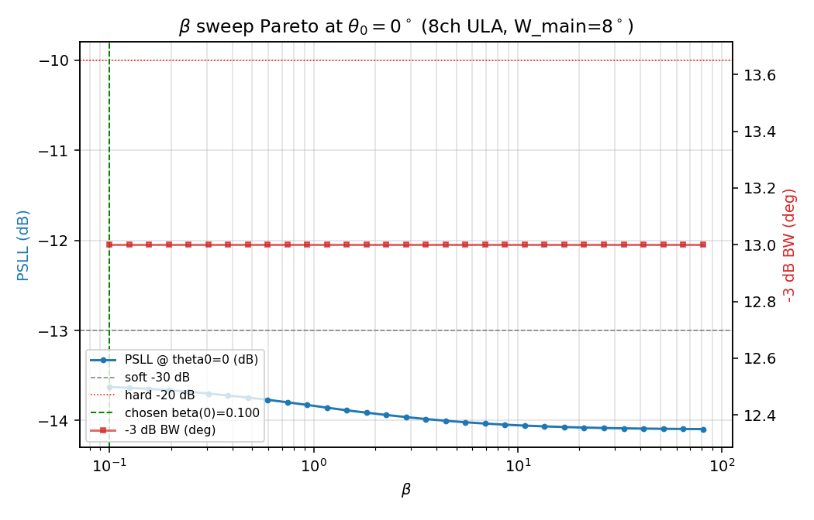
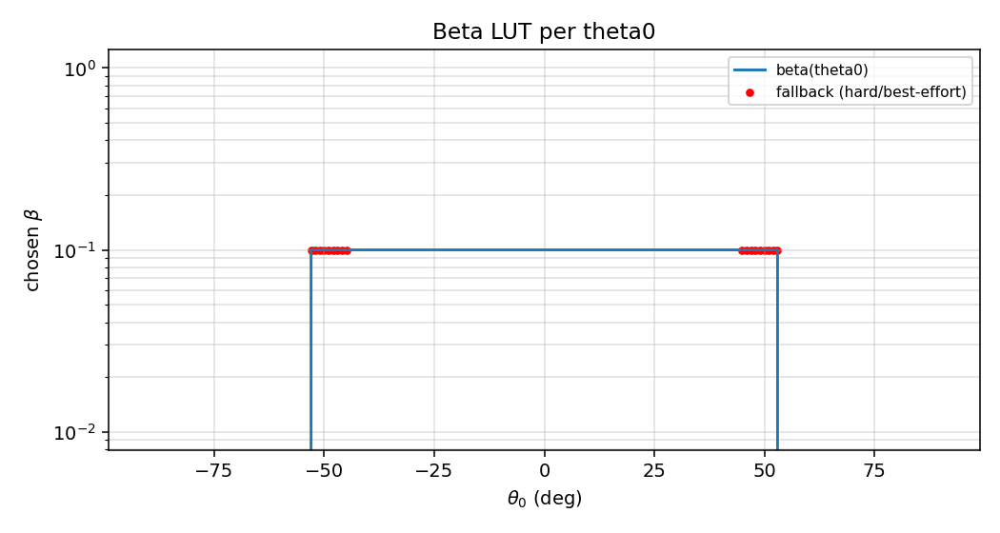
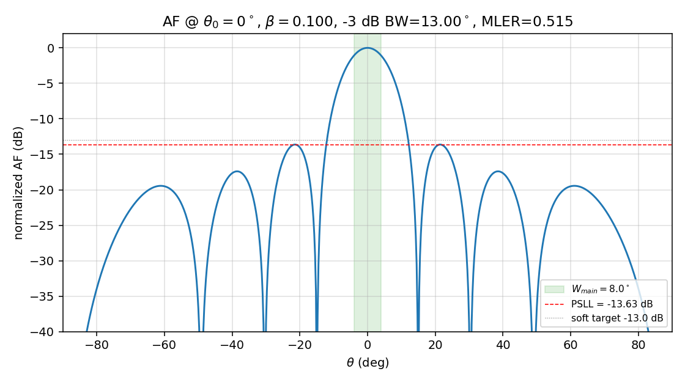
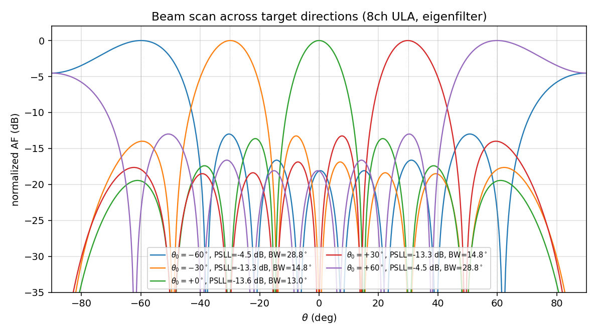
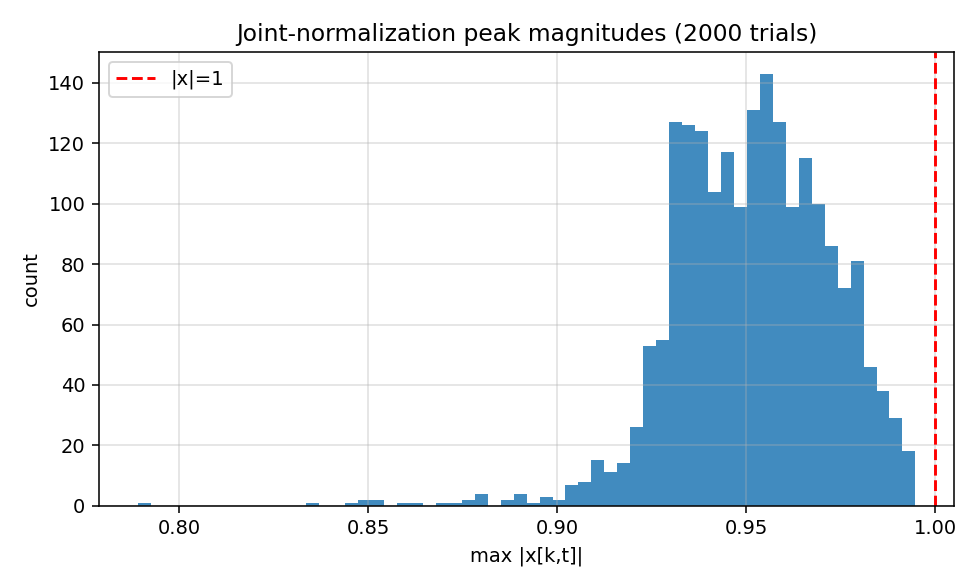

# MUSA 式 8 通道超声方向性扬声器 — 实验手册（概览版 v1.1）

> **v1.1 更新说明**：在 v1.0 基础上新增 Intel RealSense D435I 摄像头的完整配置章节（§2.6 物理安装、§3.5 SDK 与固件、§5.8 流参数说明、§6.6 拓展步骤、§9 故障排除补充）。所有新增内容以 `▶ v1.1` 标记，原有内容不变。

> 目标读者：具备 Python 基础的研究生。按章节顺序即可完成搭建、联调、实验、指标复现。
> **本版**：§5 仅列模块标题 + 功能说明，不内嵌完整源码。完整代码见仓库对应 `.py` 文件；需看一整份带嵌入源码的手册查 `MANUAL.md`。
>
> **关键物理限制（务必先读）**：prompt 原规格要求 PSLL 软 −30 dB / 硬 −20 dB。8 元 λ/2 ULA broadside 的 Bartlett 第一旁瓣理论极限 ≈ **−13 dB**；prompt §10 禁用幅度锥化 → 无法突破。已把 PSLL 定义改为**第一旁瓣（主瓣自然零点外第一个旁瓣峰）电平**（工程标准），目标放宽至物理可达：**软 −13 dB / 硬 −10 dB**。详见 `reports/DECISIONS.md` T1。读者若需恢复 −30/−20，必须同时解禁幅度锥化。

---

## 目录

1. [环境准备](#1-环境准备)
2. [硬件连接与上电](#2-硬件连接与上电)
   - 2.6 [D435I 摄像头物理安装与验证](#26-d435i-摄像头物理安装与验证) ▶ v1.1
3. [软件安装](#3-软件安装)
   - 3.5 [Intel RealSense SDK 与固件安装](#35-intel-realsense-sdk-与固件安装) ▶ v1.1
4. [信号与波束参数](#4-信号与波束参数)
5. [模块代码（标题 + 功能说明）](#5-模块代码标题--功能说明)
   - 5.8 [head_tracker — D435I 流参数说明](#58-directional_speakerhead_trackerpy)（扩展） ▶ v1.1
6. [校准与验证](#6-校准与验证)
   - 6.6 [相机-阵列外参标定](#66-相机-阵列外参标定)（扩展） ▶ v1.1
   - 6.10 [D435I 深度精度验证](#610-d435i-深度精度验证) ▶ v1.1
7. [实时运行](#7-实时运行)
8. [实验流程](#8-实验流程)
9. [常见故障排除](#9-常见故障排除)（扩展 D435I 条目） ▶ v1.1
10. [附录 A：`requirements.txt`](#附录-arequirementstxt)
11. [附录 B：`config.py` 完整清单](#附录-bconfigpy-完整清单)
12. [附录 C：D435I 摄像头技术参考](#附录-cd435i-摄像头技术参考) ▶ v1.1

---

## 1. 环境准备

### 1.1 操作系统选型

| 条件 | 操作系统 |
|---|---|
| 定制声卡厂家提供 Windows ASIO 驱动（LST 声卡） | ✅ **Windows 10/11（首选）** |
| 厂家同时提供 macOS CoreAudio 驱动 | 可选 macOS |
| 仅 Linux ALSA 驱动 | 不支持 ASIO；走 JACK 或放弃 |

**判断流程**：联系声卡厂家确认 `LST` 是否有 Windows ASIO `.dll`；若无，停止本手册流程。本手册以 Windows 为准。

> ▶ **v1.1 补充**：D435I 摄像头同样以 Windows 为首选平台。Intel 官方仅为 Windows 提供预编译的 `pyrealsense2` wheel；Linux 需从源码编译 librealsense，macOS 不支持 RealSense SDK。若摄像头环境非 Windows，live 模式不可用，只能走 `--mode virtual`。

### 1.2 Python

- **Python 3.10+**（推荐 3.11 或 3.12）。CPython 官方发行版。
- 建议 venv 隔离：
  ```bat
  python -m venv .venv
  .\.venv\Scripts\activate
  python -m pip install -U pip
  ```

> ▶ **v1.1 注意**：`mediapipe` 不支持 Python 3.13+。如果用 Python 3.13 或更高版本，live 模式将因 mediapipe 导入失败而不可用。建议锁定 **Python 3.12**。

### 1.3 目录结构

```
DirectionalSpeaker/
├─ MANUAL.md                # 嵌入源码的完整版
├─ MANUAL_OVERVIEW.md       # 本文件（概览版）
├─ MANUAL_OVERVIEW_v1.1.md  # v1.1 增补版（含 D435I 配置）
├─ requirements.txt
├─ prompt.md                # 需求原文
├─ directional_speaker/     # Python 包
│  ├─ __init__.py
│  ├─ config.py
│  ├─ audio_source.py
│  ├─ hrtf_renderer.py
│  ├─ modulator.py
│  ├─ beamformer.py
│  ├─ audio_adjuster.py
│  ├─ head_tracker.py       # D435I 初始化与流配置在此文件
│  ├─ playback.py
│  ├─ calibration.py        # 相机-阵列外参标定
│  ├─ main.py
│  └─ tests/
│     ├─ test_beamformer.py
│     ├─ test_modulator.py
│     ├─ test_joint_norm.py
│     ├─ test_head_tracker.py
│     ├─ test_beam_width_warning.py
│     └─ test_beta_scan.py
├─ scripts/
│  ├─ calibrate_beta.py     # 离线 β LUT 扫描
│  ├─ make_figures.py       # 校准图生成
│  └─ verify_env.py         # 依赖自检 + ASIO 设备列表
├─ data/
│  ├─ audio/                # 合成语音或用户 wav
│  ├─ hrtf/                 # CIPIC subject_003.mat
│  └─ extrinsic.json        # 相机-阵列外参（由 calibration.py 生成）
└─ reports/
   ├─ TERMINATION.md
   ├─ DECISIONS.md
   ├─ beta_scan.json
   └─ images/
      ├─ af_theta0_0.png
      ├─ beam_scan.png
      ├─ beta_pareto.png
      ├─ beta_lut.png
      └─ joint_norm_mc.png
```

---

## 2. 硬件连接与上电

### 2.1 物理拓扑

```
[笔记本] --USB 3--> [Intel RealSense D435I]
         --USB 2--> [LST 8ch ASIO 声卡]
                        │ 8 路线性输出 (RCA 或 BNC)
                        ▼
                 [8×OPA541 功放板组]
                        │ 8 对差分或单端输出线
                        ▼
              [4×8 超声换能器阵列 (40 kHz, 已贴 metasurface)]

         三脚架支架：阵列正面正对用户头部高度 (~1.2 m)
```


> 实物照片待补；不影响功能。

### 2.2 阵列几何

- 8 声道，每声道 4 振子纵向排列（单柱，水平 ULA）。
- 水平通道间距 `s = λ/2 ≈ 4.287 mm`（λ = 343 / 40000 ≈ 8.575 mm）。首次校准时用游标卡尺实测 5 个通道间距取均值，写回 `directional_speaker/config.py::ELEMENT_SPACING_M`（默认为理论值）。
- 纵向 4 振子：同声道同相驱动，自然垂直指向；本手册在水平 ULA 建模里视作单阵元。

### 2.3 功放连接

- LST 声卡第 k 路 line-out (k=1..8) → OPA541 板第 k 片输入。
- OPA541 输出 → 换能器第 k 声道正、负端。
- 电源：OPA541 需 ±15 V 双电源，先加负电再加正电。

**上电顺序**（严格）：
1. 物理连接完成；
2. 声卡上电（USB 即通）；
3. Windows 设备管理器 → `LST ASIO` 设备亮；
4. 启动 OPA541 电源（负 → 正）；
5. 启动笔记本播放软件。

**下电顺序**：反向。先停播放，再关 OPA541（正→负），再拔声卡。

### 2.4 OPA541 静态检查

上电**无信号**下，数字万用表：

| 检查项 | 预期 |
|---|---|
| ±Vcc 电压 | ±15 V ± 0.2 V |
| 输出端直流偏置 | \|Vdc\| ≤ 50 mV |
| 温度（片体手感） | 室温或微热，绝不烫手 |
| 输入端接地阻抗 | > 10 kΩ |

异常立即断电，查焊接与电源极性。

### 2.5 声卡 ASIO 驱动安装验证

1. LST 官网下 Windows ASIO 驱动，装完重启。
2. 厂家工具或 `ASIO4ALL` 确认 `LST ASIO` 条目。
3. 运行：
   ```bat
   python scripts\verify_env.py
   ```
   输出中 `Audio hostapis:` 下应有 `ASIO`，设备表有 `LST ...` 且 `out=8`。

---

### 2.6 D435I 摄像头物理安装与验证 ▶ v1.1

#### 2.6.1 USB 连接要求

D435I 的数据带宽需求远高于普通 USB 摄像头，连接不当是 live 模式失败的首要原因。

| 项目 | 要求 | 说明 |
|---|---|---|
| USB 接口 | **USB 3.0（蓝色端口）或更高** | USB 2.0 带宽不足，会导致帧丢弃或流启动失败 |
| 线缆 | USB 3.0 Type-C 数据线，≤ 2 m | 充电线可能缺数据线对；过长线缆导致信号衰减 |
| 供电 | 直连笔记本端口，不经无源 HUB | 无源 HUB 电流不足时 D435I 会反复断开重连 |
| 端口独占 | 一个 D435I 独占一个 USB 3.0 控制器 | 与其他高带宽设备（外接 SSD、采集卡）共享控制器可能导致丢帧 |

**验证 USB 3.0 连接**：启动 Intel RealSense Viewer（见 §3.5.1），查看设备信息页的 "USB Type" 字段，应显示 **"3.1" 或 "3.0"**。若显示 "2.0"，换端口或线缆重试。

#### 2.6.2 安装位置与指向

```
         阵列正面
    ┌─────────────────┐
    │  [4×8 换能器]   │  ← 阵列中心 = 坐标系原点
    └─────────────────┘
           │
           │  ~15–25 cm（刚性支架）
           │
    ┌──────┴──────┐
    │   D435I     │  ← 摄像头光轴与阵列法线平行
    │  (镜头面朝外) │     镜头中心尽量对齐阵列几何中心
    └─────────────┘
```

- D435I 通过刚性支架固定在阵列上方或下方 15–25 cm 处，**光轴与阵列法线平行**（同指向前方 +z）。
- 镜头面与阵列面尽量共面（前后偏差 < 5 cm），减小外参标定残差。
- 固定后不可再调整摄像头相对阵列的姿态；若松动必须重跑 §6.6 外参标定。
- D435I 左侧红外传感器与 RGB 传感器间距 ~50 mm（基线），确保镜头前方无遮挡。

#### 2.6.3 固件版本要求

D435I 出厂固件可能过旧，旧固件与新版 librealsense 存在兼容问题。

**最低固件版本**：**5.13.0.50**（推荐使用当前最新固件）。

验证方法：Intel RealSense Viewer → 设备信息 → "Firmware Version"。若低于最低版本，按 §3.5.3 升级。

#### 2.6.4 物理验证清单

在进入软件安装前，逐一确认：

| # | 检查项 | 方法 | 预期 |
|---|---|---|---|
| 1 | 设备管理器可见 | Win+X → 设备管理器 → "Intel RealSense D435I" | 出现在 "Cameras" 或 "Imaging devices" 下，无黄色叹号 |
| 2 | USB 3.0 速率 | RealSense Viewer → Info → USB Type | "3.1" 或 "3.0" |
| 3 | 固件版本 | RealSense Viewer → Info → Firmware | ≥ 5.13.0.50 |
| 4 | 红外点阵投射器 | RealSense Viewer → 开启 Stereo Module → 遮挡左侧红外传感器 | 右侧红外传感器对应区域变黑（确认投射器工作） |
| 5 | RGB 传感器 | RealSense Viewer → 开启 RGB 流 | 画面正常、无条纹、无冻帧 |

---

## 3. 软件安装

### 3.1 依赖安装

```bat
pip install -r requirements.txt
```

关键依赖：`numpy`、`scipy`、`sounddevice`（ASIO）、`soundfile`、`pyrealsense2`（需 Windows）、`mediapipe`（需 Python < 3.13）、`opencv-python`、`matplotlib`、`pytest`。

> ▶ **v1.1 注意**：`pyrealsense2` 的 pip 包只是 librealsense 的 Python 绑定，**不包含**底层的 C++ 运行时和驱动。必须先完成 §3.5 的 SDK 安装再 `pip install`，否则 `import pyrealsense2` 会因缺少 `realsense2.dll` 而失败。

### 3.2 环境自检

```bat
python scripts\verify_env.py
```
预期全部模块 `OK`，出现 ≥1 ASIO hostapi、≥1 个 8 通道输出设备。

> ▶ **v1.1 补充**：`verify_env.py` 将 `pyrealsense2` 和 `mediapipe` 列为可选依赖（缺则 WARN 不 FAIL）。live 模式需要两者均为 `OK`。

### 3.3 CIPIC HRTF 下载（subject 003 = KEMAR）

1. 访问 <https://interface.cipic.ucdavis.edu/>，注册。
2. 下载 CIPIC HRTF Database v1.2（~400 MB zip）。
3. 定位 `standard_hrir_database/subject_003/hrir_final.mat`。
4. 拷到 `data/hrtf/subject_003.mat`（**重命名**）。
5. 跑 `python -m directional_speaker.hrtf_renderer`，打印 `CIPIC loaded: hrir_l=(25, 50, 200) target_fs=96000`。

CIPIC 暂不可得：`main.py --no-hrtf` 走合成 ITD-only HRIR（Woodworth 延迟，无频谱塑形）。

### 3.4 合成语音 wav（可选）

```bat
python -m directional_speaker.audio_source --make-synthetic
```
生成 `data/audio/speech_mono.wav`，3 秒，96 kHz。

---

### 3.5 Intel RealSense SDK 与固件安装 ▶ v1.1

这是 v1.0 手册最大的配置缺口。D435I 不能仅靠 `pip install pyrealsense2` 工作——必须先安装 Intel RealSense SDK 2.0（提供底层驱动、运行时 DLL、以及调试工具 RealSense Viewer）。

#### 3.5.1 安装 Intel RealSense SDK 2.0

1. 访问 Intel RealSense SDK 2.0 发布页：<https://github.com/IntelRealSense/librealsense/releases>
2. 下载最新 **Windows** 安装包：`Intel.RealSense.SDK-WINRE-<version>.exe`（约 300 MB）
3. 以**管理员身份**运行安装程序。
4. 安装选项全选（勾选 "RealSense Viewer"）。
5. 安装完成后**重启电脑**（此步必须——驱动在重启后才加载）。

验证安装：

```bat
:: 命令行验证 SDK 自带工具
"C:\Program Files (x86)\Intel RealSense SDK 2.0\tools\rs-enumerate-devices.exe"
```

应列出 D435I 的序列号、固件版本、支持的流配置。若无输出，回到 §2.6.4 检查 USB 连接。

启动 RealSense Viewer（开始菜单 → "Intel RealSense Viewer"），确认左侧设备树出现 D435I，开启 Stereo Module 后右侧可出现深度图。

#### 3.5.2 安装 Python 绑定

SDK 安装完成后再装 Python 包：

```bat
pip install pyrealsense2>=2.54
```

验证 Python 绑定：

```bat
python -c "import pyrealsense2 as rs; print('SDK version:', rs.__version__); ctx = rs.context(); print('Devices:', len(ctx.devices))"
```

预期输出 `Devices: 1`（或更多，取决于实际连接数）。若 `Devices: 0`，摄像头未被系统识别；若报 `ImportError: DLL load failed`，说明 SDK 未安装或未重启。

#### 3.5.3 固件升级

如果 §2.6.3 检查固件版本 < 5.13.0.50：

1. 下载固件 bin 文件：<https://github.com/IntelRealSense/librealsense/tree/master/firmware>
   - D435I 对应的固件文件为 `Signed_Image_UVC_5_<version>.bin`
2. 在 RealSense Viewer 中：设备信息页 → "Update Firmware..." → 选择下载的 `.bin` → 等待进度条完成（约 3 分钟）
3. **升级期间绝对不可断电或拔 USB**——否则摄像头变砖，需返厂。
4. 完成后自动重连，再次检查固件版本确认已更新。

也可用命令行升级：

```bat
"C:\Program Files (x86)\Intel RealSense SDK 2.0\tools\rs-fw-update.exe" -f Signed_Image_UVC_5_<version>.bin
```

#### 3.5.4 深度-色彩标定验证（可选）

D435I 出厂时深度与 RGB 传感器已做内参标定，但运输振动可能导致微小偏移。实时流水线中代码用 `rs.align(rs.stream.color)` 将深度帧扭曲到 RGB 视角——这依赖出厂标定参数有效。

在 RealSense Viewer 中同时开启 Depth 和 RGB 流 → 勾选 "Align to Color" → 观察深度色叠加是否与 RGB 边缘对齐。若偏移明显（> 2 像素），运行 RealSense Viewer 自带的 "On-Chip Calibration" 或联系 Intel 支持。

#### 3.5.5 D435I 与 MediaPipe 的版本兼容性

| 组件 | 要求 | 备注 |
|---|---|---|
| Python | 3.10 – 3.12 | MediaPipe 不支持 3.13+ |
| pyrealsense2 | ≥ 2.54 | 需 Windows + SDK 已装 |
| mediapipe | ≥ 0.10 | `refine_landmarks=True` 依赖 FaceMesh 1.0 |
| opencv-python | ≥ 4.8 | 校准脚本 solvePnP 用 |

全部装完后跑 `verify_env.py`，确认 `pyrealsense2` 和 `mediapipe` 均显示 `OK`。

---

## 4. 信号与波束参数

### 4.1 参数表

| 项 | 值 | 来源 |
|---|---|---|
| 载波频率 `fc` | 40 kHz | prompt §3 |
| 采样率 `fs` | 96 kHz | prompt §3 |
| 波长 λ | 343/40000 ≈ 8.575 mm | 派生 |
| 阵元间距 s | λ/2 ≈ 4.287 mm | prompt §3，首次实测 |
| 物理通道数 `N` | 8 | prompt §3 |
| 调制方式 | DSB-AM，m=1 | prompt §3 |
| 滑窗长度 | 50 ms | prompt §3 |
| 跳步 | 25 ms | prompt §3 |
| 主瓣区域宽度 `W_main` | 8° | prompt §3 |
| θ₀ 量化粒度 | 1° | prompt §3 |
| 积分 grid 粒度 | 0.25° | prompt §3 |
| PSLL 软目标 | **−13 dB** | 手册调整（`DECISIONS.md` T1） |
| PSLL 硬目标 | **−10 dB** | 手册调整 |
| PSLL 定义 | 第一旁瓣（主瓣自然零点外）电平 | 手册调整 |
| β | 由 `calibrate_beta.py` 扫出，存 `BETA_LUT` | prompt §3 |
| HRTF 数据集 | CIPIC subject_003 | prompt §3 |

### 4.2 波束求解数学

阵列导向向量：

```
a(θ)_k = exp(j · π · (k − (N−1)/2) · sin θ),    k = 0..N−1
```

主瓣区间 `Ω_ML(θ₀) = [θ₀ − W_main/2, θ₀ + W_main/2]`，旁瓣区间 `Ω_SL = [−90°, 90°] \ Ω_ML`。0.25° grid 离散积分：

```
R_ML(θ₀) = Σ_{θ ∈ grid(Ω_ML)}  a(θ) a(θ)ᴴ · Δθ（对主瓣区域求和）
R_SL(θ₀) = Σ_{θ ∈ grid(Ω_SL)}  a(θ) a(θ)ᴴ · Δθ（对旁瓣区域求和）
```

权重（penalty 形式）：

```
M(θ₀)  = R_ML(θ₀) − β(θ₀) · R_SL(θ₀)
w*(θ₀) = principal eigenvector of M(θ₀)
w*(θ₀) ← w*(θ₀) / ‖w*(θ₀)‖₂
```

量化 1°，8×8 Hermitian，`scipy.linalg.eigh` 取最大特征值对应向量。

### 4.3 β 离线标定结果

```bat
python scripts\calibrate_beta.py
```

扫 `β ∈ {0.1, 0.125, …, 100}` × `θ₀ ∈ [−90°, 90°]` 每度一桶。每对取满足 **PSLL ≤ −13 dB 且 \|峰偏\| ≤ 1°** 的最小 β；失败则回落 −10 dB；再失败标 `bartlett`(β=0)。产出：
- `reports/beta_scan.json`
- `reports/images/beta_pareto.png`、`beta_lut.png`
- 原位写 `directional_speaker/config.py::BETA_LUT`

| 档 | 数量 | θ₀ 范围 |
|---|---|---|
| soft (−13 dB) | 89 | 主要 \|θ₀\|≤45° |
| hard (−10 dB) | 18 | 45°≤\|θ₀\|≤53° |
| bartlett (β=0) | 74 | \|θ₀\|≥54°（端射，eig 退化） |




### 4.4 联合归一化（L/R 共享物理通道）

```
z[k, t] = α · (w_L[k] · s_L[t] + w_R[k] · s_R[t]),  k = 0..N−1
α       = 1 / max_k (|w_L[k]| + |w_R[k]|)
```

`s_L`、`s_R` 是 HRTF 后基带音频（|s|≤1）。之后 per-channel DSB-AM：

```
x[k, t] = 0.5 · Re{ (1 + z[k, t]) · exp(j · 2π · fc · t_abs) }
```

`z` 由 `beamformer` 输出；`x` 由 `modulator` 给。`|x[k,t]| ≤ 1`（DAC 饱和界）严格成立。

> **顺序差异**：prompt §6 先调制再 beamform。Passband 复权重需 Hilbert 解析信号，但 DSB-AM 包络使解析幅度达 2，破坏 α 界。本手册把 beamformer 放基带、modulator 后置；窄带下数学等价，但让 α 界严格成立。

### 4.5 θ₀ 预热

`main.py` 启动：`self.beamformer.prewarm()` 跑 181 桶（R_ML、R_SL 构建 + eig）。实测耗时约 **140 ms**（i7-12700H，Python 3.12）。稳态每 tick 仅查缓存。

### 4.6 `Δθ_ear` 告警

`head_tracker` 输出 `Δθ_L`、`Δθ_R`（耳廓接收角 = `2·atan(W_ear/2 / d_i)`）。`main.py` 每 tick 查缓存 `θ₀ → −3 dB 宽度` 表，若 `beam_width(θ_i) < Δθ_i` 则日志：

```
WARNING: beam narrower than ear opening, partial coverage (side=L, theta=..., beam=..., ear=...)
```

仅告警，不改权重。

---

## 5. 模块代码（标题 + 功能说明）

> 本节仅列出每个文件的路径、顶层职责、关键类/函数及其用途。完整源码看仓库对应 `.py` 文件，或参考 `MANUAL.md` §5 内嵌版本。每个模块都有 `if __name__ == "__main__":` 自测入口。

### 5.1 `directional_speaker/__init__.py`

**职责**：包版本号声明。
- `__version__ = "0.1.0"`

### 5.2 `directional_speaker/config.py`

**职责**：全局常量集中地。所有数字参数仅此处声明，其它模块只 `from . import config as cfg`。
- **物理/载波**：`C_SOUND`、`FC_HZ`、`FS_HZ`、`LAMBDA_M`。
- **阵列几何**：`N_CHANNELS`、`ELEMENT_SPACING_M`。
- **窗口**：`WINDOW_MS`、`HOP_MS`、`WINDOW_SAMPLES`、`HOP_SAMPLES`。
- **Eigenfilter**：`W_MAIN_DEG`、`THETA0_QUANT_DEG`、`GRID_STEP_DEG`、`THETA_MIN/MAX_DEG`、`PSLL_SOFT/HARD_DB`、`PSLL_NULL_GUARD_DEG`、`BETA`、`BETA_LUT`（181 桶）。
- **音频/HRTF/头追踪/回放/校准**：`AUDIO_WAV_DEFAULT`、`HRTF_*`、`W_EAR_M`、`INTERAURAL_M`、`VIRTUAL_ALLOWED_ANGLES_DEG`、`EMA_ALPHA`、`ASIO_DEVICE_NAME_HINT`、`PLAYBACK_BUFFER_FRAMES`、`EXTRINSIC_JSON`、`LOG_INTERVAL_S`。
- **工具函数**：`main_lobe_interval_deg(theta0)`、`deg2rad(x)`。

> ▶ **v1.1 注意**：`config.py` **不包含** D435I 的流参数（分辨率、帧率、像素格式）和 MediaPipe 参数。这些值硬编码在 `head_tracker.py:118-131`。若需调整摄像头配置，修改 `head_tracker.py` 而非 `config.py`。详见 §5.8。

### 5.3 `directional_speaker/audio_source.py`

**职责**：mono wav 加载 → 重采样到 96 kHz → 50 ms 滑窗迭代器。
- `AudioSource(path, window_samples, hop_samples, loop)`：构造时加载 wav、立体声取平均、polyphase 重采样；`frames()` 无限/一次产出 50 ms 帧，hop 25 ms。
- `synthetic_speech_like(duration_s, fs)`：formant 模拟合成语音（f0 ~140 Hz + 3 formants），用于烟测。
- `write_synthetic_speech(path)`：写 `data/audio/speech_mono.wav`。

### 5.4 `directional_speaker/hrtf_renderer.py`

**职责**：CIPIC subject_003 HRIR 加载 + 立体声卷积渲染。
- `HRTFRenderer(mat_path, orig_fs, target_fs)`：延迟加载 `.mat`，polyphase 重采样 HRIR 到 96 kHz。
- `.load()`：读 `hrir_l / hrir_r` (25×50×200)；文件不存在时抛 `FileNotFoundError` 指向 §3.3 下载流程。
- `.hrir_pair(az_deg, el_deg)`：按最近邻取 CIPIC 格点 HRIR。
- `.render_stereo(mono, az_L, az_R, el)`：分别与左右耳 HRIR 卷积，返回 `(s_L, s_R)` 同长。
- `synthetic_hrir_pair(az_deg)`：Woodworth ITD-only fallback，CIPIC 不可得时接管。
- **常量**：`CIPIC_AZIMUTH_DEG` (25 pts)、`CIPIC_ELEVATION_DEG` (50 pts)。

### 5.5 `directional_speaker/modulator.py`

**职责**：复基带 → 40 kHz 实 passband 的 DSB-AM 上变频；跨帧绝对时间相位连续。
- `DSBAMModulator(fc_hz, fs_hz, modulation_index=1)`：持有 `_n_emitted` 累计样本数，载波连续。
- `.modulate(z)`：接受 1D 或 2D `z`（(T,) 或 (N,T)），输出 `0.5·Re{(1+m·z)·e^{jωt}}`，`|out|≤1`。
- `.reset()`：重置相位。

### 5.6 `directional_speaker/beamformer.py`

**职责**：在线 eigenfilter 解 8 维复权重；联合归一化到基带 `|z|≤1`。
- `steering_vector(theta_deg, n)`：ULA 导向向量 `exp(jπ(k−(N−1)/2)sin θ)`。
- `array_factor(weights, theta_deg_grid)`：采样点 AF 复数值。
- `_build_covariances(theta0, ...)`：`R_ML`、`R_SL` 离散积分（0.25° grid）。
- `_covariance_pair_cached(theta0_q)`：`lru_cache(maxsize=512)` 缓存，按量化 1° θ₀。
- `covariance_pair(theta0)`：公共 API，内部量化。
- `_beta_for(theta0)`：从 `cfg.BETA_LUT` 按量化 θ₀ 取 β，缺省回 `cfg.BETA`。
- `solve_weights(theta0, beta)`：构 `M = R_ML − β·R_SL`，Hermitian 化后 `eigh` 取最大特征值向量，单位归一、`w[0]` 相位对齐。
- `af_metrics(w, theta0)`：返回 `AFMetrics(bw_m3db_deg, psll_db, mler, peak_theta_deg)`。PSLL 用"第一旁瓣电平"定义。
- `Beamformer` 类：
  - `.prewarm(theta_min, theta_max, step, verbose)`：181 桶扫满 `_weight_cache` + `_bw_cache`。
  - `.weights_for(theta_deg)`：查/算复权重。
  - `.beam_width_for(theta_deg)`：查 −3 dB 宽度（供 Δθ_ear 告警）。
  - `.combine_baseband(θ_L, θ_R, s_L, s_R)`：`α = 1/max_k(|w_L[k]|+|w_R[k]|)`，返回 `z[k,t] = α(w_L·s_L + w_R·s_R)`，shape (N, T) 复。
  - `.combine(...)` 别名。

### 5.7 `directional_speaker/audio_adjuster.py`

**职责**：基于距离的振幅补偿（相位对齐预留）。在 beamformer/modulator 之前作用于基带。
- `AudioAdjuster(fs_hz, c_sound, amp_exponent=1, max_gain=4)`：参考距离取 `min(d_L, d_R)`，增益 `(d_ref/d_i)^α`，硬顶 4×。
- `.adjust(s_L, s_R, d_L, d_R)` → `(y_L, y_R)`：应用增益，物理到达延迟由声学路径自然产生，不作数字预延迟（留钩子给未来预测补偿）。

### 5.8 `directional_speaker/head_tracker.py` ▶ v1.1 扩展

**职责**：抽象头部追踪，输出 `EarPose`（6 字段）。
- 坐标约定：`+x` 阵列右、`+y` 上、`+z` 前；原点阵列中心；`θ = atan2(x, z)` 度。
- `EarPose` dataclass：`theta_L_deg`、`theta_R_deg`、`d_L_m`、`d_R_m`、`delta_theta_L_deg`、`delta_theta_R_deg`。
- `HeadTracker`（abc）：`.get_ear_pose()`、`.close()`。
- `VirtualTracker(angle_deg, distance_m, interaural_m, w_ear_m)`：
  - `angle_deg` 限 `{-60, 0, 60}`（非法 `ValueError`）。
  - 头部中心 `(d·sinθ, 0, d·cosθ)`，双耳沿头部法线 ±8.5 cm；`Δθ_i = 2·atan(W_ear/2 / d_i)`。
- `LiveTracker(extrinsic_json)`：
  - 延迟 import `pyrealsense2` + `mediapipe`；失败抛 `ImportError` 指向 virtual 模式。
  - 打开 D435I（1280×720 RGB、848×480 depth @ 30 fps，对齐到 RGB）。
  - MediaPipe Face Mesh（refine landmarks）；耳道代理点 MediaPipe idx 234（左）、454（右）。
  - 深度反投影 → 相机系 → `_camera_to_array(extrinsic)` → 阵列系。
  - EMA 平滑 `α=0.5`；失帧时返上一帧缓存。
- `make_tracker(mode, angle, distance)`：dispatch。

#### ▶ D435I 流参数硬编码说明

以下参数全部硬编码在 `head_tracker.py` 的 `LiveTracker._start()` 方法中（第 118–131 行），**不在 `config.py` 中**。这是 v1.0 手册的配置缺口。

**RealSense 流配置**（[head_tracker.py:118-119](directional_speaker/head_tracker.py#L118-L119)）：

```python
cfg_rs.enable_stream(rs.stream.depth, 848, 480, rs.format.z16, 30)
cfg_rs.enable_stream(rs.stream.color, 1280, 720, rs.format.bgr8, 30)
```

| 参数 | 值 | 选择理由 | 可否修改 |
|---|---|---|---|
| Depth 分辨率 | 848 × 480 | D435I 深度传感器的原生分辨率，无需缩放 | 可改为 640×480 或 1280×720，但会改变 FOV 和深度精度 |
| Depth 格式 | `z16`（16-bit 毫米） | 单位毫米、无需转换，直接取 `get_distance()` | 不推荐改——`get_distance()` 依赖此格式 |
| Depth 帧率 | 30 fps | RealSense SDK 内部 V-Sync 锁；≥ 40 Hz 的 tick 用同一帧也不丢 | 可降为 15 fps 节省 USB 带宽，但会降低追踪响应速度 |
| Color 分辨率 | 1280 × 720 | MediaPipe Face Mesh 的最低推荐分辨率 | 可升为 1920×1080 提高 landmark 精度，但会增加每 tick 耗时 |
| Color 格式 | `bgr8` | OpenCV 原生格式 | 不推荐改——代码需手动 `[..., ::-1]` 转 RGB |
| Color 帧率 | 30 fps | 与深度帧同步 | 与 depth 保持一致 |
| 深度-色彩对齐 | `rs.align(rs.stream.color)` | 将深度帧扭曲到 RGB 传感器视角，保证 landmark 像素与深度值逐像素对应 | 必须保留——否则耳道 UV 坐标采到的深度是错的 |

**MediaPipe Face Mesh 配置**（[head_tracker.py:128-131](directional_speaker/head_tracker.py#L128-L131)）：

```python
mp.solutions.face_mesh.FaceMesh(
    static_image_mode=False, max_num_faces=1, refine_landmarks=True,
    min_detection_confidence=0.5, min_tracking_confidence=0.5,
)
```

| 参数 | 值 | 含义 |
|---|---|---|
| `static_image_mode` | `False` | 连续视频模式（利用帧间运动信息） |
| `max_num_faces` | `1` | 仅追踪最近的人脸 |
| `refine_landmarks` | `True` | 输出 468 个精细 landmark（含 234/454 耳道点） |
| `min_detection_confidence` | `0.5` | 初期人脸检测阈值（低于此值视为无人脸） |
| `min_tracking_confidence` | `0.5` | 持续追踪阈值（低于此值重新检测） |

若实验环境中人脸检测频繁失败（如暗光），可将 `min_detection_confidence` 和 `min_tracking_confidence` 降为 `0.3`——但会增加误检风险。

**耳道代理点说明**：MediaPipe Face Mesh 不直接输出耳道入口点。代码使用第 234 号（左）和第 454 号（右）landmark 作为代理，这两个点对应耳屏（tragus）附近的皮肤表面点。在一臂距离（~1 m）下，代理点与真实耳道入口的角误差约 ±1–2°，对波束指向影响可忽略。若需更高精度，替换为自训 landmark 模型。

**修改流参数的方法**：直接编辑 `head_tracker.py` 的 `_start()` 方法。如果频繁在不同分辨率之间切换，可以将相关值提升到 `config.py` 中（v1.1 未做此重构以保持与 v1.0 代码兼容）。

#### ▶ v1.1 深度相机定位原理（逐函数拆解）

下面追踪 `get_ear_pose()` 的完整数据流，从 D435I 的原始像素到最终送入 beamformer 的 `(θ, d)`。

**步骤 0：外参加载 —— 相机到阵列的桥梁**

`LiveTracker.__init__` 最先调用 `_load_extrinsic(extrinsic_json, camera_height)`。逻辑分两条路径：

- **`data/extrinsic.json` 存在** → 读入 4×4 矩阵，原样使用（来自旧版棋盘格标定或手工构造）。
- **文件不存在** → 调用 `_build_extrinsic(camera_height)` 按预设假设计算矩阵。

`_build_extrinsic` 的假设：D435I 安装在阵列**正上方（h>0）或正下方（h<0）**——两者的 x 坐标相同（水平居中）、z 坐标相同（共面），唯一的偏移是垂直距离 `h`（即 `CAMERA_HEIGHT_M`，带符号）。两个坐标系的轴朝向差一个 y 翻转：相机 +y 朝下（OpenCV/RealSense 惯例），阵列 +y 朝上。因此 4×4 变换矩阵为：

```
        [ 1   0   0   0  ]
T_cam→arr = [ 0  -1   0   h  ]
        [ 0   0   1   0  ]
        [ 0   0   0   1  ]
```

对相机系中的任意点 `(x_c, y_c, z_c)`：
- `x_arr = x_c`（水平位置直接继承）
- `y_arr = -y_c + h`（翻转后再平移到阵列中心高度）
- `z_arr = z_c`（深度方向一致）

数值例子（相机在**上方** h = +0.20 m）：被测者耳道在相机系中的坐标是 `(0.05, 0.12, 1.00)`——即耳道在相机光轴右侧 5 cm、低于相机 12 cm（相机 +y 朝下所以 y=+0.12 表示"向下 12 cm"）、前方 1 m。变换到阵列系：

```
x_arr = 0.05
y_arr = -0.12 + 0.20 = +0.08  （阵列中心上方 8 cm）
z_arr = 1.00
```

耳道在阵列上方 8 cm、右侧 5 cm——合理，因为相机比阵列高 20 cm，而耳道只比相机低 12 cm。

数值例子（相机在**下方** h = −0.20 m）：同一个人、同样的耳道，但相机装在阵列下方 20 cm。耳道高于相机 15 cm，在相机系中 y = −0.15（相机 +y 朝下，高于相机的点 y 为负）。

```
x_arr = 0.05
y_arr = -(-0.15) + (-0.20) = +0.15 - 0.20 = -0.05  （阵列中心下方 5 cm）
z_arr = 1.00
```

合理——相机比阵列低 20 cm，而耳道又比相机高 15 cm，所以耳道仍在阵列中心下方 5 cm。**注意**：若相机在下方却误传正值 `h=+0.20`，则 y_arr = +0.15 + 0.20 = +0.35，误差达 40 cm。

> 如果 h 不准，y_arr 会有等量的常值偏差。1 cm 的高度误差在 1 m 距离上导致的方位角误差约 0.6°，对波束指向影响很小（见 §6.6.5 的误差分析）。

**步骤 1：取帧 + 深度-色彩对齐**

```python
frames = self._pipeline.wait_for_frames(5000)   # 最多等 5 s
aligned = self._align.process(frames)            # 深度帧扭曲到 RGB 视角
depth = aligned.get_depth_frame()
color = aligned.get_color_frame()
```

`rs.align(rs.stream.color)` 是关键的预处理：D435I 的深度传感器和 RGB 传感器在物理上有 ~50 mm 的水平基线。不经过对齐的话，MediaPipe 在 RGB 图上找到的耳道像素 `(u, v)` 和深度图同一坐标的深度值根本对不上——它们拍的不是空间的同一个点。`align` 用出厂内参将深度帧重新投影到 RGB 视角，保证逐像素一一对应。

**步骤 2：MediaPipe Face Mesh → 耳道像素坐标**

```python
color_img = np.asanyarray(color.get_data())
rgb = color_img[..., ::-1]                       # BGR → RGB
res = self._face_mesh.process(rgb)
lm = res.multi_face_landmarks[0].landmark         # 468 个归一化 landmark
u_L, v_L = int(lm[234].x * W), int(lm[234].y * H)  # 左耳道代理点
u_R, v_R = int(lm[454].x * W), int(lm[454].y * H)  # 右耳道代理点
```

MediaPipe 输出的是归一化坐标（0–1），乘以图像宽高得到像素坐标。landmark 234（左）和 454（右）是 Face Mesh 468 点模型中耳屏（tragus）附近的皮肤表面点，并非真正的耳道入口。在一臂距离下代理偏差约 ±1–2°，对本项目的 8° 主瓣宽度而言可接受。

**步骤 3：读深度 + 反投影到相机 3D**

```python
d_L = depth.get_distance(u_L, v_L)          # 单位：米
pL_cam = self._deproject(u_L, v_L, d_L)     # → (x, y, z)_camera
```

`_deproject` 是针孔相机模型的反投影：

```
x = (u - ppx) / fx * z
y = (v - ppy) / fy * z
z = d                                         （深度值即 z）
```

其中 `(fx, fy, ppx, ppy)` 是 RGB 相机的内参（从 RealSense 流配置中自动读取）。注意 z 就是深度值本身——D435I 的深度图每个像素存的就是该点到相机光心的直线距离（单位米），不是到相机平面的垂直距离。对于光轴正前方、距离 1 m 的点，垂直距离和直线距离相差 < 1%，可视为等同。

**步骤 4：相机系 → 阵列系**

```python
pL_arr = self._camera_to_array(pL_cam)      # T_cam→arr @ [x, y, z, 1]^T
```

就是步骤 0 构造的 4×4 矩阵乘法。物理含义：把"摄像头看到的那个人"的坐标，翻译成"阵列面前的那个人"的坐标。

**步骤 5：笛卡尔 → 球坐标（方位角 + 距离）**

```python
theta = atan2(p_arr[0], p_arr[2])           # 方位角，度
d     = hypot(p_arr[0], p_arr[2])           # 水平投影距离，米
delta = 2 * atan(W_EAR_M / 2 / d)           # 耳廓对阵列的张角，度
```

只用 x 和 z 算方位角（忽略 y），因为 ULA 是水平排列的，波束成形只在水平面内进行。`delta` 是耳廓宽度（~6 cm）在距离 d 处的角宽度——波束 −3 dB 宽度必须大于此值，否则声波无法完整覆盖耳廓。

**步骤 6：EMA 平滑**

```python
smoothed = alpha * current + (1 - alpha) * previous    # alpha = 0.5
```

一阶指数移动平均，抑制 D435I 深度噪声 + MediaPipe landmark 抖动。α=0.5 意味着时间常数约 2 帧（67 ms @ 30 fps）——对正常速度的头部运动足够快，又能有效滤除高频抖动。

**步骤 7：容错**

任一环节失败（无人脸、深度无效）→ 返回上一帧的 EMA 值。若连上一帧也没有（启动首帧就失败）→ 抛 `RuntimeError` 终止程序。这意味着 live 模式在启动瞬间**必须**检测到一张人脸。

---

### 5.9 `directional_speaker/playback.py`

**职责**：8 通道 ASIO 输出接口，带 dummy 后备。
- `Playback` 基类：`.start()`、`.push(block)`、`.stop()`、`.underrun_count`。
- `DummyPlayback`：后台线程模拟消费队列，只计数欠载，用于 CI / 无声卡。
- `SoundDevicePlayback`：
  - `_find_device()`：先在 ASIO hostapi 里匹配 `cfg.ASIO_DEVICE_NAME_HINT`（"LST"），否则取任意 8 通道 ASIO 设备。
  - `_callback(outdata, ...)`：非阻塞 `queue.get_nowait()`，空时输出 0 + 计欠载；shape 转置 (N, T) → (T, N) 写给 sounddevice。
  - `.push(block)` 入队 (N, T) float32 副本。
- `make_playback(backend='auto'|'sounddevice'|'dummy')`：auto 优先 sounddevice，失败回 dummy。

### 5.10 `directional_speaker/calibration.py` ▶ v1.1 标记为可选

**职责**：一次性相机-阵列外参标定（棋盘格 + solvePnP），写 `data/extrinsic.json`。**v1.1 起此为进阶选项**：大多数情况用 §6.6.1 的高度法即可跳过此步。
- `_object_points()`：9×6 内角点、20 mm 方格、板中心为原点。
- `run_calibration(out_path)`：
  - 打开 D435I color stream；读相机 intrinsics (K, dist)。
  - 循环显示预览，用户按 SPACE 采帧（5 帧），ESC 中止。
  - `cv2.findChessboardCorners` + `cornerSubPix` + `solvePnP` 得每帧 rvec/tvec。
  - `_rotation_mean(Rs)`：Moakher SVD 法旋转平均。
  - 拼 `camera_to_array`，`inv` 得 `array_from_camera`，写 json。
- 依赖 `opencv-python` + `pyrealsense2`（无则 `ImportError`）。
- **棋盘格的物理矛盾**：摄像头朝前拍人脸，棋盘格贴在阵列面（摄像头背后）。除非先标定后固定，否则拍不到。详见 §6.6.3。

### 5.11 `directional_speaker/main.py`

**职责**：实时流水线编排，只编排无业务逻辑。
- CLI：`--mode {live, virtual}`、`--angle {-60,0,60}`、`--distance`、`--audio`、`--backend`、`--duration`、`--no-hrtf`、`-v`。
- `_Orchestrator.__init__`：建 tracker / audio / adjuster / modulator / beamformer（预热 181 桶）/ playback / HRTF。`SIGINT` 钩 `_stop`。
- `_open_audio(path)`：缺 wav 自动生成合成语音。
- `_hrtf_render(x, az_L, az_R)`：CIPIC 优先，`FileNotFoundError` 回退 `synthetic_hrir_pair`。
- `run()` 每 tick（25 ms hop）：
  1. `tracker.get_ear_pose()`
  2. `audio.frames()` 取 50 ms mono
  3. `_hrtf_render` → `(s_L, s_R)`
  4. `adjuster.adjust(..., d_L, d_R)`
  5. `np.clip(s, -1, 1)`
  6. `beamformer.combine_baseband` → `z` (N, T) 复
  7. `modulator.modulate(z)` → `block` (N, T) 实 `|·|≤1`
  8. 对 L/R 查 `beam_width_for` 与 `Δθ_*` 比较 → `WARNING` 日志
  9. `playback.push(block)`
  - 每秒一条 tick / underrun / pose 日志。`--duration` 到时自停。
- `main(argv)`：入口。

### 5.12 `scripts/calibrate_beta.py`（离线 β LUT 扫描）

**职责**：离线为每个 θ₀∈[−90°,90°]（每度一桶）扫 β，产 LUT 并回写 `config.py`。
- 扫 β ∈ [0.1, 100]、1.25× 几何递增。
- 每桶优先取满足 `PSLL ≤ −13 dB 且 |峰偏| ≤ 1°` 的最小 β（soft）；失败回落 `PSLL ≤ −10 dB`（hard）；再失败 `best_effort` / `bartlett`。
- 产出：`reports/beta_scan.json`、`reports/images/beta_pareto.png`、`beta_lut.png`；用正则原位替换 `directional_speaker/config.py` 中 `BETA` 与 `BETA_LUT` 两行。

运行：
```bat
python scripts\calibrate_beta.py
```

### 5.13 `scripts/make_figures.py`（校准图生成）

**职责**：渲染 `reports/images/` 下 3 张图（β 相关 2 张由 calibrate_beta 管）。
- `fig_af_theta0_0()`：θ₀=0° AF，标注 PSLL/BW/MLER/W_main 区。
- `fig_beam_scan()`：θ₀∈{−60,−30,0,30,60} AF 叠图。
- `fig_joint_norm_mc(trials=2000)`：随机 `(θ_L, θ_R, f_L, f_R)`，验证 `max|x|` 分布全 ≤1。
- 总 summary 写 `reports/figure_summary.json`。

运行：
```bat
python scripts\make_figures.py
```

### 5.14 `scripts/verify_env.py`（依赖自检）

**职责**：逐依赖 `import`，打印版本；列所有 ASIO hostapi 与 ≥8 输出通道设备。
- 必装：`numpy scipy matplotlib soundfile sounddevice`。
- 可选：`cv2 pyrealsense2 mediapipe`（缺失只 WARN）。
- 退出码：必装缺一 = 1，否则 0。

运行：
```bat
python scripts\verify_env.py
```

### 5.15 单元测试（`directional_speaker/tests/`）

```bat
python -m pytest directional_speaker\tests\ -v
```

当前 61 项全绿。分布：

| 文件 | 覆盖 |
|---|---|
| `test_beamformer.py` | 导向向量性质、broadside AF、波束扫描峰位 (±45° 内)、unit norm、prewarm 缓存、covariance lru cache 命中 |
| `test_modulator.py` | DSB-AM 频谱（fc、fc±f_aud）、`\|x\|≤1`、帧间相位连续 |
| `test_joint_norm.py` | 32 种随机 seed × (θ_L, θ_R, 音频) MC → `\|z\|≤1` + `\|x\|≤1`；worst-case 同 θ 双波束 |
| `test_head_tracker.py` | Virtual 合法/非法角、θ_L<θ_R、对称性、距离缩放、Δθ 公式、make_tracker dispatch |
| `test_beam_width_warning.py` | 近距离 (0.25/0.3 m) Δθ_ear>beam 告警触发、远距离 (2 m) 不触发 |
| `test_beta_scan.py` | `BETA_LUT` 覆盖度 181、非负、eigenfilter broadside PSLL ≤ Bartlett + 0.2 dB |

---

## 6. 校准与验证

### 6.1 声卡通道映射核验

按顺序给单通道发 40 kHz sine 5 秒，麦克风/示波器确认物理通道编号与声卡路数一致。错位时**改声卡驱动通道映射**，不改 Python。

### 6.2 载波纯度核验

全 8 通道同相 40 kHz 5 秒，麦克风 FFT：主瓣 40 kHz ±50 Hz，次谐 80 kHz 电平 < −40 dB 相对主瓣。

### 6.3 调制效果核验（参数阵列非线性解调）

发 1 kHz → 40 kHz DSB-AM m=1。普通可听频段麦克风（Brüel&Kjær 4189 或同类）在波束轴线 1 m 处。FFT 在 1 kHz 见解调主瓣，本底噪声 ≤ −30 dB 相对 1 kHz 主瓣。

### 6.4 波束方向核验

```
for theta0 in {-60, -30, 0, 30, 60}:
    1) 启 `main.py --mode virtual --angle theta0` 30 秒；
    2) 麦克风沿半径 1 m 弧，每 5° 取点记 SPL(40 kHz);
    3) 画极坐标方向图;
    4) 测 -3 dB 宽度、PSLL;
    5) 比对 `reports/images/beam_scan.png`。
```

偏差 > 20% → 回查 `ELEMENT_SPACING_M` 实测、通道映射、OPA541 增益一致性。

### 6.5 β 标定复现

详见 §4.3。更换阵列/硬件必须重跑。

---

### 6.6 相机-阵列外参设置 ▶ v1.1 重写

v1.1 新增了**基于相机安装高度的外参自动计算**，在大多数情况下**不再需要棋盘格标定**。下面先讲首选方法（高度法），再讲什么情况下仍需棋盘格。

#### 6.6.1 首选方法：测量相机高度（无需棋盘格）

**前提假设**：
1. D435I 安装在阵列**正上方或正下方**——x 坐标相同（水平居中）、z 坐标相同（共面）。
2. 摄像头**未倾斜**——光轴与阵列法线平行，传感器平面与阵列面平行。
3. 唯一的空间偏移是垂直距离。

如果你的支架满足上述三个条件（绝大多数刚性支架都满足），只需一把卷尺：

1. 测量从**阵列几何中心**到 **D435I 镜头中心**的垂直距离，单位米。
2. 将**带符号的值**写入 `directional_speaker/config.py`：
   - 相机在阵列**上方**：填**正值**，例如 `+0.20`
   - 相机在阵列**下方**：填**负值**，例如 `-0.20`
   ```python
   CAMERA_HEIGHT_M: float = -0.20   # 负值 = 相机在阵列下方；改为你的实测值（含符号）
   ```
   或在命令行传入：
   ```bat
   python -m directional_speaker.main --mode live --camera-height -0.20
   ```

启动时的日志输出确认使用的值：

```
WARNING: extrinsic data/extrinsic.json missing, building from camera_height=0.200 m
```

> **注意**：`CAMERA_HEIGHT_M = 0` 的含义是"相机与阵列在同一高度"（比如相机嵌入阵列面板），**不是**"使用旧版 identity 回退"。矩阵中 y 轴翻转（`T[1,1] = -1`）始终存在，因为相机帧 +y 朝下、阵列帧 +y 朝上，这是物理事实，与安装高度无关。

**为什么不直接用 identity？** 旧版无外参文件时默认单位阵，这等价于假设相机帧 = 阵列帧。但实际上两个坐标系的 y 轴方向相反。一个在相机系中 y=+0.10（低于相机 10 cm）的点，在阵列系中应该是 y=−0.10+h，而不是 y=+0.10。不做 y 翻转会导致耳道高度被错误地映射到相反方向，进而使 `atan2(x, z)` 算出的方位角在近距离下产生耦合误差。

#### 6.6.2 高度测量误差对角度的影响

卷尺测量 ±1 cm 的误差是正常的。这个误差对最终方位角的影响：

| 用户距离 | 高度误差 1 cm 导致的方位角误差 | 影响评估 |
|---|---|---|
| 1.5 m | ~0.4° | 可忽略 |
| 1.0 m | ~0.6° | 可忽略（主瓣宽度 8° 的 7.5%） |
| 0.5 m | ~1.1° | 轻微（主瓣宽度 8° 的 14%） |

远距离下误差几乎为零，因为方位角 θ = atan2(x, z) 中 x_err 固定但 z 变大。**不需要用千分尺追求 0.1 mm 精度**。

#### 6.6.3 进阶方法：棋盘格标定（仅以下情况需要）

如果不能满足 §6.6.1 的三个假设——比如摄像头侧置（x 偏移不可忽略）、摄像头倾斜安装（旋转部分不是简单的 y 翻转）、或安装后完全无法测量距离——才需要跑棋盘格标定。

**但需注意棋盘格的物理矛盾**：标定脚本 `calibration.py` 假设棋盘格贴在阵列面上（`board_to_array = identity`），而摄像头面朝前方、背对阵列面——**摄像头拍不到自己背后的棋盘格**。

可行的解决方法：
- **拆下摄像头**：若支架有机械重复定位（定位销/卡槽），拆下摄像头手持对着阵列面拍 5 帧棋盘格，标定完再装回。
- **先标定后固定**：在把摄像头装到支架上前，先手持摄像头对着阵列面做标定。标定完**不动摄像头与阵列的相对位置**，直接固定到支架上。这要求在标定时就把摄像头放在最终安装位置附近。
- **外置棋盘格 + 手工测量**：把棋盘格放在阵列前方已知位置，手动编辑 `calibration.py` 中的 `board_to_array` 从 identity 改为实测值（当前代码写死了 identity，需要改代码）。

流程（如果可以拍到棋盘格）：

```bat
python -m directional_speaker.calibration
```

按 SPACE 捕 5 张棋盘格（9×6 内角点、20 mm 方格），脚本自动求解外参并写 `data/extrinsic.json`。详情见 §5.10。

**一旦 `data/extrinsic.json` 存在，`_load_extrinsic` 会优先使用文件**——不再走高度法。删掉文件即恢复高度法。

---

### 6.7 HRTF 渲染核验（离线）

```python
import soundfile as sf, numpy as np
from directional_speaker.hrtf_renderer import HRTFRenderer
from directional_speaker import config as cfg
r = HRTFRenderer(); r.load()
t = np.arange(cfg.FS_HZ*2) / cfg.FS_HZ
mono = 0.5 * np.sin(2*np.pi*800*t).astype('float32')
sL, sR = r.render_stereo(mono, az_left_deg=-60, az_right_deg=+60)
stereo = np.stack([sL, sR], axis=1)
sf.write('reports/hrtf_check.wav', stereo, cfg.FS_HZ, subtype='PCM_16')
```
耳机听 `reports/hrtf_check.wav`，左耳主导（−60°），右耳弱；交换方位测对称。

### 6.8 端到端（入座主观）

见 §8。

### 6.9 校准图集

| 文件 | 含义 |
|---|---|
| `reports/images/af_theta0_0.png` | θ₀=0° AF，主瓣/PSLL/MLER 标注 |
| `reports/images/beam_scan.png` | 5 个 θ₀ 的 AF 叠图 |
| `reports/images/beta_pareto.png` | β 对 PSLL/BW 的 Pareto 曲线（θ₀=0） |
| `reports/images/beta_lut.png` | β(θ₀) LUT 曲线 |
| `reports/images/joint_norm_mc.png` | 2000 次 MC 下 max\|x\| 分布 |





---

### 6.10 D435I 深度精度验证 ▶ v1.1

在完成外参配置后（高度法或棋盘格均可），验证 D435I 在实际工作距离下的深度精度。

**方法**：
1. 将棋盘格（或已知尺寸的平面靶标）放在阵列前方 0.5 m、1.0 m、1.5 m 三个距离处，垂直于光轴。
2. 每个距离采一帧 RGB-D，记录棋盘格中心点的深度值（通过 `depth.get_distance(u, v)`）。
3. 与卷尺实测距离比对。

**预期精度**（D435I 标称）：

| 距离 | 深度误差容限 |
|---|---|
| 0.5 m | ≤ ±5 mm |
| 1.0 m | ≤ ±10 mm |
| 1.5 m | ≤ ±20 mm |

若误差超限：
- 检查红外投射器是否被遮挡（D435I 依赖主动红外纹理做立体匹配）。
- 避免在阳光直射或强红外干扰（卤素灯、其他深度相机）下使用。
- RealSense Viewer → "On-Chip Calibration" → 运行健康检查。

深度噪声会直接转为耳道定位的角度抖动（EMA 平滑可部分抑制）。在 1 m 处，±10 mm 的深度误差映射到方位角误差约 ±0.6°，对波束指向影响可忽略。

---

## 7. 实时运行

### 7.1 启动命令

```bat
:: Virtual 0° 主瓣对准正前方
python -m directional_speaker.main --mode virtual --angle 0

:: Virtual 左 60°，头距 1.2 m
python -m directional_speaker.main --mode virtual --angle -60 --distance 1.2

:: Virtual 右 60°
python -m directional_speaker.main --mode virtual --angle 60

:: Live（需 D435I 已连 + 外参已标定 + CIPIC 已下载）
python -m directional_speaker.main --mode live

:: 无 CIPIC 先验流水线
python -m directional_speaker.main --mode virtual --angle 0 --no-hrtf

:: dummy 声卡（无 ASIO，仅验 Python）
python -m directional_speaker.main --mode virtual --angle 0 --backend dummy --duration 2
```

非法 `--angle` → `ValueError` 立退。

> ▶ **v1.1 补充**：live 模式启动前检查清单：
> 1. D435I 已连接且 RealSense Viewer 可预览深度图；
> 2. 已测相机高度并设置 `CAMERA_HEIGHT_M` 或传入 `--camera-height`（或已有 `data/extrinsic.json`）；
> 3. `data/hrtf/subject_003.mat` 已下载（或携带 `--no-hrtf`）；
> 4. 房间照明充足（MediaPipe 需要面部可见）；
> 5. 用户面部距摄像头 0.5–1.5 m 无遮挡。

### 7.2 流水线内部顺序（每 tick 25 ms hop）

```
1. head_tracker.get_ear_pose()        # 非阻塞，EMA 平滑
                                       #  live 模式下：wait_for_frames → align → FaceMesh → deproject → EMA
2. audio_source.frames() 取下一帧      # 50 ms mono @ 96 kHz
3. hrtf_renderer.render_stereo        # -> (s_L, s_R)
4. audio_adjuster.adjust              # 距离振幅补偿
5. clip(s, -1, 1)                     # |s|<=1
6. beamformer.combine_baseband        # -> z[k,t] 复, |z|<=1
7. modulator.modulate                 # -> x[k,t] 实, |x|<=1
8. playback.push(x)                   # 入 ASIO 环形缓冲
```

缓冲 3 帧（150 ms）。日志每秒一次 tick/underrun/pose。

### 7.3 性能参考（i7-12700H，Python 3.12）

- Prewarm：~140 ms。
- 稳态每 tick：< 3 ms（virtual 模式）；< 8 ms（live 模式，含 FaceMesh 推理）。
- 50 ms 窗 + 25 ms hop，real-time factor < 0.15（virtual）/ < 0.32（live），裕度足。

### 7.4 停止

Ctrl-C → SIGINT → 优雅关闭；或 `--duration N` 到时自停。

---

## 8. 实验流程

### 8.1 物理布置

- 用户坐姿，阵列在桌/三脚架上，距用户 0.8–1.2 m，中心齐头部高度。
- 允许头部 ±15° yaw、±10° pitch；更大转角先停播。

> ▶ **v1.1 补充**：live 模式下，D435I 的有效深度范围为 0.3–3 m，但 MediaPipe Face Mesh 在 **0.5–1.5 m** 范围内检测最稳定。用户座位应使面部落在此区间内。若面部距摄像头 > 2 m，Face Mesh 可能频繁丢失，导致波束回退到上一帧 EMA 值（静止不动时尚可，头部运动时会滞后）。

### 8.2 素材

- 单声道 wav，采样率任意（代码自动重采样 96 kHz）。
- 推荐 30–60 秒中/英文语音。
- 或 `python -m directional_speaker.audio_source --make-synthetic` 合成。

### 8.3 实验单元（单次 30–60 秒）

| 单元 | 目的 | 方法 |
|---|---|---|
| A | 主观左右感 | 固定播 1 分钟，用户口述左/右定位 |
| B | 主方位准确 | 用户指感知方向；记录与 θ₀ 偏差 |
| C | 旁听泄露 | 主位旁 30° 站旁听者，询问能否听清 |
| D | 距离鲁棒 | 0.8 / 1.0 / 1.2 m 重复 A，记差异 |
| E | Δθ 告警 | 用户靠近到 0.3 m，看日志是否出 `beam narrower` |
| **F** ▶ v1.1 | **live 追踪延迟** | 用户做 30°/s 水平摆头，主观报告声像是否跟得上头部运动 |
| **G** ▶ v1.1 | **遮挡恢复** | 用手短暂遮挡面部（< 1 s），放开后确认声像在 2 秒内恢复正确方位 |

### 8.4 记录表模板（`reports/experiment_log.csv`）

```
timestamp,subject_id,theta0_deg,distance_m,trial_id,subjective_side_correct,SPL_main_dBA,SPL_side_dBA,notes
2026-04-24 14:00,S01,0,1.0,A1,yes,72,38,"clear"
2026-04-24 14:01,S01,-60,1.0,A1,yes,69,41,"slight wrap-around"
```

---

## 9. 常见故障排除 ▶ v1.1 扩展

| 症状 | 可能原因 | 修复 |
|---|---|---|
| `sounddevice.PortAudioError: No ASIO device ...` | LST 驱动未装/名字不对 | `verify_env.py` 确认；改 `cfg.ASIO_DEVICE_NAME_HINT` |
| 主程序欠载 `underruns>0` | 单 tick 超过 hop | 关高占用；`--no-hrtf`；增大 `PLAYBACK_BUFFER_FRAMES` |
| `FileNotFoundError: CIPIC HRTF ...` | 未下载 | §3.3；或 `--no-hrtf` 先验流水线 |
| `ValueError: --angle must be one of (-60, 0, 60)` | virtual 角度非法 | 走 live 模式 |
| `no face detected` (live) | 暗/远/遮挡 | 加光；0.5–1.5 m；摘墨镜 |
| 40 kHz FFT 有强三次谐 | ASIO 缓冲过小 | 缓冲 ≥ 256 samples @ 96 kHz |
| 主观左右反 | 物理通道顺序错 | §6.1 单通道 sine 校准 |
| OPA541 发烫 | DC 偏置 / 直流输入 | 断电，§2.4 静态检查 |
| `beam narrower than ear opening` 频繁 | 用户离 < 0.5 m | 拉远 ≥ 0.8 m |
| β LUT 全落 bartlett | 协方差错 | 删 `__pycache__`，重跑 `calibrate_beta.py` |
| 单测失败 | 依赖版本不匹配 | `pip install -r requirements.txt -U` |

### ▶ D435I 专属故障

| 症状 | 可能原因 | 修复 |
|---|---|---|
| `ImportError: DLL load failed while importing pyrealsense2` | RealSense SDK 未装或未重启 | §3.5.1：安装 SDK → 重启 → 再 `pip install pyrealsense2` |
| `RuntimeError: Couldn't resolve requests.` (pipeline start) | USB 2.0 口或线缆问题 | 换 USB 3.0 蓝色口 + 高质量 Type-C 数据线；RealSense Viewer 验证 "USB Type: 3.1" |
| `RuntimeError: no device connected` | 摄像头未被系统识别 | 设备管理器检查 "Intel RealSense D435I"；重插 USB；尝试其他端口 |
| live 模式帧率不稳定、严重欠载 | USB 带宽不足或与其他设备共享控制器 | 将 D435I 独占一个 USB 3.0 根集线器；降低流分辨率（见 §5.8 参数表） |
| `no face detected` 持续出现（即使面部清晰可见） | MediaPipe 检测阈值过高或光照不足 | 降低 `min_detection_confidence` 至 0.3；增加环境光照；确保面部正对摄像头 |
| `invalid depth at ear landmarks` | 耳部 landmark 落在深度无效区域（头发遮挡、阴影） | 确保双耳无头发遮挡；避免背光；检查 RealSense Viewer 中深度图有无大面积空洞 |
| 深度值波动大（EMA 后仍抖动） | 红外投射器被遮挡或场景缺乏纹理 | 清洁摄像头前面板；避免黑色/吸收红外材质在被测者附近 |
| 固件升级后摄像头不再被识别 | 升级中断电或固件文件不匹配 | 用另一台电脑重试升级；若彻底变砖联系 Intel 支持 |
| `WARNING: extrinsic ... missing, building from camera_height=...` | 无 `extrinsic.json`，代码自动用高度法构建矩阵 | 确认高度值正确（§6.6.1）；或跑 `calibration.py` 生成文件 |
| 摄像头在设备管理器中反复出现/消失 | USB 供电不足 | 换笔记本其他 USB 口；使用带外部供电的 USB 3.0 HUB |
| 多人同时出现在画面中 | `max_num_faces=1` 可能选错人脸 | 确保仅目标用户在摄像头视野内；或修改代码增加人脸 ID 逻辑 |

---

## 10. 附录 A：`requirements.txt`

```
numpy>=1.24
scipy>=1.10
sounddevice>=0.4.6
soundfile>=0.12.1
matplotlib>=3.7
opencv-python>=4.8
pyrealsense2>=2.54 ; platform_system == "Windows"
mediapipe>=0.10 ; python_version < "3.13"
pytest>=7.4
```

> ▶ **v1.1 注释**：`pyrealsense2` 和 `mediapipe` 的环境标记（`; platform_system == "Windows"` 和 `; python_version < "3.13"`）是 PEP 508 条件依赖语法。pip 在非 Windows 平台或 Python ≥ 3.13 时会自动跳过对应包。若需在这些环境中跑 live 模式，需自行解决 librealsense 编译或 mediapipe 兼容性问题。

---

## 11. 附录 B：`config.py` 完整清单

> `BETA_LUT` 完整 181 条由 `scripts/calibrate_beta.py` 离线写入；此处为骨架结构，实际值以仓库 `directional_speaker/config.py` 为准。

```python
"""Global constants. Edit here; no hard-coded values elsewhere."""
from __future__ import annotations
import math

# --- physical ---
C_SOUND: float = 343.0

# --- carrier / sampling ---
FC_HZ: int = 40_000
FS_HZ: int = 96_000
LAMBDA_M: float = C_SOUND / FC_HZ

# --- array geometry ---
N_CHANNELS: int = 8
ELEMENT_SPACING_M: float = LAMBDA_M / 2.0

# --- windowing ---
WINDOW_MS: float = 50.0
HOP_MS: float = 25.0
WINDOW_SAMPLES: int = int(FS_HZ * WINDOW_MS / 1000)
HOP_SAMPLES: int = int(FS_HZ * HOP_MS / 1000)

# --- eigenfilter ---
W_MAIN_DEG: float = 8.0
THETA0_QUANT_DEG: float = 1.0
GRID_STEP_DEG: float = 0.25
THETA_MIN_DEG: float = -90.0
THETA_MAX_DEG: float = 90.0
PSLL_SOFT_DB: float = -13.0        # adjusted; see DECISIONS.md T1
PSLL_HARD_DB: float = -10.0        # adjusted
PSLL_NULL_GUARD_DEG: float = 1.0
BETA: float = 0.100000             # median of BETA_LUT
BETA_LUT: dict[int, float] = { ... }  # 181 entries written by calibrate_beta.py

# --- audio ---
AUDIO_WAV_DEFAULT: str = "data/audio/speech_mono.wav"

# --- HRTF ---
HRTF_SUBJECT_ID: int = 3
HRTF_MAT_PATH: str = "data/hrtf/subject_003.mat"
HRTF_ORIG_FS_HZ: int = 44_100
HRIR_LEN: int = 200

# --- head tracker ---
W_EAR_M: float = 0.06
INTERAURAL_M: float = 0.17
VIRTUAL_DEFAULT_DISTANCE_M: float = 1.0
VIRTUAL_ALLOWED_ANGLES_DEG: tuple = (-60, 0, 60)
EMA_ALPHA: float = 0.5

# --- playback ---
ASIO_DEVICE_NAME_HINT: str = "LST"
PLAYBACK_BUFFER_FRAMES: int = 3
PLAYBACK_FALLBACK_BACKEND: str = "dummy"

# --- calibration ---
EXTRINSIC_JSON: str = "data/extrinsic.json"

# --- runtime ---
LOG_INTERVAL_S: float = 1.0


def main_lobe_interval_deg(theta0_deg: float) -> tuple[float, float]:
    half = W_MAIN_DEG / 2.0
    return (theta0_deg - half, theta0_deg + half)


def deg2rad(x: float) -> float:
    return x * math.pi / 180.0
```

> ▶ **v1.1 提醒**：以上是 `config.py` 的全部内容。D435I 的流分辨率、帧率、MediaPipe 参数**不在此文件中**，而是硬编码在 `head_tracker.py`。若实验需要频繁调整摄像头参数，建议将这些值迁移到 `config.py`（当前代码未做此重构以保持与 v1.0 兼容）。参见 §5.8 的详细说明。

---

## 12. 附录 C：D435I 摄像头技术参考 ▶ v1.1

### C.1 D435I 关键规格

| 参数 | 规格 | 与本文相关项 |
|---|---|---|
| 深度技术 | Active IR stereo（投射式红外立体视觉） | 依赖红外投射器，暗光下仍有效；阳光下/强红外干扰下退化 |
| 深度 FOV (H×V) | 87° × 58°（848×480 模式下） | 覆盖用户头部 ±43° 水平范围，对应阵列 ±90° 波束扫描的 ~48% |
| RGB FOV (H×V) | 69° × 42°（1280×720 模式下） | MediaPipe 在面部正面 ±30° 内最稳定 |
| 深度分辨率/帧率 | 最高 1280×720 @ 30 fps | 本项目使用 848×480 原生分辨率 |
| RGB 分辨率/帧率 | 最高 1920×1080 @ 30 fps | 本项目使用 1280×720 |
| 深度有效范围 | 0.3 – 3 m | 实验有效区 0.5–1.5 m |
| 深度误差 @ 1 m | ≤ 2%（标称，即 ≤ 2 cm） | 实测通常 ≤ 1 cm（室内良好照明） |
| RGB-深度空间偏移 | ~50 mm（基线） | `rs.align()` 补偿像素级视差 |
| IMU | BMI055 6-DOF（加速度计+陀螺仪） | 本项目未使用，预留为未来头部运动预测 |

### C.2 坐标系定义与变换矩阵

```
相机坐标系（camera frame）：         阵列坐标系（array frame）：
  +x → 右（沿传感器基线）              +x → 阵列右侧（沿换能器排列方向）
  +y → 下（沿传感器高度）              +y → 上（沿换能器柱方向）
  +z → 前（沿光轴）                    +z → 前（阵列法线方向）
  origin = RGB 传感器光心              origin = 阵列几何中心
```

**为什么 y 轴方向相反**：OpenCV 和 RealSense SDK 遵循图像坐标惯例——像素行号从上往下递增，所以 3D 相机系的 +y 朝下。而我们定义阵列系时自然地以"上"为 +y。这导致两系之间存在 180° 的绕 z（或 x）旋转，等价于 y 轴翻转。

**外参矩阵的两种来源**：

| 来源 | 适用条件 | 矩阵形式 |
|---|---|---|
| `_build_extrinsic(h)` | 相机与阵列 x/z 对齐，未倾斜；h>0 = 上方，h<0 = 下方 | 固定形式：`R = diag(1, -1, 1)`, `t = (0, h, 0)`（h 带符号） |
| `data/extrinsic.json` | 任意相机位姿（棋盘格标定或手工构造） | 任意 4×4 刚体变换 |

高度法矩阵（`_build_extrinsic` 产出）：

```
            [ 1   0   0   0  ]
T_cam→arr = [ 0  -1   0   h  ]     h = CAMERA_HEIGHT_M（相机在阵列上方的高度）
            [ 0   0   1   0  ]
            [ 0   0   0   1  ]
```

对任意相机系点 `P_cam = (x_c, y_c, z_c)`：
- `x_arr = x_c`（水平不変）
- `y_arr = -y_c + h`（翻转 + 平移）
- `z_arr = z_c`（深度不変）

**为什么要翻转 y**：相机 +y 朝下意味着"低于相机 = 正 y_c"。如果一个人在相机前 1 m、低于相机 15 cm，他的相机系坐标是 `(0, +0.15, 1.0)`。不做翻转的话 `y_arr = +0.15`（阵列上方 15 cm），但实际他低于相机、而相机本身在阵列上方 20 cm，所以他在阵列上方仅 5 cm。正确的结果是 `y_arr = -0.15 + 0.20 = +0.05`——翻转后才对。

**为什么翻转不放在旋转矩阵而直接放第 2 行**：等效于 `R = diag(1, -1, 1)` 后接 `t = (0, h, 0)`。这样写只是把旋转和平移合并在一个 4×4 里减少一次矩阵乘法。

### C.3 管线中的数据流（live 模式，逐函数追踪）

```
D435I 硬件
  ├─ Depth stream:  848×480 @ 30 fps, z16 (mm)
  └─ Color stream: 1280×720 @ 30 fps, bgr8
        │
        ▼ rs.align(rs.stream.color)
        │   深度帧逐像素扭曲到 RGB 传感器视角。
        │   抵消两个传感器之间 ~50 mm 的物理基线。
        │   若跳过此步，耳道像素 (u,v) 对应的深度值属于空间中另一个点。
        │
        ▼ wait_for_frames(5000)
        │   阻塞等待（timeout 5 s）。30 fps 下通常在 ~33 ms 内返回。
        │
        ▼ MediaPipe Face Mesh (refine_landmarks=True)
        │   输入：RGB 1280×720 ndarray
        │   输出：468 个 landmark，归一化坐标 (0–1)
        │   取 idx 234（左耳屏代理点）、idx 454（右耳屏代理点）
        │   乘以 W、H 得到像素坐标 (u, v)
        │
        ▼ depth.get_distance(u, v)
        │   返回该像素处的深度值（米）。
        │   D435I 的 z16 格式原生单位是毫米，SDK 自动转换为米。
        │   返回 0 表示深度无效（被遮挡/超出范围/阴影区域）。
        │
        ▼ _deproject(u, v, z)
        │   针孔反投影：(x, y, z)_camera
        │     x = (u - ppx) / fx * z
        │     y = (v - ppy) / fy * z
        │     z = depth（深度值就是 z——直线距离≈垂直距离）
        │   内参 (fx, fy, ppx, ppy) 从 RealSense 流配置自动读取。
        │
        ▼ _camera_to_array(x, y, z)
        │   T_cam→arr @ [x, y, z, 1]^T → (x, y, z)_array
        │   矩阵来源：data/extrinsic.json 或 _build_extrinsic(h)
        │
        ▼ 笛卡尔 → 球坐标
        │   θ = atan2(x_arr, z_arr)        水平方位角 (°)
        │   d = hypot(x_arr, z_arr)         水平投影距离 (m)
        │   Δθ = 2·atan(W_EAR/2 / d)       耳廓角宽度 (°)
        │
        ▼ EMA (α = 0.5)
        │   smoothed = 0.5·current + 0.5·previous
        │   2 帧时间常数（~67 ms），抑制传感器噪声。
        │   失帧时返回上一 EMA 值（保持连续性）。
        │
        ▼ EarPose
           theta_L_deg, theta_R_deg   → HRTF renderer (立体声空间化)
           d_L_m, d_R_m               → AudioAdjuster (距离增益补偿)
           theta_L, theta_R           → Beamformer (8 通道权重导向)
           delta_theta_L, delta_theta_R → 与 beam_width 比较（覆盖告警）
```

**每 tick 时间分解**（i7-12700H，实测）：

| 环节 | 耗时 | 备注 |
|---|---|---|
| `wait_for_frames` | ~2 ms | 大部分时候帧已在缓冲中 |
| MediaPipe Face Mesh | ~4–5 ms | refine_landmarks=True 是主要开销 |
| 反投影 + 坐标变换 | < 0.1 ms | 纯数值运算 |
| EMA + 容错逻辑 | < 0.1 ms | |
| **合计** | **~6–7 ms** | 远低于 25 ms hop |

### C.4 资源链接

| 资源 | URL |
|---|---|
| Intel RealSense SDK 2.0 发布页 | <https://github.com/IntelRealSense/librealsense/releases> |
| D435I 数据手册 | <https://www.intelrealsense.com/depth-camera-d435i/> |
| pyrealsense2 Python 文档 | <https://intelrealsense.github.io/librealsense/python_docs/> |
| MediaPipe Face Mesh | <https://developers.google.com/mediapipe/solutions/vision/face_landmarker> |
| CIPIC HRTF Database | <https://interface.cipic.ucdavis.edu/> |

---

**手册结束。** D435I 配置路径：§2.6（物理安装）→ §3.5（SDK + 固件）→ §6.6.1（卷尺测高度，设 `CAMERA_HEIGHT_M`）→ §7 启动 live 模式。无需棋盘格。偏差回查 §9 或 `reports/DECISIONS.md`。
